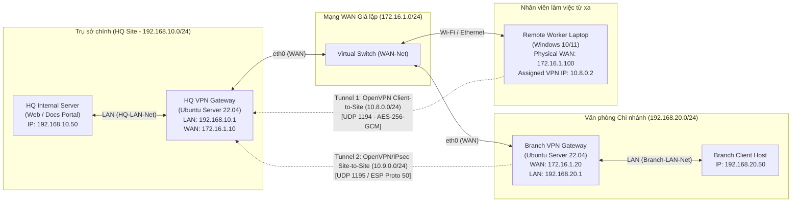

# Đồ Án An Ninh Mạng: Thiết Lập Mạng Riêng Ảo VPN Site-to-Site và Client-to-Site

> **Design and Implementation of a Secure VPN Network Using OpenVPN and IPsec for Remote Workforce Connectivity**  
> Hệ thống phòng lab an ninh mạng mô phỏng mạng doanh nghiệp gồm Trụ sở chính (HQ Site), Văn phòng Chi nhánh (Branch Site) và Nhân viên làm việc từ xa (Remote Worker).

---

## 👥 Thành Viên Tham Gia

1. [Nguyen Le Huy Tam](https://github.com/Sleepy2608)
2. [Nguyen Sun Sin](https://github.com/ngnsusinn)
3. [Huynh Dinh Chan](https://github.com/Chan-2006)

---

## 📌 Tổng Quan Kiến Trúc Mạng



---

## 📂 Cấu Trúc Thư Mục Repository

```text
├── .agents/                    # Quy chuẩn và hướng dẫn hệ thống cho AI Agent
├── .plan/                      # Kế hoạch kỹ thuật chi tiết & Hướng dẫn triển khai
├── quick-setup.bat             # Công cụ điều khiển và kiểm tra nhanh hệ thống trên Windows
├── configs/                    # Mẫu tệp cấu hình mạng & dịch vụ Netplan
│   └── netplan/                # Cấu hình IP tĩnh cho 4 máy ảo Ubuntu
├── docs/                       # Hồ sơ tài liệu kỹ thuật chi tiết
│   ├── 01-project-overview.md  # Tổng quan đề tài & Kiến trúc bảo vệ dịch vụ nội bộ
│   ├── 02-network-topology.md  # Sơ đồ mạng Lab, Bảng IP & Thiết lập mạng ảo
│   ├── 03-pki-ca-setup.md      # Hạ tầng PKI độc lập Easy-RSA 3 & Quản lý chứng chỉ X.509
│   ├── 04-client-to-site-guide.md # Hướng dẫn triển khai OpenVPN Client-to-Site
│   ├── 05-site-to-site-guide.md   # Hướng dẫn triển khai OpenVPN Site-to-Site (CCD & iroute)
│   ├── 06-ipsec-strongswan-guide.md # Mở rộng Site-to-Site strongSwan IPsec IKEv2
│   └── 07-testing-and-security-eval.md # Báo cáo kiểm thử toàn diện, Wireshark & Đánh giá an ninh
├── openvpn/                    # Cấu hình OpenVPN C2S và S2S (CCD, template)
│   ├── pki/                    # Cấu hình biến môi trường Easy-RSA 3 (vars.example)
│   ├── client-to-site/         # Cấu hình Server C2S (UDP 1194) và Template Client .ovpn
│   └── site-to-site/           # Cấu hình S2S Gateway HQ, Branch và Client Config Directory
├── ipsec/                      # Cấu hình strongSwan IKEv2 (ipsec.conf, secrets)
│   └── strongswan/             # Cấu hình kết nối IKEv2 phía HQ và Branch Gateway
├── scripts/                    # Bộ công cụ Bash Script tự động hóa
│   ├── deploy-all.sh           # Kịch bản 1-click triển khai tự động toàn bộ từng node
│   ├── common/                 # Cài đặt phần mềm, bật IP forward và thiết lập iptables
│   ├── pki/                    # Khởi tạo CA, đóng gói .ovpn inline và phân phối cert
│   ├── deploy-c2s-server.sh    # Triển khai dịch vụ OpenVPN Client-to-Site Server
│   ├── deploy-s2s-hq.sh        # Triển khai OpenVPN S2S phía HQ Gateway
│   ├── deploy-s2s-branch.sh    # Triển khai OpenVPN S2S phía Branch Gateway
│   ├── deploy-ipsec-hq.sh      # Triển khai strongSwan IPsec phía HQ Gateway
│   ├── deploy-ipsec-branch.sh  # Triển khai strongSwan IPsec phía Branch Gateway
│   ├── deploy-hq-portal.sh     # Triển khai Cổng thông tin nội bộ Nginx trên HQ Server
│   ├── switch-vpn-mode.sh      # Chuyển đổi an toàn giữa OpenVPN và strongSwan
│   ├── capture-traffic.sh      # Tự động hóa bắt gói tin tcpdump phục vụ Wireshark
│   └── verify-*.sh             # Các script kiểm tra nghiệm thu tự động từng dịch vụ
├── services/                   # Dịch vụ mô phỏng nội bộ (HQ Intranet Portal)
│   └── intranet-portal/        # Web Portal bảo mật cao (HTML, CSS, JS, benchmark files)
├── tests/                      # Ma trận kiểm thử & phân tích an ninh mạng
│   ├── test-cases.md           # Ma trận 11 ca kiểm thử chức năng & an ninh
│   ├── security-tests.md       # Quy trình test thu hồi chứng chỉ (CRL) & tấn công giả lập
│   └── captures/               # Phân tích gói tin Wireshark & tệp pcap mẫu
└── screenshots/                # Quy chuẩn và danh mục 12 ảnh chụp màn hình minh chứng
```

---

## 📚 Danh Mục Tài Liệu Kỹ Thuật & Kiểm Thử (Documentation & Testing Checklist)

Toàn bộ hệ thống tài liệu kỹ thuật, hướng dẫn cài đặt và kịch bản kiểm thử của đồ án được biên soạn đầy đủ và phân loại chi tiết:

### 1. Tài Liệu Kỹ Thuật (Architecture & Guides)
- [x] [01-project-overview.md](file:///c:/University%20Coding%20Project/VPN-Site-to-Site-and-Client-to-Site-Implementation/docs/01-project-overview.md): Tổng quan bài toán, mục tiêu thiết kế và kiến trúc bảo vệ dịch vụ nội bộ.
- [x] [02-network-topology.md](file:///c:/University%20Coding%20Project/VPN-Site-to-Site-and-Client-to-Site-Implementation/docs/02-network-topology.md): Bản vẽ sơ đồ mạng, bảng phân bổ địa chỉ IP, thiết kế 3 mạng ảo (WAN, HQ LAN, Branch LAN).
- [x] [03-pki-ca-setup.md](file:///c:/University%20Coding%20Project/VPN-Site-to-Site-and-Client-to-Site-Implementation/docs/03-pki-ca-setup.md): Hướng dẫn thiết lập CA độc lập với Easy-RSA 3, cơ chế cấp chứng chỉ X.509, Diffie-Hellman và khóa HMAC `ta.key`.
- [x] [04-client-to-site-guide.md](file:///c:/University%20Coding%20Project/VPN-Site-to-Site-and-Client-to-Site-Implementation/docs/04-client-to-site-guide.md): Cấu hình OpenVPN Client-to-Site Server, cơ chế Split-Tunneling và cấu hình OpenVPN GUI trên Windows.
- [x] [05-site-to-site-guide.md](file:///c:/University%20Coding%20Project/VPN-Site-to-Site-and-Client-to-Site-Implementation/docs/05-site-to-site-guide.md): Cấu hình OpenVPN Site-to-Site Routed Tunnel kết hợp Client Config Directory (CCD) và chỉ thị `iroute`.
- [x] [06-ipsec-strongswan-guide.md](file:///c:/University%20Coding%20Project/VPN-Site-to-Site-and-Client-to-Site-Implementation/docs/06-ipsec-strongswan-guide.md): Triển khai mở rộng strongSwan IPsec IKEv2 In-Kernel ESP và so sánh đối chiếu với OpenVPN.
- [x] [07-testing-and-security-eval.md](file:///c:/University%20Coding%20Project/VPN-Site-to-Site-and-Client-to-Site-Implementation/docs/07-testing-and-security-eval.md): Báo cáo tổng kết kiểm thử toàn diện, đo đạc độ trễ/thông lượng, đánh giá an ninh mô hình STRIDE.

### 2. Kiểm Thử An Ninh & Bắt Gói Tin (Testing & Verification)
- [x] [tests/test-cases.md](file:///c:/University%20Coding%20Project/VPN-Site-to-Site-and-Client-to-Site-Implementation/tests/test-cases.md): Ma trận 11 ca kiểm thử thực nghiệm (TC-01 đến TC-11) bao gồm kết nối, định tuyến, ứng dụng, phân tích mã hóa và rò rỉ dữ liệu.
- [x] [tests/security-tests.md](file:///c:/University%20Coding%20Project/VPN-Site-to-Site-and-Client-to-Site-Implementation/tests/security-tests.md): 6 kịch bản kiểm thử bảo mật chuyên sâu: Thu hồi chứng chỉ (CRL), giả mạo PSK, chống rò rỉ (Killswitch), quét Nmap mạng ngoài, chống DoS/Replay.
- [x] [tests/captures/wireshark-analysis.md](file:///c:/University%20Coding%20Project/VPN-Site-to-Site-and-Client-to-Site-Implementation/tests/captures/wireshark-analysis.md): Bóc tách cấu trúc Header trên Wireshark đối chứng giữa gói tin Cleartext, OpenVPN và IPsec ESP.
- [x] [tests/captures/samples/](file:///c:/University%20Coding%20Project/VPN-Site-to-Site-and-Client-to-Site-Implementation/tests/captures/samples/): Thư mục lưu trữ tệp `.pcap` mẫu và hướng dẫn xuất/mở bằng Wireshark.
- [x] [screenshots/](file:///c:/University%20Coding%20Project/VPN-Site-to-Site-and-Client-to-Site-Implementation/screenshots/): Quy hoạch danh mục 12 ảnh chụp màn hình minh chứng phục vụ báo cáo và thuyết minh đồ án.

---

## 🛠️ Hướng Dẫn Triển Khai Hệ Thống (System Deployment Guide)

Hệ thống hỗ trợ 2 phương pháp triển khai: sử dụng công cụ tự động hóa 1-click (khuyến nghị) hoặc thực hiện tuần tự theo từng node.

### Phương Pháp 1: Triển Khai Nhanh Bằng Công Cụ Tự Động Hóa (Khuyến Nghị)

#### 1. Trên máy khách Windows (Host / Remote PC):
Chạy tiện ích điều khiển [quick-setup.bat](file:///c:/University%20Coding%20Project/VPN-Site-to-Site-and-Client-to-Site-Implementation/quick-setup.bat):
```cmd
quick-setup.bat
```
*Tính năng:* Menu tương tác hỗ trợ kiểm tra thông mạng (Ping), mở Web Portal nội bộ, kiểm tra bảng route split-tunnel, chạy traceroute, kết nối SSH nhanh tới các máy ảo, và đo tốc độ tải file bảo mật.

#### 2. Trên các máy ảo Ubuntu Linux (HQ-GW, Branch-GW, HQ-Server, Branch-PC):
Sử dụng script triển khai tự động toàn diện [scripts/deploy-all.sh](file:///c:/University%20Coding%20Project/VPN-Site-to-Site-and-Client-to-Site-Implementation/scripts/deploy-all.sh):
```bash
# Triển khai trọn gói trên HQ Gateway (PKI CA + C2S + S2S OpenVPN + IPsec):
sudo bash scripts/deploy-all.sh hq-gw

# Triển khai trọn gói trên Branch Gateway (S2S OpenVPN + IPsec):
sudo bash scripts/deploy-all.sh branch-gw

# Triển khai trọn gói trên HQ Internal Server (Nginx Web Portal + Benchmark files):
sudo bash scripts/deploy-all.sh hq-server

# Kiểm tra kết nối từ máy trạm Chi nhánh:
sudo bash scripts/deploy-all.sh branch-pc
```

---

### Phương Pháp 2: Triển Khai Tuần Tự Theo Từng Node (Manual Deployment)

#### Bước 1: Thiết lập 3 mạng ảo nội bộ trong VirtualBox / VMware
Tạo 3 mạng ảo (Internal Networks) tương ứng:
- `WAN-Net` (`172.16.1.0/24`)
- `HQ-LAN-Net` (`192.168.10.0/24`)
- `Branch-LAN-Net` (`192.168.20.0/24`)

Gán card mạng cho 5 máy ảo theo bảng quy hoạch tại [02-network-topology.md](file:///c:/University%20Coding%20Project/VPN-Site-to-Site-and-Client-to-Site-Implementation/docs/02-network-topology.md).

#### Bước 2: Cài đặt và cấu hình Gateway Trụ sở chính (`VM-HQ-GW`)
```bash
# 1. Cài đặt các gói phần mềm cần thiết:
sudo bash scripts/common/install-prerequisites.sh gw

# 2. Áp dụng cấu hình IP tĩnh Netplan:
sudo cp configs/netplan/01-netcfg-hq-gw.yaml /etc/netplan/01-netcfg.yaml
sudo netplan apply

# 3. Kích hoạt IP Forwarding và Tường lửa iptables:
sudo bash scripts/common/enable-ip-forward.sh
sudo bash scripts/common/setup-firewall-rules.sh hq-gw

# 4. Khởi tạo CA và cấp phát chứng chỉ số:
sudo bash scripts/pki/init-ca.sh
sudo bash scripts/pki/build-client-ovpn.sh client1

# 5. Khởi chạy OpenVPN Server (Client-to-Site & Site-to-Site):
sudo bash scripts/deploy-c2s-server.sh
sudo bash scripts/deploy-s2s-hq.sh

# 6. Cài đặt cấu hình strongSwan IPsec (chế độ mở rộng):
sudo bash scripts/deploy-ipsec-hq.sh
```

#### Bước 3: Cài đặt và cấu hình Gateway Chi nhánh (`VM-Branch-GW`)
```bash
# 1. Cài đặt các gói phần mềm:
sudo bash scripts/common/install-prerequisites.sh gw

# 2. Áp dụng IP tĩnh Netplan:
sudo cp configs/netplan/01-netcfg-branch-gw.yaml /etc/netplan/01-netcfg.yaml
sudo netplan apply

# 3. Bật IP Forwarding và Tường lửa iptables:
sudo bash scripts/common/enable-ip-forward.sh
sudo bash scripts/common/setup-firewall-rules.sh branch-gw

# 4. Triển khai OpenVPN S2S Client:
sudo bash scripts/deploy-s2s-branch.sh

# 5. Cài đặt strongSwan IPsec phía Branch:
sudo bash scripts/deploy-ipsec-branch.sh
```

#### Bước 4: Cài đặt Máy chủ nội bộ HQ (`VM-HQ-Server`)
```bash
# 1. Áp dụng IP tĩnh Netplan:
sudo cp configs/netplan/01-netcfg-hq-server.yaml /etc/netplan/01-netcfg.yaml
sudo netplan apply

# 2. Triển khai Cổng thông tin nội bộ Nginx:
sudo bash scripts/deploy-hq-portal.sh

# 3. Kiểm tra trạng thái Web Portal:
bash scripts/verify-portal.sh
```

#### Bước 5: Cấu hình và kết nối Máy khách từ xa (`VM-Remote-PC`)
1. Cài đặt phần mềm **OpenVPN GUI** trên Windows (khuyến nghị phiên bản có Wintun driver).
2. Sao chép tệp `client1.ovpn` (được tạo ra tại `/home/student/openvpn-ca/client1.ovpn` trên HQ Gateway) vào thư mục cấu hình: `C:\Users\<User>\OpenVPN\config\`.
3. Nhấp chuột phải vào biểu tượng OpenVPN ở thanh Taskbar -> Chọn **Connect**.
4. Biểu tượng chuyển sang màu xanh lá cây báo hiệu kết nối thành công (nhận IP `10.8.0.2`).
5. Mở trình duyệt truy cập `http://192.168.10.50` để kiểm tra Cổng thông tin nội bộ HQ.

---

## 🔍 Kiểm Tra Nghiệm Thu & Chuyển Đổi Chế Độ VPN

### 1. Các lệnh kiểm tra tự động
```bash
# Kiểm tra kết nối Client-to-Site (chạy trên HQ GW):
bash scripts/verify-c2s.sh

# Kiểm tra đường hầm Site-to-Site OpenVPN và ping LAN-to-LAN (chạy trên HQ GW hoặc Branch GW):
bash scripts/verify-s2s.sh

# Kiểm tra đường hầm strongSwan IPsec IKEv2 (chạy trên HQ GW hoặc Branch GW):
bash scripts/verify-ipsec.sh
```

### 2. Chuyển đổi linh hoạt giữa OpenVPN và strongSwan
Để tránh xung đột định tuyến khi chạy song song cả 2 công nghệ Site-to-Site, sử dụng kịch bản:
```bash
# Chuyển sang dùng đường hầm OpenVPN S2S:
sudo bash scripts/switch-vpn-mode.sh openvpn

# Chuyển sang dùng đường hầm strongSwan IPsec IKEv2:
sudo bash scripts/switch-vpn-mode.sh ipsec
```

### 3. Bắt gói tin phân tích mật mã bằng Wireshark
```bash
# Bắt gói tin OpenVPN trên card mạng WAN:
sudo bash scripts/capture-traffic.sh -i eth0 -m openvpn-c2s -c 100

# Bắt gói tin IPsec ESP trên card mạng WAN:
sudo bash scripts/capture-traffic.sh -i eth0 -m ipsec -c 100

# Bắt gói tin bản rõ đối chứng trên card mạng LAN:
sudo bash scripts/capture-traffic.sh -i eth1 -m lan-http -c 50

# Kiểm tra chống rò rỉ dữ liệu khi tắt VPN:
sudo bash scripts/capture-traffic.sh -i eth0 -m leak-check -c 20
```
