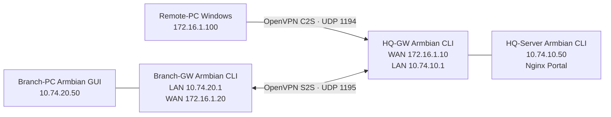

# VPN Site-to-Site và Client-to-Site bằng OpenVPN

**Mô hình đang triển khai: 5 máy — hai gateway, hai host LAN và Windows remote.**

**Địa chỉ LAN đang dùng trên lab:** HQ `10.74.10.0/24`, Branch `10.74.20.0/24`. Portal dùng `http://10.74.10.50`. Qua SSH đã xác nhận S2S hai chiều, HTTP và SHA-256 của file tải từ Branch. HQ-GW ghi nhận `client1` kết nối lại qua C2S và được gửi route HQ mới. Xem [kết quả và IP SSH quản trị](docs/deployment/live-lab-status.md) cùng [cách chuyển địa chỉ trên lab đã dựng](docs/deployment/README.md#2-chuyển-địa-chỉ-cho-lab-đã-dựng).

**Mode đang chạy trên VMware:** strongSwan IPsec cho S2S và OpenVPN cho C2S. Để trình diễn bài OpenVPN S2S bên dưới, chuyển mode trên cả hai gateway theo [hướng dẫn chuyển đổi](docs/technical-guides/06-ipsec-strongswan-guide.md#triển-khai-và-chuyển-mode-trên-cả-hai-gateway). Có thể dùng [script cài lại profile OpenVPN GUI](scripts/setup-c2s-windows.ps1) trong Windows Remote-PC.

**Bắt đầu tại [bộ hướng dẫn triển khai từng máy](docs/deployment/README.md).** Bộ tài liệu có sơ đồ, bảng NIC/IP, phần chuẩn bị VMware, YAML đầy đủ kể cả NAT tạm, lệnh cài đặt, chuyển chứng chỉ, kết quả kỳ vọng và xử lý lỗi riêng từng máy:

- [Chuẩn bị chung](docs/deployment/00-preparation.md).
- [Máy 1 HQ-GW](docs/deployment/01-hq-gw.md) và [Máy 2 Branch-GW](docs/deployment/02-branch-gw.md).
- [Máy 3 HQ-Server](docs/deployment/03-hq-server.md) và [Máy 4 Branch-PC](docs/deployment/04-branch-pc.md).
- [Máy 5 Windows Remote-PC](docs/deployment/05-windows-remote.md).
- [Nghiệm thu sau khi ngắt NAT và reboot](docs/deployment/06-acceptance.md).

## Kết luận rà soát Chủ đề 14 (20/11/2026)

**Bài thực hành 3 máy chỉ đáp ứng Client-to-Site, chưa đủ cả đề tài.** Hai client Linux/Windows kết nối cùng server không tạo thành Site-to-Site: chưa có hai LAN được nối qua hai gateway.

**Chọn mô hình 5 máy bên dưới để triển khai và nghiệm thu đủ Site-to-Site + Client-to-Site.** Đây là phương án đã có cấu hình và script trong repo, giữ nguyên lựa chọn Armbian/Windows/VMware. OpenVPN có thể thực hiện cả hai loại VPN; IPsec là phần so sánh mở rộng, không phải điều kiện bắt buộc suy ra từ tên đề tài.

| Phương án | Client-to-Site | Site-to-Site | Sử dụng |
| --- | --- | --- | --- |
| 3 máy: Linux Server + Linux Client + Windows Client | Có, web ở `10.8.0.1` | Chưa có hai LAN/gateway | Bài thực hành C2S riêng |
| 5 máy: HQ-GW + Branch-GW + HQ-Server + Branch-PC + Remote-PC | OpenVPN UDP 1194 | OpenVPN UDP 1195, hai LAN định tuyến | **Phương án chính để đáp ứng đủ chủ đề** |
| 5 máy, thay OpenVPN S2S bằng strongSwan | Giữ OpenVPN C2S | IPsec IKEv2/ESP giữa hai LAN | Mở rộng sau khi phương án chính chạy đạt |

Đọc [báo cáo đối chiếu yêu cầu, lỗi và phần đã bổ sung](docs/topic14-audit.md) để xem đánh giá ban đầu; kết quả VM mới nhất được ghi riêng tại [báo cáo triển khai trực tiếp](docs/deployment/live-lab-status.md). Ghi bằng chứng theo [checklist nghiệm thu](tests/openvpn-demo.md), phân biệt client Linux thử với Windows chưa nghiệm thu.

- [Runbook 5 máy — triển khai và demo đầy đủ](docs/presentation/detailed-lab-runbook.md).
- [Bài thực hành C2S 3 máy](docs/presentation/three-vm-openvpn-demo.md): giữ riêng IP/lệnh; không dùng thay cho bài Site-to-Site.

Thành viên: [Nguyen Le Huy Tam](https://github.com/Sleepy2608), [Nguyen Sun Sin](https://github.com/ngnsusinn), [Huynh Dinh Chan](https://github.com/Chan-2006).

## 1. Mô hình demo



| Nội dung | Công cụ/cấu hình |
| --- | --- |
| Máy ảo | 4 Armbian Generic UEFI x86_64 + 1 Windows 10/11 x64 trên VMware |
| Backend mạng thực tế | HQ-GW dùng NetworkManager; Branch-GW, HQ-Server, Branch-PC dùng networkd |
| Máy chi nhánh thực tế | Branch-PC dùng CLI/ping/curl để kiểm tra S2S; có thể bổ sung Desktop/browser khi cần |
| VPN nhân viên từ xa | OpenVPN GUI trên Windows Remote-PC → HQ-GW, tunnel `10.8.0.0/24` |
| VPN liên chi nhánh | OpenVPN Branch-GW → HQ-GW, tunnel `10.9.0.0/24` |
| Chứng chỉ | Easy-RSA, xác thực X.509 và `tls-crypt` |
| Tài nguyên demo | Nginx tại `http://10.74.10.50` và tệp tải mẫu 1 MiB |
| Quan sát | Ping, route, trạng thái OpenVPN, tcpdump/Wireshark |

Đây là triển khai **theo từng node bằng Bash**: tự tạo VM và mạng trước, sau đó chạy `deploy-all.sh` trên từng Armbian. Script không tạo VM, tự cài GUI hoặc tự áp dụng Netplan. Gateway Linux cần OpenVPN **2.5 trở lên** (tương thích gói Ubuntu 22.04); từ 2.6 script tắt DCO để việc quan sát `tun0`/`tun1` nhất quán. Dùng image **Generic UEFI x86_64** phù hợp VMware/host Intel–AMD, không dùng image Armbian cho board ARM. Xem [chuẩn bị Armbian trên VMware](docs/technical-guides/09-armbian-vmware-guide.md).

**Windows tối thiểu:** OpenVPN GUI hiện hành hỗ trợ Windows 10 trở lên. Baseline lab chọn **Windows 10 22H2 64-bit**; khuyến nghị **Windows 11 64-bit còn được hỗ trợ** vì Windows 10 Home/Pro đã hết hỗ trợ thông thường từ 14/10/2025. Xem [yêu cầu Windows và nguồn chính thức](docs/technical-guides/08-windows-client-requirements.md).

## 2. Chuẩn bị một lần trước demo

### Image Armbian và mạng VMware

Mô hình có 5 VM: 3 Armbian Minimal/CLI không GUI, 1 Armbian Desktop làm Branch-PC, 1 Windows Remote-PC. Tạo ba **LAN Segment** trên VMware:

| Mạng | Subnet | Card nối vào |
| --- | --- | --- |
| WAN-Net | `172.16.1.0/24` | WAN HQ-GW, WAN Branch-GW, Remote-PC |
| HQ-LAN-Net | `10.74.10.0/24` | LAN HQ-GW, HQ-Server |
| Branch-LAN-Net | `10.74.20.0/24` | LAN Branch-GW, Branch-PC |

WAN-Net chỉ đóng vai trò WAN giả lập. Cấu hình IP trong từng VM; tên LAN Segment không tự gán IP. Hai mạng tunnel OpenVPN không cần tạo virtual switch riêng. Hai gateway cần 2 NIC lab; HQ-Server và Branch-PC cần 1 NIC LAN, Windows cần 1 NIC WAN.

Cài/khởi động đúng image Armbian và chép repo lên 4 Armbian VM; Windows cài OpenVPN Community x64 kèm GUI/driver và Wireshark nếu cần. Thêm NIC NAT tạm trên từng VM cần tải gói; giữ tới khi deploy xong rồi ngắt trước demo. Nếu dùng image clone, tạo MAC/hostname riêng. Đồng bộ đồng hồ để chứng chỉ hợp lệ.

### Chuẩn bị Armbian

Mở terminal tại thư mục repo trên từng VM, cài gói khi còn Internet:

```bash
# Trên cả HQ-GW và Branch-GW:
sudo bash scripts/common/install-prerequisites.sh gw

# Trên HQ-Server:
sudo bash scripts/common/install-prerequisites.sh server

# Trên Branch-PC:
sudo bash scripts/common/install-prerequisites.sh pc

```

Dùng `ip -br link` và MAC trong VMware để xác định NIC WAN/LAN/NAT. Sửa khóa `eth0`/`eth1` trong mẫu Netplan thành tên thật (ví dụ `ens33`/`ens37`). Minimal thường dùng renderer `networkd`, standard CLI/Desktop có thể dùng `NetworkManager`: kiểm tra backend đang hoạt động, không suy ra từ việc có GUI. Mẫu Branch-PC đặt NetworkManager cho Armbian GUI.

Trên **mỗi gateway**, khai báo NIC thực tế cho các script (ví dụ, phải sửa theo máy):

```bash
sudo install -d -m 755 /etc/vpn-lab
sudo tee /etc/vpn-lab/interfaces.conf >/dev/null <<'EOF'
WAN_IF=ens33
LAN_IF=ens37
EOF
sudo chmod 644 /etc/vpn-lab/interfaces.conf
```

File trên không tự đặt IP. Script đọc cùng cấu hình NIC cho firewall, NAT, deploy OpenVPN, verify và capture. Nếu không có file thì vẫn mặc định eth0/eth1. Xem [hướng dẫn xử lý Netplan/DHCP mặc định của Armbian](docs/technical-guides/09-armbian-vmware-guide.md) trước khi áp dụng mẫu.

Áp dụng mẫu **đã sửa NIC/renderer** trên từng VM bằng console VMware. Sao lưu và xử lý YAML/connection DHCP mặc định chồng lên NIC lab; nếu giữ NAT để deploy thì khai báo riêng NIC NAT với DHCP trong cấu hình còn lại:

```bash
# Ví dụ HQ-GW; các VM khác chọn mẫu cùng tên trong configs/netplan/:
sudo cp configs/netplan/01-netcfg-hq-gw.yaml /etc/netplan/20-vpn-lab.yaml
sudo chmod 600 /etc/netplan/20-vpn-lab.yaml
sudo netplan generate
sudo netplan try
```

Các mẫu còn lại là `01-netcfg-branch-gw.yaml`, `01-netcfg-hq-server.yaml`, `01-netcfg-branch-pc.yaml`. Trên Windows mở `ncpa.cpl`, đặt IPv4 cho card WAN-Net: IP `172.16.1.100`, subnet mask `255.255.255.0`, để trống gateway/DNS trên card lab. Windows không dùng Netplan.

## 3. Triển khai bằng một quy trình

Chạy từ thư mục repo trên đúng Armbian node. `deploy-all.sh` dùng apt/systemd và cần Internet để cài gói; nó dừng và tắt tự khởi động strongSwan từ lab cũ nếu có. Kiểm tra `/dev/net/tun` và unit OpenVPN trên image đã chọn theo hướng dẫn Armbian trước nghiệm thu.

### Bước 1 — HQ-GW

```bash
sudo bash scripts/deploy-all.sh hq-gw
```

Script bật forwarding, cấu hình firewall, tạo CA/chứng chỉ, xuất `client1.ovpn` và chạy OpenVPN C2S + S2S. PKI mặc định nằm ở `~/openvpn-ca` của tài khoản gọi sudo; profile nằm ở `~/client1.ovpn` của cùng tài khoản. Có thể chỉ định `CA_DIR` nếu dùng PKI ở vị trí khác.

### Bước 2 — Chuyển chứng chỉ từ HQ sang Branch

Branch-GW phải bật SSH và ping được `172.16.1.10`. Chạy **trên HQ-GW**, thay `student` bằng tài khoản Armbian thật trên Branch:

```bash
sudo env BRANCH_USER=student bash scripts/pki/distribute-certs.sh branch-gw 172.16.1.20
```

Lệnh dùng SCP/SSH và có thể hỏi mật khẩu SSH/sudo. Chỉ chuyển CA công khai, cert/key của Branch và `ta.key`; không chuyển private key của CA.

### Bước 3 — Branch-GW

```bash
sudo bash scripts/deploy-all.sh branch-gw
```

### Bước 4 — HQ-Server và Branch-PC

```bash
# Trên HQ-Server:
sudo bash scripts/deploy-all.sh hq-server

# Sau khi server và hai gateway đã sẵn sàng, trên Branch-PC:
sudo bash scripts/deploy-all.sh branch-pc
```

### Bước 5 — Windows Remote-PC

1. Cài **OpenVPN Community x64** từ [trang chính thức](https://openvpn.net/community/), giữ OpenVPN GUI và driver/service đi kèm. OpenVPN 2.7 không còn dùng Wintun; không cần tự chọn driver cũ.
2. Chuyển `~/client1.ovpn` của người triển khai HQ-GW sang Windows bằng Shared Folder, WinSCP hoặc SCP. Chỉ chuyển profile client, không chuyển private key của CA.
3. Mở OpenVPN GUI ở system tray → **Import file...** → chọn profile. Hoặc đặt file vào `%USERPROFILE%\OpenVPN\config\`.
4. Chọn `client1` → **Connect**, chờ Connected và log `Initialization Sequence Completed`.
5. Trên **PowerShell Windows**, chạy:

```powershell
ipconfig
route print -4
ping -n 3 10.74.10.50
Test-NetConnection 10.74.10.50 -Port 80
Invoke-WebRequest -UseBasicParsing -Method Head -Uri http://10.74.10.50 -TimeoutSec 5
Start-Process http://10.74.10.50
```

Ngắt bằng OpenVPN GUI → `client1` → **Disconnect**. Không chạy `deploy-all.sh` hoặc `systemctl` trên Windows. Có thể dùng `quick-setup.bat` làm menu hỗ trợ; các chức năng SSH/SCP cần OpenSSH Client hoặc phần mềm tương đương. Xem [hướng dẫn Windows chi tiết](docs/technical-guides/08-windows-client-requirements.md).

Tắt adapter NAT tạm trên các VM trước khi trình diễn. Không nối Remote-PC trực tiếp vào HQ-LAN-Net hoặc Branch-LAN-Net.

## 4. Demo trực tiếp trong 6–8 phút

1. **Client-to-Site:** Windows Remote-PC Connect bằng OpenVPN GUI → ipconfig/route print → ping HQ-Server → mở Portal.
2. **Site-to-Site:** Armbian Branch-PC có GUI ping và mở cùng Portal trong browser qua hai gateway OpenVPN.
3. **Mã hóa:** bắt gói WAN UDP 1194/1195 bằng tcpdump, tải file và mở bằng Wireshark; đối chứng HTTP bản rõ ở LAN.

Chạy nhanh các lệnh trên đúng máy:

```bash
# HQ-GW:
sudo bash scripts/verify-c2s.sh server
sudo bash scripts/verify-s2s.sh hq-gw

# Branch-PC:
bash scripts/verify-s2s.sh branch-pc
bash scripts/verify-portal.sh
```

Portal hiển thị IP mà Nginx quan sát được. C2S hiện dùng NAT nên có thể thấy `10.74.10.1`; kiểm tra IP tunnel bằng `ipconfig` trên Windows Remote-PC. Trạng thái/cipher của VPN phải đối chiếu log OpenVPN và gói tin, không suy ra chỉ từ IP trên trang Web.

## 5. Tài liệu

- [Kịch bản demo 6–8 phút](docs/presentation/demo-script.md).
- [Đề cương 8 slide](docs/presentation/slides.md).
- [Checklist nghiệm thu demo OpenVPN](tests/openvpn-demo.md).
- [Topology và mẫu Netplan](docs/technical-guides/02-network-topology.md).
- [PKI và thu hồi chứng chỉ — phần nâng cao](docs/technical-guides/03-pki-ca-setup.md).
- [OpenVPN C2S với Windows client](docs/technical-guides/04-client-to-site-guide.md), [OpenVPN S2S](docs/technical-guides/05-site-to-site-guide.md).
- [Windows tối thiểu và cách cài OpenVPN GUI](docs/technical-guides/08-windows-client-requirements.md).
- [Armbian trên VMware: image, 3 CLI + 1 GUI, NIC và Netplan](docs/technical-guides/09-armbian-vmware-guide.md).

Các cấu hình/script strongSwan và chuyển mode là phần mở rộng, không nằm trong quy trình demo chính. Đã sửa proposal AEAD, yêu cầu PSK riêng và firewall khớp policy IPsec; triển khai cả hai đầu theo hướng dẫn IPsec trước khi kiểm thử. Dùng checklist OpenVPN ở trên để ghi kết quả đo thực tế; không coi các bảng PASS/benchmark cũ là bằng chứng của lần chạy mới.

Tham khảo: [OpenVPN Community — Windows 10 trở lên](https://openvpn.net/community/), [Microsoft Lifecycle Windows 10](https://learn.microsoft.com/en-us/lifecycle/products/windows-10-home-and-pro).

## 6. Kiểm tra bổ sung và giới hạn nghiệm thu

Firewall IPv4 dùng chain riêng đặt trước các rule cũ: chỉ cho C2S → HQ LAN và hai chiều LAN-to-LAN qua S2S; chặn chuyển tiếp còn lại. WAN không được vào LAN bằng route tự thêm. SSH quản trị và ICMP tới **IP WAN gateway** vẫn được phép từ `172.16.1.0/24`. Đây là chính sách cho gateway chuyên dụng của lab; không áp dụng nguyên mẫu cho router đang phục vụ mạng khác. Phạm vi là IPv4, chưa nghiệm thu IPv6/Internet thật/NAT trung gian.

Kết nối Windows trước, chờ khoảng 5 giây rồi chạy `verify-c2s.sh server`; thiếu client trong status mới sẽ báo lỗi. Chạy kiểm tra trên **cả HQ-Server và Branch-PC** để xác nhận S2S hai chiều:

```bash
# HQ-Server:
bash scripts/verify-s2s.sh hq-server
# Branch-PC:
bash scripts/verify-s2s.sh branch-pc
```

Trên Windows có thể dùng `powershell -NoProfile -File scripts/verify-c2s-windows.ps1 -ExpectedState Connected`, rồi kiểm tra `Disconnected` sau khi ngắt GUI. Nếu chính sách thực thi chặn tệp, dùng các lệnh kiểm tra thủ công trong hướng dẫn Windows.

```bash
# Chạy tại checkout trên máy có Python 3 và Bash (Linux hoặc Git Bash Windows):
python -m unittest discover -s tests -p test_repository.py -v
```

Bộ test offline kiểm tra cú pháp Bash, status/route và hành vi firewall qua các lệnh giả lập; không tạo VPN/VM và không thay đổi firewall máy đang chạy. CRL, chống đi vòng VPN, capture và reboot cần kiểm thử thật theo checklist. Không dùng số đo mẫu làm kết quả thực nghiệm.
