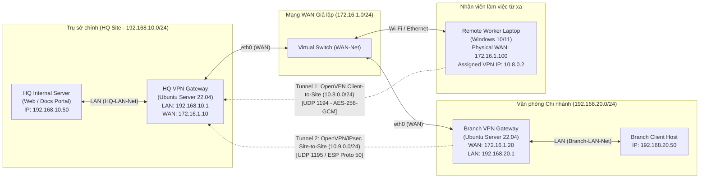

# Đồ Án An Ninh Mạng: Thiết Lập Mạng Riêng Ảo VPN Site-to-Site và Client-to-Site

> **Design and Implementation of a Secure VPN Network Using OpenVPN and IPsec for Remote Workforce Connectivity**  
> Hệ thống phòng lab an ninh mạng mô phỏng mạng doanh nghiệp gồm Trụ sở chính (HQ Site), Văn phòng Chi nhánh (Branch Site) và Nhân viên làm việc từ xa (Remote Worker).

---

## 📌 Tổng Quan Kiến Trúc Mạng



---

## 📂 Cấu Trúc Thư Mục Repository

```text
├── .agents/                    # Quy chuẩn và hướng dẫn hệ thống cho AI Agent
├── .plan/                      # Kế hoạch kỹ thuật chi tiết & Hướng dẫn triển khai
│   ├── PLAN.md                 # Kế hoạch chi tiết 7 giai đoạn (v2.1)
│   └── huong-dan-trien-khai.md # Cẩm nang thực hành theo từng giai đoạn
├── configs/                    # Mẫu tệp cấu hình mạng & dịch vụ
│   └── netplan/                # Cấu hình IP tĩnh Netplan cho 4 máy ảo Ubuntu
├── docs/                       # Báo cáo kỹ thuật chi tiết
│   └── 02-network-topology.md  # Bản vẽ sơ đồ mạng, bảng IP & thiết lập mạng ảo
├── openvpn/                    # Cấu hình OpenVPN C2S và S2S (CCD, template)
│   ├── pki/
│   │   └── vars.example        # Cấu hình mẫu biến môi trường Easy-RSA 3
│   └── client-to-site/
│       ├── server/
│       │   └── server.conf     # Cấu hình OpenVPN C2S Server (UDP 1194, tun0, AES-256-GCM)
│       └── client/
│           ├── client.ovpn.example # Hồ sơ client mẫu (sanitized)
│           └── template.ovpn   # Khuôn mẫu nhúng chứng chỉ tự động
├── ipsec/                      # Cấu hình strongSwan IKEv2 (ipsec.conf, secrets)
├── scripts/                    # Bộ công cụ Bash Script tự động hóa
│   ├── common/
│   │   ├── install-prerequisites.sh # Cài đặt toàn bộ gói phần mềm cho node
│   │   ├── enable-ip-forward.sh     # Kích hoạt IP Forwarding vĩnh viễn
│   │   ├── setup-firewall-rules.sh  # Thiết lập iptables & TCP MSS Clamping
│   │   └── verify-phase1.sh         # Kiểm tra nghiệm thu tự động Giai đoạn 1
│   ├── pki/
│   │   ├── init-ca.sh               # Tự động khởi tạo CA, DH, TLS key & cấp chứng chỉ
│   │   ├── build-client-ovpn.sh     # Tự động xuất tệp .ovpn nhúng chứng chỉ inline
│   │   └── distribute-certs.sh      # Phân phối chứng chỉ an toàn cho Server & Branch GW
│   ├── deploy-c2s-server.sh         # Script triển khai & khởi động OpenVPN C2S Server
│   ├── verify-c2s.sh                # Script kiểm tra nghiệm thu kết nối Client-to-Site
│   ├── deploy-hq-portal.sh          # Script cài đặt Nginx & triển khai Cổng nội bộ HQ
│   └── verify-portal.sh             # Script kiểm tra nghiệm thu HTTP Cổng nội bộ
├── services/                        # Dịch vụ mô phỏng nội bộ (HQ Intranet Portal)
│   └── intranet-portal/             # Ứng dụng Web Cổng thông tin nội bộ (192.168.10.50)
│       ├── index.html               # Giao diện chính kèm widget kiểm tra danh tính IP
│       ├── css/style.css            # Phong cách giao diện Cyber Security Enterprise
│       ├── js/app.js                # Xử lý logic hiển thị và phân loại IP nguồn
│       └── files/                   # Kho tài liệu bảo mật phục vụ đo kiểm Wireshark
└── tests/                           # Ma trận kiểm thử, mẫu pcap & phân tích an ninh
```

---

## 🚀 Tiến Độ Dự Án (7 Giai Đoạn)

- [x] **Giai đoạn 1: Chuẩn bị máy ảo & Cấu hình mạng Lab tĩnh**
  - [x] Thiết kế topology và bảng phân bổ địa chỉ IP
  - [x] Tạo tệp cấu hình Netplan cho các máy ảo (`configs/netplan/`)
  - [x] Viết script cài đặt gói phần mềm tiên quyết (`scripts/common/install-prerequisites.sh`)
  - [x] Viết script kích hoạt chuyển tiếp gói kernel (`scripts/common/enable-ip-forward.sh`)
  - [x] Viết script cấu hình tường lửa và MSS Clamping (`scripts/common/setup-firewall-rules.sh`)
  - [x] Viết script kiểm tra nghiệm thu tự động Giai đoạn 1 (`scripts/common/verify-phase1.sh`)
  - [x] Biên soạn tài liệu kiến trúc mạng (`docs/02-network-topology.md`)
- [x] **Giai đoạn 2: Xây dựng PKI độc lập với Easy-RSA 3**
  - [x] Tạo file cấu hình mẫu Easy-RSA 3 vars (`openvpn/pki/vars.example`)
  - [x] Tạo template và hồ sơ mẫu client (.ovpn) nhúng chứng chỉ (`openvpn/client-to-site/client/`)
  - [x] Viết script tự động hóa khởi tạo CA, DH, TLS-Crypt & cấp chứng chỉ (`scripts/pki/init-ca.sh`)
  - [x] Viết script tự động đóng gói profile client .ovpn inline (`scripts/pki/build-client-ovpn.sh`)
  - [x] Viết script phân phối chứng chỉ an toàn sang các node (`scripts/pki/distribute-certs.sh`)
  - [x] Biên soạn tài liệu kỹ thuật thiết lập PKI, CRL và xác thực OpenSSL (`docs/03-pki-ca-setup.md`)
- [x] **Giai đoạn 3: Triển khai Client-to-Site OpenVPN Server & Client**
  - [x] Soạn thảo cấu hình chuẩn `server-c2s.conf` (`openvpn/client-to-site/server/`)
  - [x] Viết script tự động hóa cài đặt & khởi chạy C2S Server (`scripts/deploy-c2s-server.sh`)
  - [x] Cấu hình iptables FORWARD, NAT Masquerade và mở cổng UDP 1194
  - [x] Đóng gói profile client và hướng dẫn kết nối Windows OpenVPN GUI
  - [x] Viết script kiểm tra nghiệm thu tự động C2S (`scripts/verify-c2s.sh`)
  - [x] Biên soạn tài liệu kỹ thuật chi tiết Client-to-Site (`docs/04-client-to-site-guide.md`)
- [x] **Giai đoạn 4: Dựng Web Server nội bộ HQ & Kiểm tra truy cập từ xa**
  - [x] Thiết kế giao diện Cổng nội bộ chuẩn Cyber Security Enterprise (`services/intranet-portal/`)
  - [x] Tích hợp widget Network Identity Inspector nhận diện IP dải VPN (`10.8.0.x`)
  - [x] Xây dựng kho tài liệu bảo mật phục vụ đo kiểm tải file và phân tích Wireshark
  - [x] Viết script tự động cài đặt Nginx và cấu hình virtual host (`scripts/deploy-hq-portal.sh`)
  - [x] Viết script tự động kiểm tra nghiệm thu HTTP (`scripts/verify-portal.sh`)
  - [x] Biên soạn tài liệu tổng quan đề tài và cơ chế bảo vệ dịch vụ nội bộ (`docs/01-project-overview.md`)
- [ ] **Giai đoạn 5: Triển khai Site-to-Site OpenVPN Routed Tunnel (HQ <=> Branch)**
- [ ] **Giai đoạn 6: Triển khai mở rộng IPsec IKEv2 bằng strongSwan**
- [ ] **Giai đoạn 7: Kiểm thử chuyên sâu, Wireshark & Hoàn thiện hồ sơ báo cáo**

---

## ⚡ Hướng Dẫn Nhanh Giai Đoạn 1 (Quickstart Phase 1)

1. **Thiết lập 3 mạng ảo (Internal Networks)** trong VirtualBox / VMware:
   - `WAN-Net` (`172.16.1.0/24`)
   - `HQ-LAN-Net` (`192.168.10.0/24`)
   - `Branch-LAN-Net` (`192.168.20.0/24`)
2. **Cài đặt gói phần mềm** trên máy ảo:
   ```bash
   sudo bash scripts/common/install-prerequisites.sh gw   # Cho HQ-GW và Branch-GW
   sudo bash scripts/common/install-prerequisites.sh server # Cho HQ-Server
   ```
3. **Áp dụng IP tĩnh Netplan**:
   ```bash
   # Ví dụ trên VM-HQ-GW:
   sudo cp configs/netplan/01-netcfg-hq-gw.yaml /etc/netplan/01-netcfg.yaml
   sudo netplan apply
   ```
4. **Bật IP Forwarding & Tường lửa trên Gateway**:
   ```bash
   sudo bash scripts/common/enable-ip-forward.sh
   sudo bash scripts/common/setup-firewall-rules.sh hq-gw
   ```
5. **Kiểm tra nghiệm thu kết nối**:
   ```bash
   bash scripts/common/verify-phase1.sh
   ```
