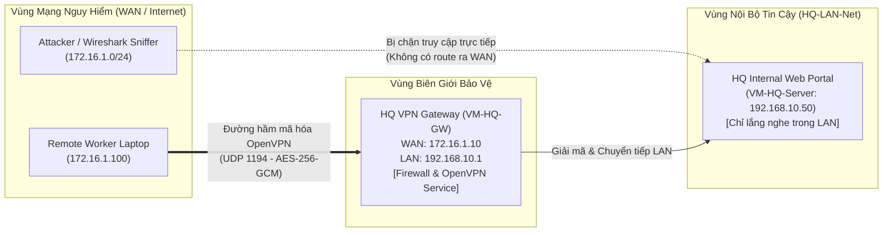

# TÀI LIỆU KỸ THUẬT: TỔNG QUAN ĐỒ ÁN & MÔ HÌNH BẢO VỆ DỊCH VỤ NỘI BỘ

> **Dự án:** Thiết lập mạng riêng ảo VPN Site-to-Site và Client-to-Site  
> **Tài liệu:** `docs/01-project-overview.md`  
> **Giai đoạn:** Giai đoạn 4 - Dựng Web Server nội bộ HQ & Kiểm tra truy cập từ xa  

---

## 1. Đặt Vấn Đề & Tính Cấp Thiết Của Đề Tài

Trong bối cảnh chuyển đổi số và xu hướng làm việc linh hoạt từ xa (Remote Workforce / Work from Anywhere), nhu cầu truy cập an toàn vào hạ tầng mạng cục bộ của doanh nghiệp trở thành ưu tiên an ninh hàng đầu:
- **Nguy cơ trên đường truyền Internet công cộng (WAN):**
  - Tấn công nghe lén (Eavesdropping / Packet Sniffing).
  - Tấn công xen giữa (Man-in-the-Middle - MitM) và giả mạo máy chủ (DNS/ARP Spoofing).
  - Rò rỉ thông tin đăng nhập, dữ liệu tài chính và tài liệu nội bộ khi truyền tải bằng các giao thức bản rõ (HTTP, Telnet, FTP).
- **Giải pháp Mạng riêng ảo (Virtual Private Network - VPN):**
  - Xây dựng "đường hầm" logic bảo mật (Encrypted Tunnel) bắc cầu qua mạng công cộng.
  - Sử dụng các chuẩn mật mã đối xứng hiện đại (AES-256-GCM) và xác thực hạ tầng khóa công khai (PKI X.509) để đảm bảo 3 thuộc tính an toàn thông tin kinh điển: **Tính Bảo Mật (Confidentiality)**, **Tính Toàn Vẹn (Integrity)**, và **Tính Xác Thực (Authentication)**.

---

## 2. Mục Tiêu Đồ Án & Phạm Vi Triển Khai

1. **Triển khai 2 mô hình VPN chuẩn doanh nghiệp:**
   - **Mô hình 1: Client-to-Site (Remote Access VPN):** Sử dụng OpenVPN phục vụ nhân viên lưu động (`172.16.1.100`) kết nối an toàn vào mạng Trụ sở HQ (`192.168.10.0/24`).
   - **Mô hình 2: Site-to-Site (LAN-to-LAN VPN):** Kết nối mạng LAN Trụ sở HQ (`192.168.10.0/24`) và Văn phòng Chi nhánh (`192.168.20.0/24`) thông qua cặp Gateway định tuyến, triển khai trên cả hai công nghệ: **OpenVPN Routed Tunnel** và **strongSwan IPsec IKEv2**.
2. **Xây dựng ứng dụng dịch vụ nội bộ (HQ Secure Intranet Portal):**
   - Đặt tại máy chủ `VM-HQ-Server` (`192.168.10.50`), nằm sâu trong phân vùng mạng nội bộ được cô lập hoàn toàn (`HQ-LAN-Net`).
   - Cung cấp giao diện trực quan giám sát kết nối (Network Identity Inspector) và kho tài liệu bảo mật để đo kiểm thông lượng.
3. **Đo kiểm thực nghiệm & Phân tích an ninh:**
   - Bắt gói tin Wireshark so sánh lưu lượng bản rõ tại LAN và lưu lượng đã được đóng gói mã hóa tại WAN.
   - Kiểm tra khả năng chống chịu tấn công và cơ chế thu hồi chứng chỉ tức thời (CRL).

---

## 3. Vai Trò Của Máy Chủ Nội Bộ HQ (`192.168.10.50`)

Máy chủ Web nội bộ đóng vai trò là "mục tiêu bảo vệ cốt lõi" của toàn bộ hệ thống:



### Nguyên tắc bảo vệ mạng 2 trạng thái:
* **Trạng thái 1: Khi VPN BẬT (Connected)**
  - Máy khách được cấp địa chỉ IP ảo `10.8.0.2` và nhận tuyến đường `push route 192.168.10.0/24`.
  - Mọi yêu cầu HTTP tới `http://192.168.10.50` được đóng gói an toàn vào gói tin OpenVPN UDP 1194.
  - Cổng nội bộ mở thành công, hiển thị huy hiệu:  
    `[SECURE] Bạn đang kết nối an toàn qua OpenVPN Remote Access (Tunnel IP: 10.8.0.2)`.
* **Trạng thái 2: Khi VPN TẮT (Disconnected)**
  - Máy khách mất tuyến đường tới dải `192.168.10.0/24`.
  - Yêu cầu tới `http://192.168.10.50` bị rớt gói tin ngay lập tức (Request Timed Out).
  - Chứng minh máy chủ hoàn toàn tàng hình trước môi trường Internet công cộng bên ngoài.

---

## 4. Hướng Dẫn Triển Khai & Kiểm Tra Nghiệm Thu (Giai Đoạn 4)

### 4.1. Triển khai Cổng nội bộ trên `VM-HQ-Server`
Chạy script tự động hóa:
```bash
sudo bash scripts/deploy-hq-portal.sh
```

### 4.2. Kiểm tra truy cập từ xa từ máy khách (`VM-Remote-PC`)
1. **Kiểm tra tự động bằng script:**
   ```bash
   bash scripts/verify-portal.sh http://192.168.10.50
   ```
2. **Kiểm tra trực quan bằng trình duyệt:**
   - Mở trình duyệt Web trên Windows, gõ URL: `http://192.168.10.50`.
   - Quan sát bảng thông số mạng, tải thử tệp `corporate-security-policy-2026.txt`.
   - Ngắt kết nối OpenVPN GUI -> F5 tải lại trang -> Xác nhận mất kết nối hoàn toàn.

