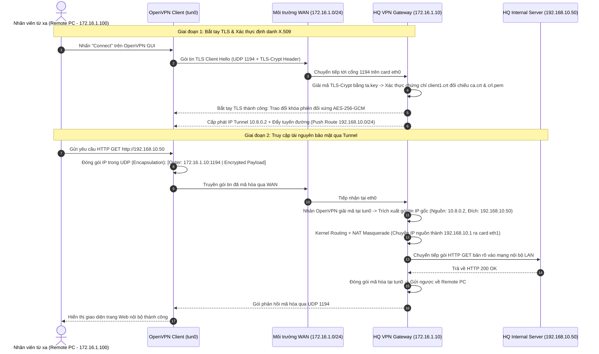

# TÀI LIỆU KỸ THUẬT: TRIỂN KHAI OPENVPN CLIENT-TO-SITE (REMOTE ACCESS)

> **Dự án:** Thiết lập mạng riêng ảo VPN Site-to-Site và Client-to-Site  
> **Tài liệu:** `docs/04-client-to-site-guide.md`  
> **Giai đoạn:** Giai đoạn 3 - Triển khai Client-to-Site OpenVPN Server & Client  

---

## 1. Tổng Quan Kiến Trúc & Luồng Dữ Liệu (Sequence Diagram)

Mô hình **Client-to-Site (Remote Access)** cho phép nhân viên làm việc từ xa (Remote Worker) thiết lập một đường hầm bảo mật qua môi trường mạng không tin cậy (Internet/WAN) để truy cập an toàn vào hạ tầng mạng nội bộ của Trụ sở chính (HQ LAN `192.168.10.0/24`).



---

## 2. Phân Tích Chi Tiết Cấu Hình Máy Chủ (`server-c2s.conf`)

Tệp cấu hình máy chủ được lưu tại `openvpn/client-to-site/server/server.conf` và triển khai vào `/etc/openvpn/server/server-c2s.conf` trên `VM-HQ-GW`:

| Chỉ thị cấu hình | Giá trị | Ý nghĩa kỹ thuật & An ninh mạng |
|---|---|---|
| `port` | `1194` | Cổng dịch vụ tiêu chuẩn của OpenVPN do IANA cấp phát |
| `proto` | `udp` | Giao thức UDP tránh hiện tượng TCP-over-TCP Meltdown khi mạng có jitter |
| `dev` | `tun0` | Tạo giao diện mạng ảo Layer 3 (IP Tunneling - định tuyến) |
| `ca`, `cert`, `key` | `/etc/openvpn/server/...` | Chuỗi chứng chỉ số xác thực X.509 giữa Server và Client |
| `dh` | `dh.pem` | Tham số Diffie-Hellman 2048-bit bảo đảm Perfect Forward Secrecy |
| `tls-crypt` | `ta.key` | Khóa đối xứng bảo vệ kênh điều khiển, chống tấn công dò quét cổng và DoS |
| `crl-verify` | `crl.pem` | Kiểm tra danh sách thu hồi chứng chỉ số trong mỗi phiên bắt tay TLS |
| `server` | `10.8.0.0 255.255.255.0` | Cấu hình DHCP ảo: Server nhận `10.8.0.1`, các client nhận từ `10.8.0.2` trở đi |
| `topology` | `subnet` | Mô hình phân bổ mạng con hiện đại, mỗi client nhận 1 địa chỉ IP duy nhất |
| `push "route ..."` | `192.168.10.0 255.255.255.0` | Tự động thêm route vào bảng định tuyến của client trỏ vào mạng HQ LAN |
| `cipher` | `AES-256-GCM` | Thuật toán mã hóa đối xứng xác thực (AEAD), tốc độ cao và an toàn tuyệt đối |
| `auth` | `SHA256` | Hàm băm bảo đảm tính toàn vẹn dữ liệu |
| `user`, `group` | `nobody`, `nogroup` | Hạ quyền đặc quyền của tiến trình OpenVPN sau khi khởi tạo socket |
| `persist-key`, `persist-tun` | (Bật) | Giữ nguyên trạng thái tunnel và key khi khởi động lại dịch vụ hoặc rớt mạng ngắn |

---

## 3. Cơ Chế Định Tuyến & Thiết Lập Tường Lửa (Firewall & NAT)

Để lưu lượng từ dải IP ảo `10.8.0.0/24` có thể đi vào và phản hồi từ mạng LAN Trụ sở `192.168.10.0/24`, các quy tắc sau bắt buộc phải có trên `VM-HQ-GW`:

```bash
# 1. Bật chuyển tiếp gói tin IPv4
sudo sysctl -w net.ipv4.ip_forward=1

# 2. Cho phép chuyển tiếp gói tin giữa interface ảo tun0 và card mạng LAN eth1
sudo iptables -A FORWARD -i tun0 -o eth1 -j ACCEPT
sudo iptables -A FORWARD -i eth1 -o tun0 -m state --state RELATED,ESTABLISHED -j ACCEPT

# 3. Kích hoạt NAT Masquerade cho dải VPN ra LAN HQ
sudo iptables -t nat -A POSTROUTING -s 10.8.0.0/24 -o eth1 -j MASQUERADE

# 4. Mở cổng UDP 1194 trên card WAN eth0
sudo iptables -A INPUT -i eth0 -p udp --dport 1194 -j ACCEPT

# 5. Kẹp giá trị TCP MSS để chống phân mảnh gói tin qua tunnel
sudo iptables -t mangle -A FORWARD -p tcp --tcp-flags SYN,RST SYN -j TCPMSS --clamp-mss-to-pmtu

# 6. Lưu vĩnh viễn quy tắc
sudo netfilter-persistent save
```

---

## 4. Hướng Dẫn Cài Đặt & Kết Nối Phía Máy Khách (Client Setup)

### 4.1. Đóng gói tệp hồ sơ cấu hình (.ovpn)
Trên `VM-HQ-GW`, chạy script tự động để sinh file profile:
```bash
bash scripts/pki/build-client-ovpn.sh client1 ~/client1.ovpn
```

### 4.2. Kết nối từ máy Windows 10/11 (`VM-Remote-PC`)
1. Cài đặt ứng dụng **OpenVPN GUI** (phiên bản mới nhất có Wintun driver).
2. Sao chép tệp `client1.ovpn` sang máy Windows (đặt trong thư mục `C:\Users\<User>\OpenVPN\config\` hoặc kéo thả vào biểu tượng OpenVPN GUI).
3. Nhấp chuột phải vào biểu tượng OpenVPN GUI trên thanh Taskbar -> Chọn **`client1`** -> Nhấn **Connect**.
4. Biểu tượng chuyển sang màu **xanh lá cây** (Connected).

### 4.3. Cấu hình Windows Defender Firewall trên máy Client
Mặc định Windows Firewall chặn gói ICMP Echo Request từ dải mạng khác. Để kiểm thử ping thành công:
1. Mở `wf.msc` bằng quyền Administrator.
2. Tại mục **Inbound Rules**, tìm quy tắc:  
   `File and Printer Sharing (Echo Request - ICMPv4-In)`.
3. Nhấp chuột phải chọn **Enable Rule**.

---

## 5. Quy Trình Đo Kiểm Nghiệm Thu (Verification)

Chạy script kiểm tra nghiệm thu tự động trên Gateway:
```bash
bash scripts/verify-c2s.sh server
```

### Các ca kiểm thử thực nghiệm tương ứng:
* **TC-01 (Kết nối thành công):**
  - Trên Windows, mở `cmd` gõ: `ipconfig` -> Tìm adapter OpenVPN, kiểm tra đã nhận IP `10.8.0.2` (Subnet `255.255.255.0`).
* **TC-02 (Kiểm tra bảng định tuyến):**
  - Trên Windows gõ: `route print` -> Phải thấy dòng `192.168.10.0 255.255.255.0` trỏ qua Gateway `10.8.0.1`.
* **TC-03 (Ping máy chủ nội bộ):**
  - Trên Windows gõ: `ping 10.8.0.1` -> Phản hồi dưới 2ms, 0% packet loss.
  - Sau khi dựng HQ Server ở Giai đoạn 4, lệnh `ping 192.168.10.50` sẽ thông suốt.
* **TC-04 (Kiểm tra log trạng thái):**
  - Trên `VM-HQ-GW`, xem tệp `/var/log/openvpn/openvpn-c2s-status.log` để thấy bản ghi phiên kết nối của `client1` kèm địa chỉ IP thực tế `172.16.1.100`.

---

## 6. Cẩm Nang Xử Lý Sự Cố Thường Gặp (Troubleshooting)

1. **Lỗi: `TLS Error: cannot locate HMAC checksum`**
   - *Nguyên nhân:* Server bật `tls-crypt ta.key` nhưng phía client thiếu khóa hoặc dùng `tls-auth`.
   - *Khắc phục:* Sử dụng script `build-client-ovpn.sh` để bảo đảm thẻ `<tls-crypt>` được nhúng chính xác.

2. **Lỗi: `Certificate not yet valid` hoặc `Certificate expired`**
   - *Nguyên nhân:* Đồng hồ trên máy ảo Linux và máy Windows bị lệch múi giờ hoặc lệch giây.
   - *Khắc phục:* Đồng bộ thời gian bằng lệnh `sudo chronyc makestep` trên Ubuntu.

3. **Lỗi: Kết nối thành công nhưng không ping được mạng LAN HQ**
   - *Nguyên nhân:* Quên chưa bật IP Forwarding hoặc thiếu quy tắc iptables NAT Masquerade.
   - *Khắc phục:* Chạy lại `sudo bash scripts/common/enable-ip-forward.sh` và `sudo bash scripts/common/setup-firewall-rules.sh hq-gw`.

