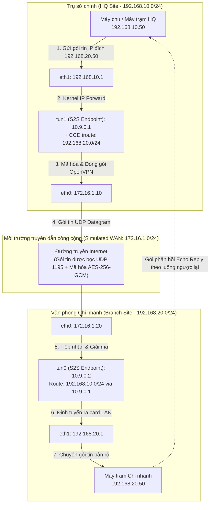

# TÀI LIỆU KỸ THUẬT: TRIỂN KHAI OPENVPN SITE-TO-SITE ROUTED TUNNEL

> **Dự án:** Thiết lập mạng riêng ảo VPN Site-to-Site và Client-to-Site  
> **Tài liệu:** `docs/05-site-to-site-guide.md`  
> **Giai đoạn:** Giai đoạn 5 - Triển khai Site-to-Site OpenVPN Routed Tunnel (HQ <=> Branch)  

---

## 1. Tổng Quan Kiến Trúc Mô Hình Site-to-Site (LAN-to-LAN)

Mô hình **Site-to-Site VPN** cho phép liên kết hai hoặc nhiều mạng cục bộ (LAN) tại các vị trí địa lý khác nhau (Trụ sở chính HQ và Văn phòng Chi nhánh Branch Office) thành một mạng logic duy nhất thông qua cặp VPN Gateway:
- **Đặc điểm nổi bật:** Toàn bộ quá trình mã hóa, giải mã và định tuyến được thực hiện tập trung tại 2 Gateway (`VM-HQ-GW` và `VM-Branch-GW`).
- **Trong suốt với người dùng cuối (Transparency):** Các máy trạm tại hai bên (`192.168.10.50` và `192.168.20.50`) **hoàn toàn không cần cài đặt bất kỳ phần mềm VPN nào**; chúng giao tiếp với nhau như thể đang nằm trong cùng một mạng diện rộng riêng (WAN/MPLS nội bộ).



---

## 2. Nguyên Lý Then Chốt: Phân Biệt Giữa `route` Và `iroute` (CCD)

Đây là điểm mấu chốt kỹ thuật thường gây lỗi không thông mạng trong OpenVPN Site-to-Site:

| Khái niệm | Nơi cấu hình | Phạm vi tác động | Mục đích kỹ thuật |
|---|---|---|---|
| **`route 192.168.20.0 ...`** | `server-s2s.conf` | **Kernel Hệ điều hành Linux (OS)** | Dạy cho bảng định tuyến của OS trên HQ Gateway biết rằng: Mọi gói tin có đích đến `192.168.20.0/24` phải chuyển vào giao diện ảo `tun1`. |
| **`iroute 192.168.20.0 ...`** | `/etc/openvpn/ccd/branch-gw` | **Nội bộ tiến trình OpenVPN Daemon** | Dạy cho tiến trình OpenVPN biết rằng: Trong số rất nhiều client đang kết nối, chính client có Common Name `branch-gw` là thiết bị sở hữu mạng `192.168.20.0/24`. |

> [!CRITICAL]
> Nếu thiếu lệnh `iroute` trong file CCD, nhân Linux sẽ đẩy gói tin vào `tun1`, nhưng tiến trình OpenVPN Server sẽ không biết gửi gói tin này cho client nào và sẽ hủy gói tin (Drop packet) với thông báo log: `MULTI: no route to host`.

---

## 3. Cấu Hình Chi Tiết Hai Đầu Gateway

### 3.1. Cấu hình HQ Gateway Server (`s2s-hq.conf` -> `/etc/openvpn/server/server-s2s.conf`)
- Chạy trên cổng riêng: `port 1195`, giao thức `udp`, interface `dev tun1`.
- Dải mạng đường hầm S2S: `server 10.9.0.0 255.255.255.0`.
- Thư mục cấu hình client: `client-config-dir /etc/openvpn/ccd`.
- Đẩy tuyến đường về HQ cho Branch: `push "route 192.168.10.0 255.255.255.0"`.
- Định tuyến OS: `route 192.168.20.0 255.255.255.0`.
- Tệp CCD `/etc/openvpn/ccd/branch-gw`: chứa dòng `iroute 192.168.20.0 255.255.255.0`.

### 3.2. Cấu hình Branch Gateway Client (`s2s-branch.conf` -> `/etc/openvpn/client/client-s2s.conf`)
- Chế độ máy khách: `client`, `dev tun0`, `proto udp`.
- Địa chỉ máy chủ HQ: `remote 172.16.1.10 1195`.
- Chứng chỉ xác thực: `ca.crt`, `branch-gw.crt`, `branch-gw.key`, `ta.key`.
- Tự động nhận tuyến đường `192.168.10.0/24 via 10.9.0.1` do HQ Server đẩy sang.

---

## 4. Quy Tắc Tường Lửa Chuyển Tiếp (iptables FORWARD)

Không giống mô hình Client-to-Site (cần NAT Masquerade), mô hình Site-to-Site Routed Tunnel yêu cầu bảo toàn địa chỉ IP gốc của hai mạng LAN để phục vụ giám sát và kiểm soát an ninh.

### Trên HQ Gateway (`VM-HQ-GW`):
```bash
# Cho phép chuyển tiếp gói tin hai chiều giữa tun1 (S2S) và eth1 (HQ LAN)
sudo iptables -A FORWARD -i tun1 -o eth1 -j ACCEPT
sudo iptables -A FORWARD -i eth1 -o tun1 -j ACCEPT

# Mở cổng dịch vụ OpenVPN S2S
sudo iptables -A INPUT -i eth0 -p udp --dport 1195 -j ACCEPT
sudo netfilter-persistent save
```

### Trên Branch Gateway (`VM-Branch-GW`):
```bash
# Cho phép chuyển tiếp gói tin hai chiều giữa tun0 (S2S) và eth1 (Branch LAN)
sudo iptables -A FORWARD -i tun0 -o eth1 -j ACCEPT
sudo iptables -A FORWARD -i eth1 -o tun0 -j ACCEPT
sudo netfilter-persistent save
```

---

## 5. Quy Trình Triển Khai & Kiểm Tra Nghiệm Thu Tự Động

### Bước 5.1: Triển khai phía HQ Gateway
```bash
sudo bash scripts/deploy-s2s-hq.sh
```

### Bước 5.2: Triển khai phía Branch Gateway
```bash
sudo bash scripts/deploy-s2s-branch.sh
```

### Bước 5.3: Chạy script kiểm tra nghiệm thu
Trên Branch PC (`192.168.20.50`):
```bash
bash scripts/verify-s2s.sh branch-pc
```

### Các tiêu chí nghiệm thu đạt yêu cầu (Pass Criteria):
- [x] **TC-05 (Tunnel Status):** Interface `tun1` (HQ: `10.9.0.1`) và `tun0` (Branch: `10.9.0.2`) đều ở trạng thái `UP`.
- [x] **TC-06 (LAN-to-LAN Connectivity):** Từ máy `192.168.20.50` ping `192.168.10.50` đạt tỷ lệ phản hồi 100% không mất gói (0% loss), RTT < 5ms.
- [x] **TC-07 (Traceroute Hop Inspection):** Lệnh `traceroute -n 192.168.10.50` hiển thị rõ ràng gói tin đi qua chặng Gateway nội bộ `192.168.20.1` -> chặng đường hầm `10.9.0.1` -> máy chủ `192.168.10.50` (hoàn toàn không để lộ địa chỉ mạng công cộng `172.16.1.x`).
- [x] **HTTP Access:** Lệnh `curl -I http://192.168.10.50` từ máy trạm chi nhánh phản hồi `HTTP/1.1 200 OK`.
