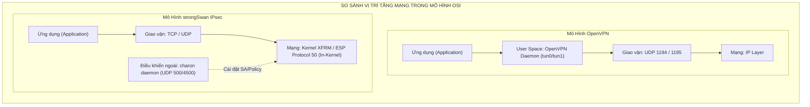

# TÀI LIỆU KỸ THUẬT: MỞ RỘNG SITE-TO-SITE IPSEC IKEV2 BẰNG STRONGSWAN

> **Dự án:** Thiết lập mạng riêng ảo VPN Site-to-Site và Client-to-Site  
> **Tài liệu:** `docs/06-ipsec-strongswan-guide.md`  
> **Giai đoạn:** Giai đoạn 6 - Triển khai mở rộng IPsec IKEv2 bằng strongSwan  

---

## 1. Tổng Quan Kiến Trúc IPsec & So Sánh Đối Chiếu Với OpenVPN

Trong khi OpenVPN là giải pháp VPN hoạt động tại **Tầng Ứng Dụng (Layer 4/Application)** dựa trên không gian người dùng (User-space TUN/TAP interface), thì **IPsec (Internet Protocol Security)** là bộ giao thức bảo mật hoạt động ngay tại **Tầng Mạng (Layer 3/Network)** của ngăn xếp giao thức TCP/IP.



### Bảng đối chiếu kỹ thuật giữa OpenVPN và IPsec strongSwan:

| Tiêu chí so sánh | OpenVPN (Site-to-Site) | strongSwan IPsec IKEv2 | Ý nghĩa thực tiễn |
|---|---|---|---|
| **Vị trí xử lý mã hóa** | User-space (chuyển ngữ cảnh kernel ↔ user) | **In-Kernel (Linux XFRM Framework)** | IPsec đạt thông lượng cao hơn và tiêu tốn ít CPU hơn trên phần cứng lớn |
| **Giao thức đóng gói** | Bọc trong UDP Datagram (Port 1195) | **Giao thức ESP (IP Protocol 50)** | Gói tin ESP không có cổng UDP (trừ khi bật NAT-T UDP 4500) |
| **Giao diện mạng ảo** | Tạo card ảo `tun0`, `tun1` | **Không tạo card ảo** (Dựa trên Policy-based XFRM) | IPsec áp dụng bảng chính sách kernel thay vì bảng định tuyến thông thường |
| **Giao thức bắt tay** | TLS Handshake (kênh điều khiển OpenVPN) | **IKEv2 (Internet Key Exchange version 2)** | IKEv2 hỗ trợ cơ chế MOBIKE và thiết lập nhanh chóng |
| **Độ dài Header phụ trội** | Khoảng 69 bytes (IP + UDP + OpenVPN) | Khoảng 50-56 bytes (IP + ESP + IV/ICV) | IPsec tiết kiệm MTU hơn một chút so với OpenVPN |

---

## 2. Hai Giai Đoạn Bắt Tay Của Chuẩn IKEv2

Quá trình thiết lập đường hầm bảo mật IPsec diễn ra qua 2 giai đoạn độc lập:

1. **Giai đoạn 1: IKE_SA (IKE Security Association)**
   - Sử dụng cổng UDP 500 (hoặc UDP 4500 nếu qua thiết bị NAT).
   - Hai Gateway trao đổi khóa Diffie-Hellman nhóm MODP-2048 để tạo ra một kênh điều khiển mã hóa an toàn.
   - Xác thực danh tính lẫn nhau bằng khóa chia sẻ trước (Pre-Shared Key - PSK).
2. **Giai đoạn 2: CHILD_SA (ESP Security Association)**
   - Thỏa thuận bộ khóa mã hóa dữ liệu thực tế cho luồng lưu lượng LAN (`192.168.10.0/24` ↔ `192.168.20.0/24`).
   - Cài đặt trực tiếp các bản ghi **XFRM State (Mã hóa/Giải mã)** và **XFRM Policy (Chính sách điều hướng)** vào nhân Linux.

---

## 3. Cấu Hình Chi Tiết Tệp `ipsec.conf` & `ipsec.secrets`

### 3.1. Phía HQ Gateway (`/etc/ipsec.conf`):
```text
config setup
    charondebug="ike 1, knl 1, cfg 0"
    uniqueids=yes

conn hq-to-branch
    keyexchange=ikev2
    auto=start
    authby=secret
    type=tunnel
    left=172.16.1.10
    leftsubnet=192.168.10.0/24
    leftid=172.16.1.10
    right=172.16.1.20
    rightsubnet=192.168.20.0/24
    rightid=172.16.1.20
    ike=aes256gcm16-sha256-modp2048!
    esp=aes256gcm16-sha256-modp2048!
    dpdaction=restart
    dpddelay=30s
```

### 3.2. Phía Branch Gateway (`/etc/ipsec.conf`):
Đảo ngược giá trị `left` và `right` để tương ứng với góc nhìn của Chi nhánh (`left=172.16.1.20/leftsubnet=192.168.20.0/24`, `right=172.16.1.10/rightsubnet=192.168.10.0/24`).

### 3.3. Tệp khóa bí mật `/etc/ipsec.secrets`:
```text
172.16.1.10 172.16.1.20 : PSK "DuAnAnNinhMang2026SecureKeyStrongSwan!"
```
*Yêu cầu bắt buộc:* `sudo chmod 600 /etc/ipsec.secrets` để ngăn chặn rò rỉ khóa Pre-Shared Key cho người dùng khác trong hệ điều hành.

---

## 4. Thiết Lập Tường Lửa Tầng Mạng Cho IPsec

Khác với OpenVPN chỉ cần mở cổng UDP, IPsec yêu cầu mở cả cổng điều khiển và giao thức mạng cấp thấp:

```bash
# 1. Mở cổng đàm phán IKEv2
sudo iptables -A INPUT -i eth0 -p udp --dport 500 -j ACCEPT

# 2. Mở cổng NAT Traversal (nếu có thiết bị NAT trung gian)
sudo iptables -A INPUT -i eth0 -p udp --dport 4500 -j ACCEPT

# 3. Mở giao thức ESP (Encapsulating Security Payload - IP Protocol 50)
sudo iptables -A INPUT -i eth0 -p esp -j ACCEPT

# 4. Cho phép lưu lượng hai chiều giữa 2 dải mạng nội bộ
sudo iptables -A FORWARD -s 192.168.10.0/24 -d 192.168.20.0/24 -j ACCEPT
sudo iptables -A FORWARD -s 192.168.20.0/24 -d 192.168.10.0/24 -j ACCEPT
sudo netfilter-persistent save
```

---

## 5. Quy Trình Chuyển Đổi An Toàn Giữa OpenVPN S2S & strongSwan IPsec

Để tránh lỗi xung đột định tuyến (*Routing Conflict* — gói tin bị kẹt giữa route của `tun1` và chính sách XFRM):

Sử dụng bộ công cụ chuyển đổi tự động:
```bash
# Xem trạng thái dịch vụ nào đang chiếm giữ S2S
sudo bash scripts/switch-vpn-mode.sh status

# Chuyển hoàn toàn sang IPsec IKEv2
sudo bash scripts/switch-vpn-mode.sh ipsec

# Quay trở lại OpenVPN S2S khi cần
sudo bash scripts/switch-vpn-mode.sh openvpn
```

---

## 6. Hướng Dẫn Nghiệm Thu & Phân Tích Lệnh `ipsec statusall`

Chạy script kiểm tra nghiệm thu tự động:
```bash
bash scripts/verify-ipsec.sh
```

### Phân tích đầu ra của lệnh `sudo ipsec statusall`:
```text
Status of IKE charon daemon (strongSwan 5.9.5, Linux ...):
  uptime: 45 minutes, since Nov 14 21:30:12 2026
...
Security Associations (1 up, 0 connecting):
  hq-to-branch[1]: ESTABLISHED 42 minutes ago, 172.16.1.10[172.16.1.10]...172.16.1.20[172.16.1.20]
  hq-to-branch[1]: IKEv2 SPIs: 8e5f2a1b9c3d4e5f_i* 7a2b3c4d5e6f1a2b_r, rekeying in 2 hours
  hq-to-branch[1]: IKE proposal: AES_GCM_16_256/PRF_HMAC_SHA2_256/MODP_2048
  hq-to-branch{1}:  INSTALLED, TUNNEL, reqid 1, ESP SPIs: c3a4b5c6_i d7e8f9a0_o
  hq-to-branch{1}:  AES_GCM_16_256, 12840 bytes_i (120 pkts, 2s ago), 14320 bytes_o (120 pkts, 2s ago)
  hq-to-branch{1}:   192.168.10.0/24 === 192.168.20.0/24
```

### Các thông số kiểm tra bắt buộc:
1. `ESTABLISHED`: Đường hầm đàm phán IKE Giai đoạn 1 thành công.
2. `INSTALLED, TUNNEL`: Đường hầm ESP mã hóa dữ liệu Giai đoạn 2 đã nạp thành công vào nhân Linux.
3. `bytes_i / bytes_o`: Đếm số byte và gói tin đã được mã hóa/giải mã thành công khi chạy lệnh `ping 192.168.10.50` từ máy trạm `192.168.20.50`.
