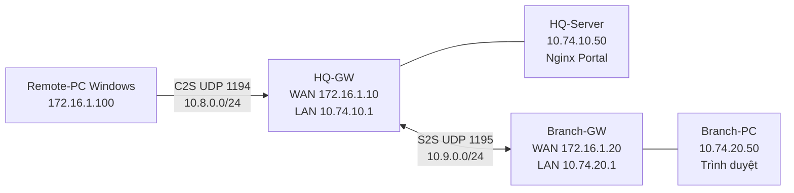

# Triển khai VPN trên năm máy

Bộ hướng dẫn này dùng đúng mô hình **HQ-GW, Branch-GW, HQ-Server, Branch-PC và Windows Remote-PC** trên VMware. Hai gateway chạy OpenVPN Site-to-Site; Windows chạy OpenVPN Client-to-Site để vào web nội bộ HQ. Thực hiện phần chuẩn bị chung, sau đó mở hướng dẫn tương ứng trên từng máy.

Nếu tiếp tục lab đã triển khai, xem [địa chỉ SSH quản trị và kết quả kiểm thử](live-lab-status.md). Mục chuyển địa chỉ bên dưới dành cho bản lab còn dùng dải cũ.

## 1 Mô hình và địa chỉ

| Máy | Hệ điều hành | WAN lab | LAN lab | Địa chỉ VPN | Hướng dẫn |
| --- | --- | --- | --- | --- | --- |
| HQ-GW | Armbian Minimal hoặc Linux server tương thích apt/systemd | 172.16.1.10/24 | 10.74.10.1/24 | C2S 10.8.0.1; S2S 10.9.0.1 | [Máy 1](01-hq-gw.md) |
| Branch-GW | Armbian Minimal hoặc Linux server tương thích apt/systemd | 172.16.1.20/24 | 10.74.20.1/24 | S2S 10.9.0.2 | [Máy 2](02-branch-gw.md) |
| HQ-Server | Armbian Minimal hoặc Linux server tương thích apt/systemd | — | 10.74.10.50/24 | Không có VPN client | [Máy 3](03-hq-server.md) |
| Branch-PC | Armbian CLI hiện tại, có thể bổ sung Desktop khi cần | — | 10.74.20.50/24 | Không có VPN client | [Máy 4](04-branch-pc.md) |
| Remote-PC | Windows x64 | 172.16.1.100/24 | — | C2S 10.8.0.x được cấp khi Connect | [Máy 5](05-windows-remote.md) |

Tài nguyên dùng thống nhất là **`http://10.74.10.50`**. Không chuyển web sang `10.8.0.1` của bài ba máy. Trong mô hình này, C2S vào HQ LAN, còn S2S nối HQ LAN và Branch LAN; không cấu hình Internet breakout hoặc truy cập Branch LAN từ Windows C2S.

## 2 Chuyển địa chỉ cho lab đã dựng

HQ và Branch dùng hai subnet riêng `10.74.10.0/24` và `10.74.20.0/24`. Các subnet này tách khỏi WAN `172.16.1.0/24`, tunnel `10.8.0.0/24` và `10.9.0.0/24`, và VMnet8 quản trị `192.168.27.0/24` trên host đã kiểm tra. Nếu dùng host khác, kiểm tra cả mạng Wi-Fi/Ethernet và các route do VPN khác cài. Trùng hoặc chồng lấn subnet có thể làm guest chọn sai interface cho đích nội bộ.

1. Qua SSH trên card NAT quản trị, đồng bộ repo mới lên bốn Linux. Sao lưu tệp Netplan đang áp dụng trên từng máy, cùng cấu hình OpenVPN và `iptables-save` trên gateway, cấu hình Nginx và web root trên HQ-Server. Giữ bản sao tại từng VM để có thể khôi phục nếu cấu hình mới lỗi.
2. Trên bốn Linux, dùng YAML theo vai trò ở bảng trên để đổi IP LAN, route LAN đối diện và next hop. Giữ đúng renderer, tên card và DHCP NAT của VM. Chạy `sudo netplan generate` để kiểm tra cấu hình. Nếu chỉ có SSH, lên lịch khởi động lại VM sau khi lưu cấu hình hợp lệ. `netplan apply` đã làm gián đoạn SSH trên ba VM dùng `systemd-networkd` trong lần đổi địa chỉ thực tế. Kiểm tra lại IP, route và SSH sau khi VM lên.
3. Trên **HQ-Server**, chạy `sudo bash scripts/deploy-hq-portal.sh` để Nginx nghe ở `10.74.10.50` và cập nhật nội dung Portal. Trên **HQ-GW**, chạy `sudo bash scripts/deploy-c2s-server.sh` và `sudo bash scripts/deploy-s2s-hq.sh` để cập nhật route được đẩy, CCD S2S và firewall. Trên **Branch-GW**, chạy `sudo bash scripts/deploy-s2s-branch.sh` để áp dụng firewall và nhận lại route HQ. Các script dùng PKI đang có. Nếu đã tùy biến CCD của `client1`, giữ bản sao và phục hồi thiết lập đó trước khi nghiệm thu.
4. Chạy [nghiệm thu](06-acceptance.md) với địa chỉ mới. Profile `client1.ovpn` chuẩn của lab vẫn dùng được vì địa chỉ WAN và cổng OpenVPN không đổi. Ở lần kết nối lại sau khi HQ-GW cập nhật, OpenVPN đẩy route `10.74.10.0/24` tới client.

## 3 Thứ tự triển khai mới

Số máy là số định danh để chia việc, không phải thứ tự chạy mọi lệnh deploy. Làm hai lượt để các máy phụ thuộc đã sẵn sàng trước khi kiểm tra.

| Lượt | Máy thực hiện | Công việc | Điều kiện chuyển bước |
| --- | --- | --- | --- |
| A | Máy host VMware | Làm [chuẩn bị chung](00-preparation.md), tạo ba LAN Segment và các NIC | Các NIC được nối đúng phân vùng |
| A | Cả bốn Linux | Cài công cụ, chép repo; làm đến hết phần cấu hình mạng và cài gói trong hướng dẫn từng máy | IP/MAC đúng, còn NAT để apt, ping được gateway LAN hoặc peer WAN |
| A | Windows | Làm phần mạng và cài OpenVPN GUI, chưa Connect | Ping được 172.16.1.10 |
| B1 | HQ-Server | Chạy phần triển khai Portal ở hướng dẫn Máy 3 | HTTP cục bộ trả 200 |
| B2 | HQ-GW | Chạy phần triển khai CA và hai server ở hướng dẫn Máy 1 | tun0/tun1 đúng IP, profile client1 đã sinh |
| B3 | HQ-GW → Branch-GW | Chuyển bộ chứng chỉ Branch theo hướng dẫn Máy 1 | Bốn tệp đã nằm tại /etc/openvpn/client trên Branch |
| B4 | Branch-GW | Chạy phần triển khai S2S ở hướng dẫn Máy 2 | Handshake hoàn tất, route HQ qua tun0 |
| B5 | Branch-PC và HQ-Server | Chạy phần kiểm tra liên site ở Máy 4 và Máy 3 | HTTP từ Branch và ping khởi tạo từ cả hai LAN thành công |
| B6 | Windows và HQ-GW | Nhận profile, Connect, kiểm tra C2S | HTTP từ Windows thành công, status HQ có client1 |
| C | Cả năm máy | Ngắt NAT tạm và làm [nghiệm thu](06-acceptance.md) | C2S/S2S vẫn hoạt động; phép thử âm và reboot đạt |

`deploy-all.sh` còn chạy apt ở từng vai trò. Giữ NAT Connected cho đến khi hoàn tất tất cả lệnh deploy; ngắt NAT trước khi kết luận kết quả nghiệm thu. Không chạy script của nhiều vai trò trên cùng một VM.

## 4 Quy ước lệnh

- Bash chạy trên Linux được chỉ định; PowerShell chạy trên Windows được chỉ định. Không chạy lệnh cấu hình VM trên Windows host.
- Repo được chép tới `~/vpn-lab` trên bốn Linux. Ví dụ tài khoản SSH là `student`; thay bằng tài khoản có sudo thực tế.
- `ens33`, `ens37`, `ens39` là ví dụ. Phải đối chiếu MAC trong VMware rồi thay tên NIC trong YAML và `interfaces.conf`.
- Dùng tài khoản thường với `sudo bash ...` để CA/profile nằm đúng home của người triển khai; nếu dùng root trực tiếp thì đường dẫn mặc định chuyển sang home root.
- Mỗi khối lệnh có kết quả kỳ vọng. Chỉ ghi đạt sau khi quan sát đúng trên VM; một service `active` chưa chứng minh có phiên VPN.

## 5 Khi cần trình diễn hoặc xử lý lỗi

Sau khi dựng xong, dùng [kịch bản demo 6–8 phút](../presentation/demo-script.md) hoặc [runbook có lời dẫn](../presentation/detailed-lab-runbook.md). Checklist chi tiết về route tự thêm, ngắt tunnel và CRL nằm tại [tests/openvpn-demo.md](../../tests/openvpn-demo.md). IPsec là bài mở rộng riêng; không chạy các script IPsec trong quy trình OpenVPN này.
