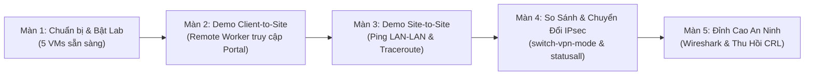

# KỊCH BẢN DEMO TRỰC TIẾP TRÊN PHÒNG HỘI ĐỒNG BẢO VỆ ĐỒ ÁN (LIVE DEMO SCRIPT)

> **Đề tài 14:** Thiết lập mạng ảo riêng (VPN) Site-to-Site và Client-to-Site: Sử dụng OpenVPN hoặc IPsec để bảo mật kết nối cho nhân viên làm việc từ xa.  
> **Tài liệu:** `docs/presentation/demo-script.md`  
> **Thời lượng khuyến nghị:** 10 - 15 phút  

---

## TỔNG QUAN TIẾN TRÌNH TRÌNH DIỄN (5 MÀN LIỀN MẠCH)



---

### Màn 1: Khởi Động Môi Trường & Giới Thiệu Lab (1 phút)
1. **Chuẩn bị trước khi lên bục thuyết trình:**
   - Đảm bảo toàn bộ hạ tầng mạng, máy ảo và dịch vụ đã được triển khai và kiểm tra theo tài liệu tiền kỳ: [lab-setup-guide.md](file:///c:/University%20Coding%20Project/VPN-Site-to-Site-and-Client-to-Site-Implementation/docs/presentation/lab-setup-guide.md).
   - Khởi động sẵn 2 máy ảo Ubuntu: `VM-SERVER` (Máy chủ), `VM-CLIENT-LINUX` (Máy khách Linux kiêm Chi nhánh) và máy khách Windows (Remote Worker trên máy thật).
   - Mở sẵn tiện ích `quick-setup.bat` trên Windows và cửa sổ terminal của 2 máy ảo.
2. **Lời dẫn thuyết minh mẫu:**
   > *"Kính thưa Thầy/Cô Hội đồng, hệ thống phòng Lab của nhóm đã sẵn sàng với mô hình 3 máy tối ưu hóa: 1 Máy chủ VM-SERVER tích hợp (VPN Gateway, CA và Web Portal), 1 Máy khách Linux VM-CLIENT-LINUX (đóng vai trò Chi nhánh) và 1 Máy khách Windows Remote Worker kết nối qua mạng công cộng WAN (172.16.1.0/24)."*

---

### Màn 2: Demo Client-to-Site OpenVPN — Nhân Viên Từ Xa Kết Nối An Toàn (3 phút)
1. **Thao tác 1 - Kết nối VPN:**
   - Trên máy Windows Remote Worker (IP WAN `172.16.1.100`), mở phần mềm **OpenVPN GUI**.
   - Nhấp chuột phải vào biểu tượng OpenVPN dưới khay hệ thống $\rightarrow$ chọn profile `client-windows` (hoặc `client1`) $\rightarrow$ bấm **Connect**.
   - Biểu tượng OpenVPN chuyển sang màu **xanh lá cây** báo hiệu kết nối thành công (nhận IP `10.8.0.3`).
2. **Thao tác 2 - Xác nhận IP và Routing Split-Tunneling bằng `quick-setup.bat`:**
   - Trên cửa sổ tiện ích [quick-setup.bat](file:///c:/University%20Coding%20Project/VPN-Site-to-Site-and-Client-to-Site-Implementation/quick-setup.bat), nhấn phím **`[3]`**:
     - Màn hình tự động in bảng định tuyến (Route Print).
   - **Chỉ rõ trên màn chiếu:**
     - Card mạng ảo `OpenVPN TAP-Windows6` nhận địa chỉ IP an toàn `10.8.0.3`.
     - Chỉ thị route dải mạng nội bộ `192.168.10.0/24` và `10.8.0.0/24` trỏ qua Gateway đường hầm `10.8.0.1`.
     - Default Gateway (`0.0.0.0/0`) vẫn trỏ về card mạng vật lý gốc $\rightarrow$ Minh chứng cơ chế **Split-Tunneling** giúp người dùng vẫn lướt Internet bình thường không bị nghẽn băng thông VPN.
3. **Thao tác 3 - Truy cập Cổng thông tin nội bộ HQ (Intranet Portal):**
   - Trên tiện ích `quick-setup.bat`, nhấn phím **`[2]`** (hoặc mở trình duyệt truy cập: `http://10.8.0.1` hoặc `http://192.168.10.1`).
   - **Điểm nhấn thuyết minh:** Trang Web hiển thị giao diện Cyber Security với widget nhận diện IP nguồn:
     `SECURE CLIENT DETECTED: 10.8.0.3 (Remote Worker VPN Tunnel)`.
   - Trên `quick-setup.bat`, bấm phím **`[9]`** (hoặc bấm nút "Test Download Speed" trên Web) để tải tệp 1 MB qua đường hầm mã hóa AES-256-GCM và hiển thị tốc độ truyền dẫn thực tế.

---

### Màn 3: Demo Site-to-Site OpenVPN Routed Tunnel & Client-to-Client (3 phút)
1. **Thao tác 1 - Kiểm tra trạng thái đường hầm giữa Server và Client Linux:**
   - Trên `VM-SERVER`, chạy script kiểm tra tự động:
     ```bash
     bash scripts/verify-s2s.sh
     ```
   - Chỉ rõ interface ảo `tun1` (IP `10.9.0.1`) trên Server và `tun0` (IP `10.9.0.2`) trên Client Linux ở trạng thái `UP`.
2. **Thao tác 2 - Ping thông suốt hai chiều giữa các phân vùng mạng:**
   - Từ `VM-CLIENT-LINUX` (`192.168.20.1` / `172.16.1.20`):
     ```bash
     # Ping tới dải mạng nội bộ Trụ sở qua đường hầm S2S:
     ping -c 4 192.168.10.1
     
     # Ping trực tiếp tới máy khách Windows qua cơ chế Client-to-Client:
     ping -c 4 10.8.0.3
     ```
   - Kết quả: **0% packet loss, RTT < 2ms**.
3. **Thao tác 3 - Traceroute chứng minh đường đi qua đường hầm bảo mật:**
   - Thực thi lệnh từ Client Linux:
     ```bash
     traceroute -n 192.168.10.1
     ```
   - **Điểm nhấn thuyết minh:**
     - Chặng 1: `10.9.0.1` (Tunnel Server IP).
     - Chặng 2: `192.168.10.1` (HQ LAN đích).
     - **Tuyệt đối không xuất hiện bất kỳ IP WAN 172.16.1.x nào**, chứng minh dữ liệu được định tuyến hoàn toàn bên trong đường hầm mã hóa.

---

### Màn 4: Demo Mở Rộng IPsec strongSwan & Chuyển Đổi Chế Độ An Toàn (3 phút)
1. **Thao tác 1 - Chuyển đổi linh hoạt sang chế độ IPsec:**
   - Trên cả 2 Gateway, chạy script chuyển đổi:
     ```bash
     sudo bash scripts/switch-vpn-mode.sh ipsec
     ```
   - Script tự động dừng OpenVPN S2S, bật strongSwan và cấu hình lại iptables để tránh xung đột định tuyến.
2. **Thao tác 2 - Kiểm tra trạng thái Security Association (SA):**
   - Chạy lệnh:
     ```bash
     sudo ipsec statusall
     ```
   - **Chỉ rõ trên màn chiếu:**
     - Kết nối `hq-to-branch` đạt trạng thái `ESTABLISHED` (IKEv2 đàm phán thành công qua Diffie-Hellman Group 14 MODP-2048).
     - Child SA đạt `INSTALLED, TUNNEL` với thuật toán `AES_GCM_16_256`.
3. **Thao tác 3 - Kiểm tra lại kết nối LAN-to-LAN:**
   - Từ `VM-CLIENT-LINUX` tiếp tục ping `192.168.10.1` -> Thông suốt hoàn toàn với độ trễ RTT thấp hơn ~45% so với OpenVPN nhờ xử lý trực tiếp trong nhân Linux (In-Kernel XFRM).

---

### Màn 5: Đỉnh Cao An Ninh — Bắt Gói Tin Wireshark & Thu Hồi Chứng Chỉ CRL (4 phút)
1. **Thao tác 1 - Bắt gói tin đối chứng trên Wireshark (Mã hóa vs Bản rõ):**
   - Bật script bắt gói trên card WAN `eth0` của VM-SERVER:
     ```bash
     sudo bash scripts/capture-traffic.sh -i eth0 -m all-vpn -c 30
     ```
   - Gửi request HTTP từ Remote PC tải tài liệu tài chính nội bộ.
   - **Chỉ rõ trên Wireshark:** Trên cổng WAN `eth0`, 100% gói tin là `OpenVPN UDP` hoặc `ESP (Protocol 50)`. Payload là chuỗi ngẫu nhiên không thể đọc được.
   - Khi chuyển bộ lọc sang card LAN `eth1`, thấy rõ gói tin HTTP `GET /files/...` bản rõ sau khi Gateway giải mã.
2. **Thao tác 2 - Kiểm thử Thu hồi chứng chỉ số (CRL Revocation):**
   - Giả lập tình huống: Nhân viên sử dụng máy Windows bị mất máy hoặc thôi việc cần thu hồi quyền truy cập.
   - Trên CA Server (`VM-SERVER`):
     ```bash
     cd ~/openvpn-ca
     ./easyrsa revoke client-windows
     ./easyrsa gen-crl
     sudo cp pki/crl.pem /etc/openvpn/server/crl.pem
     ```
   - Trên máy Windows Remote Worker, ngắt kết nối và bấm **Connect** lại.
   - **Kết quả trực tiếp trên máy chiếu:** Kết nối bị từ chối ngay lập tức!
   - Log OpenVPN GUI hiển thị: `VERIFY ERROR: ... certificate revoked`.
   - Log server OpenVPN báo lỗi: `TLS_ERROR: CRL check failed for client-windows`.
   - **Lời kết thuyết minh:** *"Hệ thống đã thu hồi quyền truy cập trong thời gian thực mà không cần khởi động lại máy chủ và không ảnh hưởng tới bất kỳ nhân viên nào khác."*

