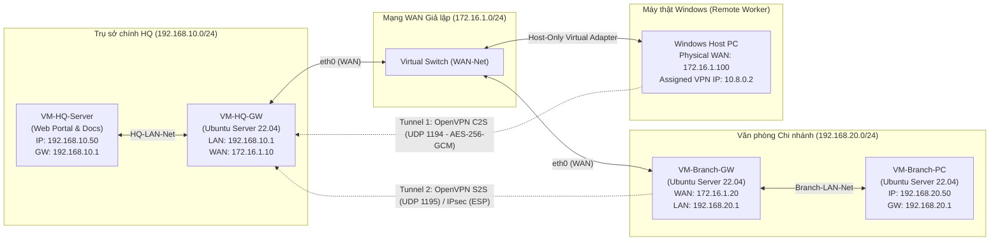
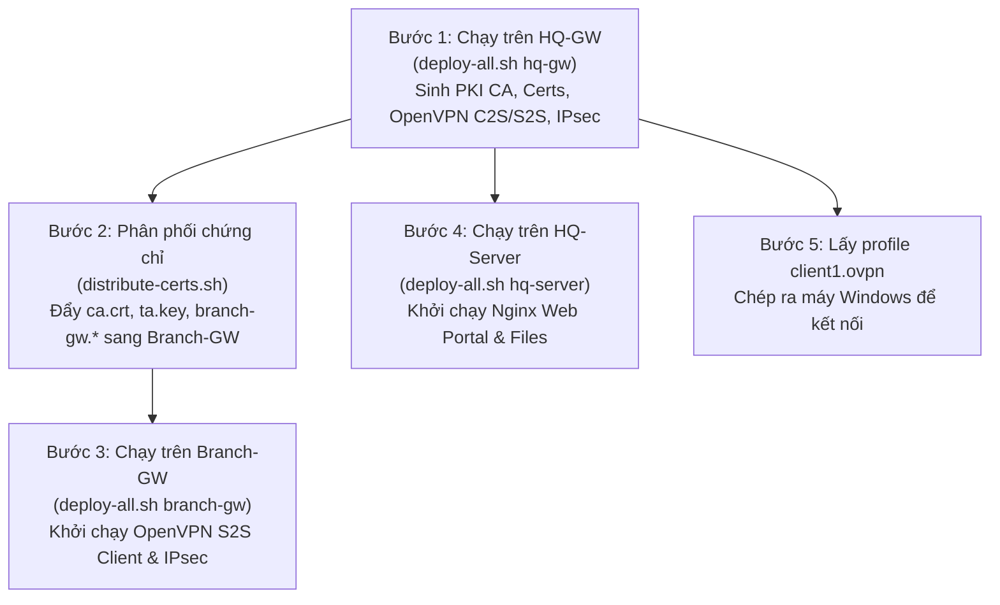

# HƯỚNG DẪN THIẾT LẬP MÔI TRƯỜNG PHÒNG LAB & TRIỂN KHAI TOÀN DIỆN (LAB SETUP GUIDE)

> **Đề tài 14:** Thiết lập mạng riêng ảo (VPN) Site-to-Site và Client-to-Site: Sử dụng OpenVPN hoặc IPsec để bảo mật kết nối cho nhân viên làm việc từ xa.  
> **Tài liệu:** `docs/presentation/lab-setup-guide.md`  
> **Mục tiêu:** Hướng dẫn chi tiết từng bước chuẩn bị 4 máy ảo Linux, cấu hình mạng ảo trên VirtualBox/VMware, đặt IP tĩnh Netplan, triển khai tự động bằng `deploy-all.sh` và thiết lập máy khách Windows trước buổi thuyết minh demo.

---

## 📑 MỤC LỤC
1. [Yêu Cầu Phần Cứng & Chuẩn Bị Tài Nguyên](#1-yêu-cầu-phần-cứng--chuẩn-bị-tài-nguyên)
2. [Sơ Đồ Kiến Trúc & Bảng Quy Hoạch IP](#2-sơ-đồ-kiến-trúc--bảng-quy-hoạch-ip)
3. [Cấu Hình Card Mạng Trên Hypervisor (VirtualBox & VMware)](#3-cấu-hình-card-mạng-trên-hypervisor-virtualbox--vmware)
4. [Tạo & Nhân Bản (Clone) 4 Máy Ảo Ubuntu Server](#4-tạo--nhân-bản-clone-4-máy-ảo-ubuntu-server)
5. [Đưa Mã Nguồn Dự Án Lên Các Máy Ảo](#5-đưa-mã-nguồn-dự-án-lên-các-máy-ảo)
6. [Cấu Hình Địa Chỉ IP Tĩnh Bằng Netplan](#6-cấu-hình-địa-chỉ-ip-tĩnh-bằng-netplan)
7. [Triển Khai Dịch Vụ Tự Động Bằng `deploy-all.sh`](#7-triển-khai-dịch-vụ-tự-động-bằng-deploy-allsh)
8. [Thiết Lập Máy Khách Windows (Remote Worker)](#8-thiết-lập-máy-khách-windows-remote-worker)
9. [Pre-Flight Checklist: Tổng Duyệt Trước Giờ Thuyết Trình](#9-pre-flight-checklist-tổng-duyệt-trước-giờ-thuyết-trình)

---

## 1. Yêu Cầu Phần Cứng & Chuẩn Bị Tài Nguyên

### 1.1. Yêu cầu máy Host (Laptop/PC của bạn)
* **Hệ điều hành:** Windows 10 hoặc Windows 11 64-bit.
* **RAM:** Tối thiểu 8 GB RAM (Khuyến nghị 16 GB).
* **CPU:** 4 Core / 8 Threads (Intel Core i5/i7 hoặc AMD Ryzen 5/7).
* **Ổ cứng:** Còn trống tối thiểu 25 - 30 GB SSD.
* **Phần mềm giả lập (Hypervisor):** Chọn 1 trong 2:
  * **Oracle VM VirtualBox** 7.0+ ([Tải về](https://www.virtualbox.org/wiki/Downloads))
  * **VMware Workstation Pro / Player** 16.x hoặc 17.x ([Tải về](https://www.vmware.com/))
* **Công cụ bổ trợ trên Windows:**
  * **OpenVPN GUI for Windows** (bản 2.6+ kèm trình điều khiển Wintun).
  * Trình duyệt web (Google Chrome / MS Edge / Firefox).

### 1.2. File ISO cài đặt
* Tải tệp ISO **Ubuntu Server 22.04 LTS (Jammy Jellyfish)** (`ubuntu-22.04.x-live-server-amd64.iso`).
  > [!NOTE]
  > Sử dụng bản **Ubuntu Server (không có giao diện Desktop GUI)** để mỗi máy chỉ tiêu tốn 300 - 500 MB RAM, giúp máy thật chạy 4 máy ảo cùng lúc cực kỳ mượt mà.

---

## 2. Sơ Đồ Kiến Trúc & Bảng Quy Hoạch IP



### Bảng phân bổ Card mạng & Địa chỉ IP

| Node / Máy ảo | Tên Interface | Cấu hình Hypervisor | Địa chỉ IP / Subnet | Default Gateway | Vai trò trong Lab |
| :--- | :--- | :--- | :--- | :--- | :--- |
| **Máy Host Windows** | Virtual Adapter | Nối mạng `WAN-Net` | `172.16.1.100 /24` | (Giữ nguyên mạng thật) | Máy của nhân viên làm việc từ xa |
| **`VM-HQ-GW`** | `eth0`<br>`eth1` | `WAN-Net`<br>`HQ-LAN-Net` | `172.16.1.10 /24`<br>`192.168.10.1 /24` | Không có<br>Không có | Cổng VPN Trụ sở chính (CA, C2S Server, S2S Gateway) |
| **`VM-Branch-GW`** | `eth0`<br>`eth1` | `WAN-Net`<br>`Branch-LAN-Net` | `172.16.1.20 /24`<br>`192.168.20.1 /24` | Không có<br>Không có | Cổng VPN Chi nhánh (S2S Client, IPsec Peer) |
| **`VM-HQ-Server`** | `eth0` | `HQ-LAN-Net` | `192.168.10.50 /24` | `192.168.10.1` | Máy chủ Web Portal nội bộ & Benchmark files |
| **`VM-Branch-PC`** | `eth0` | `Branch-LAN-Net` | `192.168.20.50 /24` | `192.168.20.1` | Máy trạm chi nhánh kiểm tra kết nối LAN-to-LAN |

---

## 3. Cấu Hình Card Mạng Trên Hypervisor (VirtualBox & VMware)

Hệ thống lab yêu cầu **3 phân vùng mạng biệt lập**:
1. `WAN-Net` (Dải `172.16.1.0/24`): Mạng công cộng kết nối Windows Host, HQ-GW và Branch-GW.
2. `HQ-LAN-Net` (Dải `192.168.10.0/24`): Mạng nội bộ riêng của Trụ sở chính (chỉ nối HQ-GW và HQ-Server).
3. `Branch-LAN-Net` (Dải `192.168.20.0/24`): Mạng nội bộ riêng của Chi nhánh (chỉ nối Branch-GW và Branch-PC).

---

### 3.1. Hướng dẫn thiết lập trên Oracle VM VirtualBox

#### Bước 3.1.1: Tạo mạng Host-Only Adapter cho WAN-Net trên Windows
1. Mở VirtualBox $\rightarrow$ Vào menu `File` $\rightarrow$ `Tools` $\rightarrow$ `Network Manager` (hoặc phím tắt `Ctrl + H`).
2. Tại tab **Host-only Networks**, nhấp nút **Create** để tạo mới một Adapter (ví dụ: `VirtualBox Host-Only Ethernet Adapter #2`).
3. Chọn Adapter vừa tạo, tại tab **Adapter**:
   * IPv4 Address: `172.16.1.100`
   * IPv4 Network Mask: `255.255.255.0`
4. Tại tab **DHCP Server**: **Bỏ tích** ô `Enable Server` (ta dùng IP tĩnh cố định). Nhấp **Apply**.

#### Bước 3.1.2: Gán Card mạng cho từng máy ảo trong VirtualBox
Chuột phải vào từng máy ảo $\rightarrow$ Chọn **Settings** $\rightarrow$ Thẻ **Network**:

* **`VM-HQ-GW`:**
  * **Adapter 1:** Tích *Enable Network Adapter* $\rightarrow$ Attached to: `Host-only Adapter` $\rightarrow$ Name: Chọn adapter vừa cấu hình ở trên (`172.16.1.100`).
  * **Adapter 2:** Tích *Enable Network Adapter* $\rightarrow$ Attached to: `Internal Network` $\rightarrow$ Name: Nhập chữ `HQ-LAN-Net`.
* **`VM-Branch-GW`:**
  * **Adapter 1:** Tích *Enable Network Adapter* $\rightarrow$ Attached to: `Host-only Adapter` $\rightarrow$ Name: Chọn adapter mạng WAN (`172.16.1.100`).
  * **Adapter 2:** Tích *Enable Network Adapter* $\rightarrow$ Attached to: `Internal Network` $\rightarrow$ Name: Nhập chữ `Branch-LAN-Net`.
* **`VM-HQ-Server`:**
  * **Adapter 1:** Tích *Enable Network Adapter* $\rightarrow$ Attached to: `Internal Network` $\rightarrow$ Name: Nhập chữ `HQ-LAN-Net`.
* **`VM-Branch-PC`:**
  * **Adapter 1:** Tích *Enable Network Adapter* $\rightarrow$ Attached to: `Internal Network` $\rightarrow$ Name: Nhập chữ `Branch-LAN-Net`.

---

### 3.2. Hướng dẫn thiết lập trên VMware Workstation

#### Bước 3.2.1: Tạo card mạng ảo VMnet2 cho WAN-Net
1. Mở VMware Workstation $\rightarrow$ Vào menu `Edit` $\rightarrow$ `Virtual Network Editor...` $\rightarrow$ Nhấp nút **Change Settings** (yêu cầu quyền Admin).
2. Nhấp **Add Network...** $\rightarrow$ Chọn tên mạng (ví dụ: `VMnet2`) $\rightarrow$ Bấm OK.
3. Cấu hình thông số cho `VMnet2`:
   * Chọn kiểu kết nối: `Host-only (connect VMs internally in a private network)`.
   * Tích chọn: `Connect a host virtual adapter (VMnet) to this network`.
   * **Bỏ tích chọn:** `Use local DHCP service to distribute IP address to VMs`.
   * Subnet IP: `172.16.1.0` - Subnet mask: `255.255.255.0`.
   * Nhấp **Apply** $\rightarrow$ **OK**.
4. Trên máy Windows thật: Nhấn `Windows + R`, gõ `ncpa.cpl` $\rightarrow$ Nhấp chuột phải vào card mạng `VMware Network Adapter VMnet2` $\rightarrow$ Chọn `Properties` $\rightarrow$ Nhấp đúp vào `Internet Protocol Version 4 (TCP/IPv4)`:
   * Chọn `Use the following IP address`:
     * IP address: `172.16.1.100`
     * Subnet mask: `255.255.255.0`
     * Default gateway: *Để trống*

#### Bước 3.2.2: Tạo 2 LAN Segment cho mạng nội bộ
Tại giao diện VMware, mở `Virtual Machine Settings` của bất kỳ máy ảo nào $\rightarrow$ Chọn `Network Adapter` $\rightarrow$ Nhấp nút **LAN Segments...**:
* Thêm Segment 1: `HQ-LAN-Net`
* Thêm Segment 2: `Branch-LAN-Net`
* Nhấp **OK**.

#### Bước 3.2.3: Gán Card mạng trên từng máy ảo trong VMware
* **`VM-HQ-GW`:**
  * Network Adapter 1: Chọn `Custom: Specific virtual network` $\rightarrow$ Chọn `VMnet2 (Host-only)`.
  * Bấm Add... thêm Network Adapter 2: Chọn `LAN segment` $\rightarrow$ Chọn `HQ-LAN-Net`.
* **`VM-Branch-GW`:**
  * Network Adapter 1: Chọn `Custom: Specific virtual network` $\rightarrow$ Chọn `VMnet2 (Host-only)`.
  * Bấm Add... thêm Network Adapter 2: Chọn `LAN segment` $\rightarrow$ Chọn `Branch-LAN-Net`.
* **`VM-HQ-Server`:**
  * Network Adapter 1: Chọn `LAN segment` $\rightarrow$ Chọn `HQ-LAN-Net`.
* **`VM-Branch-PC`:**
  * Network Adapter 1: Chọn `LAN segment` $\rightarrow$ Chọn `Branch-LAN-Net`.

---

## 4. Tạo & Nhân Bản (Clone) 4 Máy Ảo Ubuntu Server

Để tiết kiệm thời gian, **bạn chỉ cần cài đặt Ubuntu Server 1 lần duy nhất**, sau đó nhân bản (Clone) ra 4 máy.

### 4.1. Cài đặt máy ảo gốc (Base VM)
1. Tạo máy ảo mới trong VirtualBox/VMware:
   * Tên: `Ubuntu-Base`
   * RAM: `1024 MB` (1 GB), CPU: `1 vCPU`, Ổ cứng: `10 GB` (Dynamically Allocated).
   * Gắn file ISO `ubuntu-22.04.x-live-server-amd64.iso` vào ổ đĩa ảo.
2. Khởi động máy ảo và tiến hành cài đặt Ubuntu Server:
   * Ngôn ngữ: `English`.
   * Mạng (Network): Chọn cấu hình mặc định (tạm thời để DHCP hoặc cài đặt sau).
   * Hồ sơ người dùng (Profile Setup):
     * Your name: `Student`
     * Server's name: `ubuntu-base`
     * Pick a username: `student` (hoặc `vpnadmin`)
     * Choose a password: `vpnpassword123` (tùy bạn chọn)
   * **SSH Setup:** Tích chọn `Install OpenSSH server` (Rất quan trọng để copy file và điều khiển từ xa).
   * Bấm `Done` và chờ cài đặt hoàn tất $\rightarrow$ Nhấp `Reboot Now` (tháo đĩa ISO).
3. Đăng nhập vào máy, cập nhật và cài đặt các gói công cụ cơ bản:
   ```bash
   sudo apt update && sudo apt install -y curl wget git net-tools iptables traceroute
   sudo poweroff
   ```

### 4.2. Nhân bản ra 4 máy ảo
Sau khi máy `Ubuntu-Base` đã tắt nguồn hoàn toàn:
1. Nhấp chuột phải vào `Ubuntu-Base` $\rightarrow$ Chọn **Clone**.
2. Đặt tên lần lượt và chọn phương thức:
   * Máy 1: `VM-HQ-GW` $\rightarrow$ Chọn `Linked Clone` (hoặc `Full Clone` nếu muốn độc lập hoàn toàn) $\rightarrow$ Chọn `Generate new MAC addresses for all network adapters`.
   * Máy 2: `VM-Branch-GW` $\rightarrow$ Clone tương tự.
   * Máy 3: `VM-HQ-Server` $\rightarrow$ Clone tương tự.
   * Máy 4: `VM-Branch-PC` $\rightarrow$ Clone tương tự.
3. Sau khi bật từng máy ảo lên, đổi lại hostname cho trực quan:
   * Trên máy HQ-GW: `sudo hostnamectl set-hostname hq-gw`
   * Trên máy Branch-GW: `sudo hostnamectl set-hostname branch-gw`
   * Trên máy HQ-Server: `sudo hostnamectl set-hostname hq-server`
   * Trên máy Branch-PC: `sudo hostnamectl set-hostname branch-pc`

---

## 5. Đưa Mã Nguồn Dự Án Lên Các Máy Ảo

Mã nguồn dự án trên máy Windows của bạn nằm tại:  
`c:\University Coding Project\VPN-Site-to-Site-and-Client-to-Site-Implementation`

Bạn cần đưa thư mục này lên các máy ảo (đặc biệt là `VM-HQ-GW` và `VM-Branch-GW`). Có 2 phương pháp tiện nhất:

### Phương pháp 1: Chia sẻ qua HTTP Server từ Windows (Khuyến nghị - Nhanh nhất)
1. Tại máy Windows thật, mở **PowerShell** hoặc **CMD** tại thư mục dự án và gõ:
   ```cmd
   cd "c:\University Coding Project\VPN-Site-to-Site-and-Client-to-Site-Implementation"
   python -m http.server 8000
   ```
2. Trên máy ảo `VM-HQ-GW` (đã có IP WAN `172.16.1.10`), mở terminal gõ:
   ```bash
   mkdir -p ~/vpn-lab && cd ~/vpn-lab
   # Tải toàn bộ mã nguồn về qua Git (nếu máy có mạng) hoặc tải file zip từ máy host:
   git clone https://github.com/Sleepy2608/VPN-Site-to-Site-and-Client-to-Site-Implementation.git .
   ```

### Phương pháp 2: Sao chép qua SCP từ Windows PowerShell
Mở PowerShell trên máy Windows và chạy lệnh đẩy mã nguồn thẳng vào máy ảo:
```powershell
scp -r "c:\University Coding Project\VPN-Site-to-Site-and-Client-to-Site-Implementation" student@172.16.1.10:/home/student/vpn-lab
```

---

## 6. Cấu Hình Địa Chỉ IP Tĩnh Bằng Netplan

> [!IMPORTANT]
> **Xác định chính xác tên Card mạng thực tế:**
> Mặc định file cấu hình mẫu sử dụng tên card `eth0` và `eth1`. Trên Ubuntu ảo, card mạng thường có tên dạng `enp0s3`, `enp0s8` (trên VirtualBox) hoặc `ens33`, `ens38` (trên VMware).
> Hãy chạy lệnh sau trên từng máy ảo để xem danh sách card mạng thực tế:
> ```bash
> ip -br link
> ```
> *Quy ước:* Card thứ nhất (loại bỏ `lo`) là Card WAN/LAN 1, Card thứ hai là Card LAN 2.

### 6.1. Cấu hình trên `VM-HQ-GW` (Gateway Trụ sở)
1. Mở file cấu hình Netplan:
   ```bash
   sudo nano /etc/netplan/01-netcfg.yaml
   ```
2. Nhập nội dung sau (nếu tên card mạng của bạn là `enp0s3`/`enp0s8` hoặc `ens33`/`ens38`, hãy thay thế tương ứng):
   ```yaml
   network:
     version: 2
     renderer: networkd
     ethernets:
       eth0:
         addresses:
           - 172.16.1.10/24
         nameservers:
           addresses:
             - 1.1.1.1
             - 8.8.8.8
       eth1:
         addresses:
           - 192.168.10.1/24
   ```
3. Lưu file (`Ctrl+O`, `Enter`, `Ctrl+X`) và áp dụng:
   ```bash
   sudo chmod 600 /etc/netplan/01-netcfg.yaml
   sudo netplan apply
   ```

---

### 6.2. Cấu hình trên `VM-Branch-GW` (Gateway Chi nhánh)
1. Mở file Netplan:
   ```bash
   sudo nano /etc/netplan/01-netcfg.yaml
   ```
2. Nhập nội dung:
   ```yaml
   network:
     version: 2
     renderer: networkd
     ethernets:
       eth0:
         addresses:
           - 172.16.1.20/24
         nameservers:
           addresses:
             - 1.1.1.1
             - 8.8.8.8
       eth1:
         addresses:
           - 192.168.20.1/24
   ```
3. Áp dụng:
   ```bash
   sudo chmod 600 /etc/netplan/01-netcfg.yaml
   sudo netplan apply
   ```

---

### 6.3. Cấu hình trên `VM-HQ-Server` (Máy chủ nội bộ HQ)
1. Mở file Netplan:
   ```bash
   sudo nano /etc/netplan/01-netcfg.yaml
   ```
2. Nhập nội dung (chú ý có `routes` default trỏ về Gateway `192.168.10.1`):
   ```yaml
   network:
     version: 2
     renderer: networkd
     ethernets:
       eth0:
         addresses:
           - 192.168.10.50/24
         routes:
           - to: default
             via: 192.168.10.1
         nameservers:
           addresses:
             - 1.1.1.1
             - 8.8.8.8
   ```
3. Áp dụng:
   ```bash
   sudo chmod 600 /etc/netplan/01-netcfg.yaml
   sudo netplan apply
   ```

---

### 6.4. Cấu hình trên `VM-Branch-PC` (Máy trạm Chi nhánh)
1. Mở file Netplan:
   ```bash
   sudo nano /etc/netplan/01-netcfg.yaml
   ```
2. Nhập nội dung (chú ý `routes` default trỏ về Gateway `192.168.20.1`):
   ```yaml
   network:
     version: 2
     renderer: networkd
     ethernets:
       eth0:
         addresses:
           - 192.168.20.50/24
         routes:
           - to: default
             via: 192.168.20.1
         nameservers:
           addresses:
             - 1.1.1.1
             - 8.8.8.8
   ```
3. Áp dụng:
   ```bash
   sudo chmod 600 /etc/netplan/01-netcfg.yaml
   sudo netplan apply
   ```

---

### 6.5. Kiểm tra thông mạng tầng vật lý (Physical Ping Test)
Trước khi cài đặt bất kỳ dịch vụ nào, hãy đảm bảo các kết nối cục bộ đã thông:

1. **Từ Windows Host (mở CMD):**
   ```cmd
   ping 172.16.1.10
   ping 172.16.1.20
   ```
   *(Cả 2 lệnh ping HQ-GW và Branch-GW phải có phản hồi `Reply from...`)*
2. **Từ `VM-HQ-GW`:**
   ```bash
   ping -c 2 172.16.1.20    # Thông sang Branch-GW
   ping -c 2 192.168.10.50  # Thông sang HQ-Server nội bộ
   ```
3. **Từ `VM-Branch-GW`:**
   ```bash
   ping -c 2 192.168.20.50  # Thông sang Branch-PC nội bộ
   ```

---

## 7. Triển Khai Dịch Vụ Tự Động Bằng `deploy-all.sh`

Sau khi mạng vật lý đã thông, bạn thực hiện triển khai hạ tầng theo đúng **4 bước có thứ tự phụ thuộc**:



### Bước 7.1: Triển khai Cổng Trụ sở chính (`VM-HQ-GW`)
Đăng nhập vào `VM-HQ-GW`, di chuyển vào thư mục dự án và chạy:
```bash
cd ~/vpn-lab
sudo bash scripts/deploy-all.sh hq-gw
```
*Script sẽ tự động thực hiện 7 công đoạn:*
1. Kích hoạt IP Forwarding (`net.ipv4.ip_forward=1`).
2. Cấu hình tường lửa `iptables` (NAT masquerade, mở UDP 1194, 1195, IKE 500, ESP 4500).
3. Khởi tạo PKI CA nội bộ với Easy-RSA 3, sinh cặp khóa Diffie-Hellman (`dh.pem`), mã khóa HMAC (`ta.key`), chứng chỉ Server, chứng chỉ Client và chứng chỉ Gateway Chi nhánh.
4. Đóng gói profile `client1.ovpn` nhúng chứng chỉ inline.
5. Khởi chạy OpenVPN Client-to-Site Server (UDP 1194, dải `10.8.0.0/24`).
6. Khởi chạy OpenVPN Site-to-Site Server (UDP 1195, CCD gán subnet `192.168.20.0/24`).
7. Chuẩn bị cấu hình strongSwan IPsec IKEv2.

---

### Bước 7.2: Phân phối chứng chỉ sang Branch Gateway (Bắt buộc)
Vì CA được đặt trên HQ-GW, Branch-GW cần nhận chứng chỉ đã ký để kết nối:

Ngay trên terminal của `VM-HQ-GW`, thực thi:
```bash
sudo bash scripts/pki/distribute-certs.sh branch-gw 172.16.1.20
```
> [!TIP]
> **Nếu chưa cấu hình SSH Key giữa 2 máy:** Bạn có thể sao chép thủ công 4 tệp sau từ HQ-GW sang `/etc/openvpn/client/` trên Branch-GW:
> - `ca.crt` (Lấy từ `~/openvpn-ca/pki/ca.crt`)
> - `ta.key` (Lấy từ `~/openvpn-ca/ta.key`)
> - `branch-gw.crt` (Lấy từ `~/openvpn-ca/pki/issued/branch-gw.crt`)
> - `branch-gw.key` (Lấy từ `~/openvpn-ca/pki/private/branch-gw.key`)

---

### Bước 7.3: Triển khai Cổng Chi nhánh (`VM-Branch-GW`)
Đăng nhập vào `VM-Branch-GW`, di chuyển vào thư mục dự án:
```bash
cd ~/vpn-lab
sudo bash scripts/deploy-all.sh branch-gw
```
*Script sẽ kiểm tra các chứng chỉ hợp lệ, khởi động dịch vụ `openvpn-client@client-s2s` và kết nối đường hầm Site-to-Site về HQ-GW qua UDP 1195.*

Kiểm tra nhanh kết nối S2S:
```bash
bash scripts/verify-s2s.sh
```

---

### Bước 7.4: Triển khai Máy chủ Web nội bộ (`VM-HQ-Server`)
Đăng nhập vào `VM-HQ-Server`, di chuyển vào thư mục dự án:
```bash
cd ~/vpn-lab
sudo bash scripts/deploy-all.sh hq-server
```
*Script sẽ cài đặt Nginx, triển khai mã nguồn Cổng thông tin nội bộ bảo mật (Cyber Security Dark Theme) tại `/var/www/html/` và tự động sinh file benchmark 1 MB phục vụ đo tốc độ tải.*

---

## 8. Thiết Lập Máy Khách Windows (Remote Worker)

### Bước 8.1: Lấy tệp cấu hình `client1.ovpn` về Windows
Tệp cấu hình kết nối OpenVPN cho máy khách được sinh tự động tại:
`/home/student/openvpn-ca/client1.ovpn` (trên máy `VM-HQ-GW`).

Bạn sao chép tệp này về máy Windows bằng 1 trong các cách:
* **Dùng SCP từ Windows PowerShell:**
  ```powershell
  scp student@172.16.1.10:/home/student/openvpn-ca/client1.ovpn "$env:USERPROFILE\OpenVPN\config\"
  ```
* **Hoặc mở xem nội dung bằng `cat` trên máy ảo và copy-paste vào file `.ovpn` trên Windows:**
  ```bash
  cat /home/student/openvpn-ca/client1.ovpn
  ```

### Bước 8.2: Kết nối OpenVPN GUI
1. Đảm bảo file `client1.ovpn` nằm trong thư mục cấu hình của OpenVPN:
   `C:\Users\<Tên_Người_Dùng>\OpenVPN\config\`
2. Mở ứng dụng **OpenVPN GUI** trên Windows.
3. Dưới thanh Taskbar (gần đồng hồ), nhấp chuột phải vào biểu tượng OpenVPN $\rightarrow$ Chọn profile `client1` $\rightarrow$ Nhấp **Connect**.
4. Khi kết nối thành công, biểu tượng chuyển sang **màu xanh lá cây** và thông báo đã nhận địa chỉ IP ảo `10.8.0.2`.

### Bước 8.3: Khởi chạy công cụ kiểm thử `quick-setup.bat`
Nhấp đúp vào tệp [quick-setup.bat](file:///c:/University%20Coding%20Project/VPN-Site-to-Site-and-Client-to-Site-Implementation/quick-setup.bat) tại thư mục gốc của repository:
* Bấm phím `[1]`: Ping kiểm tra kết nối thông mạng (HQ-GW, Branch-GW, Tunnel Gateway `10.8.0.1`, và HQ-Server `192.168.10.50`).
* Bấm phím `[2]`: Tự động mở trình duyệt web truy cập Cổng thông tin nội bộ: `http://192.168.10.50`.
* Bấm phím `[3]`: Xem bảng định tuyến (Route Print) kiểm tra cơ chế Split-Tunneling.
* Bấm phím `[4]`: Kiểm tra Trace Route (chứng minh gói tin đi qua Tunnel `10.8.0.1` không lộ IP WAN).
* Bấm phím `[9]`: Đo tốc độ tải tệp 1 MB qua đường hầm mã hóa AES-256-GCM.

---

## 9. Pre-Flight Checklist: Tổng Duyệt Trước Giờ Thuyết Trình

Thực hiện bảng kiểm tra 8 tiêu chí sau trước khi lên bục bảo vệ đồ án:

| STT | Hạng mục kiểm tra | Vị trí thực hiện | Lệnh kiểm tra | Kết quả đạt chuẩn (Pass) |
| :---: | :--- | :--- | :--- | :--- |
| 1 | Trạng thái dịch vụ C2S Server | `VM-HQ-GW` | `systemctl is-active openvpn-server@server-c2s` | `active` |
| 2 | Trạng thái dịch vụ S2S Server | `VM-HQ-GW` | `systemctl is-active openvpn-server@server-s2s` | `active` |
| 3 | Trạng thái dịch vụ S2S Client | `VM-Branch-GW` | `systemctl is-active openvpn-client@client-s2s` | `active` |
| 4 | Trạng thái Web Portal Nginx | `VM-HQ-Server` | `systemctl is-active nginx` | `active` |
| 5 | Kết nối OpenVPN trên Windows | Máy Host Windows | Biểu tượng OpenVPN GUI | Màu xanh lá (`10.8.0.2`) |
| 6 | Ping LAN-to-LAN 2 chiều | `VM-Branch-PC` | `ping -c 2 192.168.10.50` | `0% packet loss, RTT < 2ms` |
| 7 | Truy cập Web Portal | Máy Host Windows | Mở `http://192.168.10.50` | Hiển thị Banner: `SECURE CLIENT DETECTED: 10.8.0.2` |
| 8 | Sẵn sàng script chuyển đổi IPsec | `VM-HQ-GW` & `Branch-GW` | `sudo bash scripts/switch-vpn-mode.sh --help` | Sẵn sàng cho Màn 4 |

> 🎬 **Khi tất cả 8 mục trên đều ĐẠT (PASS):** Bạn sẵn sàng mở tài liệu [docs/presentation/demo-script.md](file:///c:/University%20Coding%20Project/VPN-Site-to-Site-and-Client-to-Site-Implementation/docs/presentation/demo-script.md) để bắt đầu phần trình diễn 5 màn trước Hội đồng!

