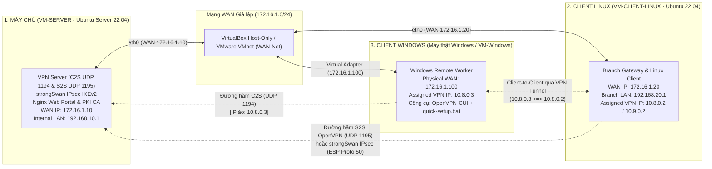

# HƯỚNG DẪN THIẾT LẬP PHÒNG LAB 3 MÁY ẢO & TRIỂN KHAI TOÀN DIỆN (3-VM LAB SETUP GUIDE)

> **Đề tài 14:** Thiết lập mạng riêng ảo (VPN) Site-to-Site và Client-to-Site: Sử dụng OpenVPN hoặc IPsec để bảo mật kết nối cho nhân viên làm việc từ xa.  
> **Tài liệu:** `docs/presentation/lab-setup-guide.md`  
> **Kiến trúc:** Mô hình tối ưu hóa **3 Máy (1 Máy chủ, 2 Máy Client: 1 Linux, 1 Windows)**  
> **Mục tiêu:** Hướng dẫn chi tiết từng bước chuẩn bị 2 máy ảo Ubuntu (Server + Client Linux), cấu hình máy Windows thật làm Client Windows, cấu hình mạng ảo trên VirtualBox/VMware, đặt IP tĩnh Netplan, triển khai 1-click bằng `deploy-all.sh` và thiết lập kết nối trước buổi thuyết minh demo.

---

## 📑 MỤC LỤC
1. [Ưu Điểm Kiến Trúc 3 Máy Ảo & Yêu Cầu Phần Cứng](#1-ưu-điểm-kiến-trúc-3-máy-ảo--yêu-cầu-phần-cứng)
2. [Sơ Đồ Kiến Trúc Mạng & Bảng Quy Hoạch IP 3 Máy](#2-sơ-đồ-kiến-trúc-mạng--bảng-quy-hoạch-ip-3-máy)
3. [Cấu Hình Card Mạng Trên Hypervisor (VirtualBox & VMware)](#3-cấu-hình-card-mạng-trên-hypervisor-virtualbox--vmware)
4. [Tạo & Nhân Bản 2 Máy Ảo Ubuntu Server](#4-tạo--nhân-bản-2-máy-ảo-ubuntu-server)
5. [Đưa Mã Nguồn Dự Án Lên Các Máy Ảo](#5-đưa-mã-nguồn-dự-án-lên-các-máy-ảo)
6. [Cấu Hình Địa Chỉ IP Tĩnh Bằng Netplan](#6-cấu-hình-địa-chỉ-ip-tĩnh-bằng-netplan)
7. [Triển Khai Dịch Vụ Tự Động Bằng `deploy-all.sh`](#7-triển-khai-dịch-vụ-tự-động-bằng-deploy-allsh)
8. [Thiết Lập Máy Khách Windows (Remote Worker)](#8-thiết-lập-máy-khách-windows-remote-worker)
9. [Pre-Flight Checklist: Tổng Duyệt Trước Giờ Thuyết Trình](#9-pre-flight-checklist-tổng-duyệt-trước-giờ-thuyết-trình)

---

## 1. Ưu Điểm Kiến Trúc 3 Máy Ảo & Yêu Cầu Phần Cứng

### 1.1. Tại sao lựa chọn mô hình 3 Máy?
Thay vì phải vận hành 4 đến 5 máy ảo gây quá tải CPU/RAM trên các dòng laptop sinh viên, mô hình **3 Máy** được tinh giản thông minh:
* **Gộp vai trò Trụ sở chính:** `VM-SERVER` đảm nhận cả vai trò **VPN Gateway** (OpenVPN C2S/S2S + IPsec) và **HQ Internal Server** (Nginx Web Portal + Benchmark files + PKI CA).
* **Gộp vai trò Chi nhánh:** `VM-CLIENT-LINUX` vừa là **Cổng Chi nhánh** (Site-to-Site endpoint) vừa là **Client Linux** làm việc từ xa.
* **Tận dụng Máy thật Windows:** Sử dụng ngay máy tính vật lý của bạn (hoặc 1 VM Windows nhỏ) làm **Windows Remote Worker** $\rightarrow$ Tiết kiệm thêm 2 - 4 GB RAM.

### 1.2. Yêu cầu phần cứng
* **RAM:** Tối thiểu 6 - 8 GB RAM (2 máy ảo Ubuntu chỉ chiếm tổng cộng ~2 GB RAM, máy chạy êm và mượt mà).
* **CPU:** 2 - 4 Core (Intel Core i3/i5/i7 hoặc AMD Ryzen).
* **Ổ cứng SSD trống:** Tối thiểu 15 - 20 GB.
* **Phần mềm:**
  * Oracle VM VirtualBox 7.0+ (hoặc VMware Workstation 16/17).
  * OpenVPN GUI for Windows (bản 2.6+ có Wintun driver).
  * File ISO: `ubuntu-22.04.x-live-server-amd64.iso`.

---

## 2. Sơ Đồ Kiến Trúc Mạng & Bảng Quy Hoạch IP 3 Máy



### Bảng phân bổ Card mạng & Địa chỉ IP

| Máy / Thiết bị | Tên Interface | Cấu hình Hypervisor | Địa chỉ IP / Subnet | Vai trò chi tiết trong Lab |
| :--- | :--- | :--- | :--- | :--- |
| **VM-SERVER** (Ubuntu) | `eth0`<br>`eth1` | `WAN-Net` (Host-Only)<br>`HQ-LAN-Net` (Internal) | `172.16.1.10/24`<br>`192.168.10.1/24` | Máy chủ hợp nhất: Cổng VPN (C2S/S2S), PKI CA, Web Portal Nginx, File Benchmark 1MB |
| **VM-CLIENT-LINUX** (Ubuntu) | `eth0`<br>`eth1` | `WAN-Net` (Host-Only)<br>`Branch-LAN-Net` (Internal) | `172.16.1.20/24`<br>`192.168.20.1/24` | Máy khách Linux kiêm Cổng Chi nhánh: Nhận VPN IP `10.8.0.2` (C2S) hoặc `10.9.0.2` (S2S) |
| **CLIENT WINDOWS** (Máy thật) | Virtual Adapter | Nối vào `WAN-Net` | `172.16.1.100/24` | Máy khách Windows của nhân viên từ xa: Nhận VPN IP `10.8.0.3`, điều khiển bằng `quick-setup.bat` |

---

## 3. Cấu Hình Card Mạng Trên Hypervisor (VirtualBox & VMware)

### 3.1. Thiết lập trên Oracle VM VirtualBox

#### Bước 3.1.1: Tạo mạng Host-Only Adapter cho WAN-Net
1. Mở VirtualBox $\rightarrow$ Nhấn phím tắt `Ctrl + H` (hoặc vào `File` $\rightarrow$ `Tools` $\rightarrow$ `Network Manager`).
2. Tại tab **Host-only Networks**, nhấp nút **Create** để tạo 1 Adapter mới:
   * IPv4 Address: `172.16.1.100`
   * IPv4 Network Mask: `255.255.255.0`
3. Tại tab **DHCP Server**: **Bỏ tích** ô `Enable Server` (sử dụng IP tĩnh). Bấm **Apply**.

#### Bước 3.1.2: Gán Card mạng cho 2 máy ảo Ubuntu
* **`VM-SERVER`:**
  * **Adapter 1:** Tích Enable $\rightarrow$ Attached to: `Host-only Adapter` $\rightarrow$ Name: Chọn adapter vừa tạo (`172.16.1.100`).
  * **Adapter 2:** Tích Enable $\rightarrow$ Attached to: `Internal Network` $\rightarrow$ Name: Nhập `HQ-LAN-Net`.
* **`VM-CLIENT-LINUX`:**
  * **Adapter 1:** Tích Enable $\rightarrow$ Attached to: `Host-only Adapter` $\rightarrow$ Name: Chọn adapter vừa tạo (`172.16.1.100`).
  * **Adapter 2:** Tích Enable $\rightarrow$ Attached to: `Internal Network` $\rightarrow$ Name: Nhập `Branch-LAN-Net`.

---

### 3.2. Thiết lập trên VMware Workstation

#### Bước 3.2.1: Tạo card mạng VMnet2 cho WAN-Net
1. Vào `Edit` $\rightarrow$ `Virtual Network Editor...` $\rightarrow$ Nhấp **Change Settings**.
2. Nhấp **Add Network...** $\rightarrow$ Thêm `VMnet2`:
   * Chọn `Host-only (connect VMs internally in a private network)`.
   * Tích chọn `Connect a host virtual adapter (VMnet) to this network`.
   * **Bỏ tích** `Use local DHCP service`.
   * Subnet IP: `172.16.1.0` - Subnet mask: `255.255.255.0`. Bấm **OK**.
3. Trên Windows thật: Nhấn `Windows + R`, gõ `ncpa.cpl` $\rightarrow$ Chuột phải vào `VMware Network Adapter VMnet2` $\rightarrow$ `Properties` $\rightarrow$ `IPv4` $\rightarrow$ Đặt IP: `172.16.1.100`, Subnet: `255.255.255.0`.

#### Bước 3.2.2: Gán Card mạng trên từng máy ảo
* **`VM-SERVER`:** Adapter 1 chọn `Custom (VMnet2)`, Adapter 2 chọn `LAN Segment (HQ-LAN-Net)`.
* **`VM-CLIENT-LINUX`:** Adapter 1 chọn `Custom (VMnet2)`, Adapter 2 chọn `LAN Segment (Branch-LAN-Net)`.

---

## 4. Tạo & Nhân Bản 2 Máy Ảo Ubuntu Server

Bạn chỉ cần tạo đúng **2 máy ảo Ubuntu Server 22.04 LTS**:

1. **Cài đặt máy 1 (`VM-SERVER`):**
   * RAM: `1024 MB` (1 GB), CPU: `1 vCPU`, Ổ cứng: `10 GB`.
   * Đặt username: `student`, password: `vpnpassword123`.
   * Cài đặt OpenSSH Server khi được hỏi.
2. **Nhân bản tạo máy 2 (`VM-CLIENT-LINUX`):**
   * Tắt máy `VM-SERVER`, chuột phải chọn **Clone** $\rightarrow$ Đặt tên `VM-CLIENT-LINUX` $\rightarrow$ Chọn **Linked Clone** (hoặc Full Clone) $\rightarrow$ Chọn *Generate new MAC addresses*.
3. **Đổi hostname trực quan:**
   * Trên Server: `sudo hostnamectl set-hostname vm-server`
   * Trên Client Linux: `sudo hostnamectl set-hostname vm-client-linux`

---

## 5. Đưa Mã Nguồn Dự Án Lên Các Máy Ảo

Mã nguồn dự án trên máy Windows của bạn nằm tại:  
`c:\University Coding Project\VPN-Site-to-Site-and-Client-to-Site-Implementation`

Bạn chỉ cần đưa mã nguồn lên `VM-SERVER` (và sau đó phân phối sang `VM-CLIENT-LINUX`):

* **Cách 1: Sao chép qua SCP từ Windows PowerShell (Nhanh nhất):**
  ```powershell
  scp -r "c:\University Coding Project\VPN-Site-to-Site-and-Client-to-Site-Implementation" student@172.16.1.10:/home/student/vpn-lab
  ```
* **Cách 2: Dùng Git clone trực tiếp (nếu có Internet):**
  ```bash
  git clone https://github.com/Sleepy2608/VPN-Site-to-Site-and-Client-to-Site-Implementation.git ~/vpn-lab
  ```

---

## 6. Cấu Hình Địa Chỉ IP Tĩnh Bằng Netplan

> [!TIP]
> Kiểm tra tên card mạng thực tế trước khi áp dụng: `ip -br link` (nếu tên card là `enp0s3`/`enp0s8` hoặc `ens33`/`ens38`, hãy thay thế `eth0`/`eth1` tương ứng).

### 6.1. Trên `VM-SERVER`:
```bash
sudo cp ~/vpn-lab/configs/netplan/01-netcfg-server.yaml /etc/netplan/01-netcfg.yaml
sudo chmod 600 /etc/netplan/01-netcfg.yaml
sudo netplan apply
```
*(Kiểm tra lại: `ip addr show` $\rightarrow$ card 1 có IP `172.16.1.10`, card 2 có IP `192.168.10.1`)*

### 6.2. Trên `VM-CLIENT-LINUX`:
```bash
sudo cp ~/vpn-lab/configs/netplan/01-netcfg-client-linux.yaml /etc/netplan/01-netcfg.yaml
sudo chmod 600 /etc/netplan/01-netcfg.yaml
sudo netplan apply
```
*(Kiểm tra lại: card 1 có IP `172.16.1.20`, card 2 có IP `192.168.20.1`)*

### 6.3. Kiểm tra ping thông mạng tầng vật lý WAN:
* Từ máy Windows thật (mở CMD):
  ```cmd
  ping 172.16.1.10
  ping 172.16.1.20
  ```
  *(Cả 2 lệnh ping phải trả lời `Reply from...` thành công!)*

---

## 7. Triển Khai Dịch Vụ Tự Động Bằng `deploy-all.sh`

Mô hình 3 máy đã được tự động hóa tối đa: Bạn chỉ cần chạy đúng **2 lệnh**:

### Bước 7.1: Triển khai trọn gói trên Máy chủ (`VM-SERVER`)
Đăng nhập vào `VM-SERVER` và chạy:
```bash
cd ~/vpn-lab
sudo bash scripts/deploy-all.sh server
```
*Script sẽ tự động hoàn tất 8 công đoạn:*
1. Kích hoạt IP Forwarding nhân Linux.
2. Thiết lập quy tắc tường lửa `iptables` (mở UDP 1194, 1195, IKE 500, ESP 4500, HTTP 80).
3. Khởi tạo PKI CA nội bộ với Easy-RSA 3, sinh chứng chỉ Server, chứng chỉ Linux Client, và chứng chỉ Windows Client.
4. Đóng gói sẵn 3 file profile inline: `client-windows.ovpn`, `client-linux.ovpn`, và `client1.ovpn`.
5. Khởi chạy OpenVPN Client-to-Site Server (UDP 1194, dải `10.8.0.0/24`, bật Client-to-Client và gán IP tĩnh qua CCD).
6. Khởi chạy OpenVPN Site-to-Site Server (UDP 1195, subnet `192.168.20.0/24`).
7. Cấu hình sẵn sàng strongSwan IPsec IKEv2.
8. Khởi chạy Nginx Web Portal bảo mật nội bộ và sinh file benchmark 1 MB.

---

### Bước 7.2: Phân phối chứng chỉ sang Client Linux
Ngay trên `VM-SERVER`, chạy lệnh đẩy chứng chỉ sang `VM-CLIENT-LINUX`:
```bash
sudo bash scripts/pki/distribute-certs.sh branch-gw 172.16.1.20
```
*(Hoặc copy file `~/openvpn-ca/client-linux.ovpn` sang máy Client Linux).*

---

### Bước 7.3: Triển khai trên Client Linux (`VM-CLIENT-LINUX`)
Đăng nhập vào `VM-CLIENT-LINUX` và chạy:
```bash
cd ~/vpn-lab
sudo bash scripts/deploy-all.sh client-linux
```
*Script sẽ khởi chạy OpenVPN Site-to-Site kết nối trực tiếp về Server.*

---

## 8. Thiết Lập Máy Khách Windows (Remote Worker)

1. **Lấy file cấu hình về Windows:**
   Trên PowerShell máy Windows, gõ lệnh lấy file `client-windows.ovpn`:
   ```powershell
   scp student@172.16.1.10:/home/student/openvpn-ca/client-windows.ovpn "$env:USERPROFILE\OpenVPN\config\"
   ```
2. **Kết nối OpenVPN GUI:**
   * Mở ứng dụng **OpenVPN GUI** $\rightarrow$ Chuột phải vào biểu tượng OpenVPN dưới khay hệ thống $\rightarrow$ Bấm **Connect**.
   * Biểu tượng chuyển sang **màu xanh lá cây** $\rightarrow$ Nhận IP an toàn `10.8.0.3`.
3. **Mở công cụ điều khiển [quick-setup.bat](file:///c:/University%20Coding%20Project/VPN-Site-to-Site-and-Client-to-Site-Implementation/quick-setup.bat):**
   * Nhấn phím `[1]`: Ping kiểm tra cả 5 điểm chốt (Server WAN, Client Linux WAN, Tunnel Server `10.8.0.1`, Tunnel Linux `10.8.0.2`, Server LAN `192.168.10.1`).
   * Nhấn phím `[2]`: Tự động mở Web Portal nội bộ `http://10.8.0.1`.
   * Nhấn phím `[3]`: In bảng route chứng minh Split-Tunneling.
   * Nhấn phím `[4]`: Tracert chứng minh gói tin chạy qua VPN Tunnel.
   * Nhấn phím `[9]`: Đo tốc độ tải tệp 1 MB qua đường hầm mã hóa AES-256-GCM.

---

## 9. Pre-Flight Checklist: Tổng Duyệt Trước Giờ Thuyết Trình

Bảng 8 tiêu chí kiểm tra nhanh trước khi bước lên bục bảo vệ:

| STT | Hạng mục kiểm tra | Vị trí kiểm tra | Lệnh thực hiện | Kết quả đạt chuẩn (PASS) |
| :---: | :--- | :--- | :--- | :--- |
| 1 | Dịch vụ OpenVPN C2S | `VM-SERVER` | `systemctl is-active openvpn-server@server-c2s` | `active` |
| 2 | Dịch vụ OpenVPN S2S | `VM-SERVER` | `systemctl is-active openvpn-server@server-s2s` | `active` |
| 3 | Dịch vụ Web Portal Nginx | `VM-SERVER` | `systemctl is-active nginx` | `active` |
| 4 | Kết nối S2S Client Linux | `VM-CLIENT-LINUX` | `systemctl is-active openvpn-client@client-s2s` | `active` |
| 5 | Kết nối OpenVPN Windows | Máy Windows | Biểu tượng OpenVPN GUI | Màu xanh lá (`10.8.0.3`) |
| 6 | Ping Client-to-Client | `VM-CLIENT-LINUX` | `ping -c 2 10.8.0.3` | `0% loss, RTT < 2ms` |
| 7 | Truy cập Web Portal | Máy Windows | Mở `http://10.8.0.1` | Nhận diện: `10.8.0.3` |
| 8 | Sẵn sàng chuyển IPsec | `VM-SERVER` & `Linux` | `sudo bash scripts/switch-vpn-mode.sh --help` | Sẵn sàng cho Màn 4 |

> 🎬 Mọi thứ đã sẵn sàng! Mời bạn mở tài liệu [docs/presentation/demo-script.md](file:///c:/University%20Coding%20Project/VPN-Site-to-Site-and-Client-to-Site-Implementation/docs/presentation/demo-script.md) để bắt đầu phần thuyết minh và demo thực tế!
