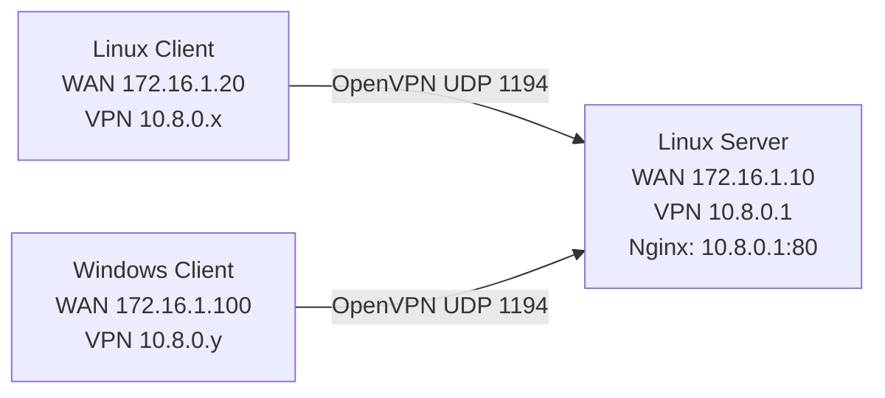

# Demo OpenVPN với 3 máy: Linux Server, Linux Client và Windows Client


> **Phạm vi: chỉ Client-to-Site, chưa đủ Chủ đề 14.** Hai client kết nối tới một server không phải hai site. Để nghiệm thu đủ cả hai loại VPN, dùng [mô hình 5 máy](detailed-lab-runbook.md) và [ma trận đối chiếu](../topic14-audit.md).

Đây là **bài thực hành C2S 3 máy**: một Linux làm OpenVPN server kiêm web server, một Linux và một Windows làm hai VPN client. Đây là **Client-to-Site (remote access)**; cả hai client kết nối tới cùng server. Không trình bày kết quả này như Site-to-Site giữa hai mạng LAN.

Hướng dẫn dùng Linux Ubuntu Server 22.04 LTS theo thông tin máy bạn cung cấp; Armbian nền Ubuntu/Debian có apt, systemd và OpenVPN 2.5+ cũng có thể áp dụng sau khi kiểm tra NIC/renderer. Linux Client không bắt buộc có GUI, dùng curl để demo. Windows dùng OpenVPN Community kèm OpenVPN GUI.

Thông tin đăng nhập dùng theo tài khoản đã cấu hình trên VM. Tài liệu này không lưu mật khẩu/PSK trong repo. Mật khẩu đăng nhập Linux dùng khi SSH/sudo, không phải cơ chế xác thực VPN của bài này. Mỗi VPN client có chứng chỉ và khóa riêng.

## 1. Mỗi máy cài gì và chạy gì?

| Máy | IP trên WAN-Net | IP VPN | Cài đặt | Chạy khi demo |
| --- | --- | --- | --- | --- |
| **VM-SERVER** | `172.16.1.10/24` | `10.8.0.1` | OpenVPN, Easy-RSA, Nginx, tcpdump, curl, SSH | `openvpn-server@demo`, `nginx` |
| **VM-CLIENT-LINUX** | `172.16.1.20/24` | Động: `10.8.0.x` | OpenVPN, curl, SSH client | `openvpn-client@demo-linux` |
| **CLIENT-WINDOWS** | `172.16.1.100/24` | Động: `10.8.0.y` | OpenVPN Community/GUI, browser | Profile `client-windows` trong OpenVPN GUI |

Hai IP client VPN phải khác nhau; không giả định máy nào luôn nhận `.2`. Dùng hai CN/chứng chỉ **`client-linux`** và **`client-windows`**, không dùng chung một profile.



Web demo: **`http://10.8.0.1`**. Nginx chỉ bind vào địa chỉ tunnel và loopback, không nghe trên WAN. Lưu lượng kết thúc ngay trên server nên bài này không cần router Linux riêng, NAT MASQUERADE, IP forwarding hoặc mạng `10.74.10.0/24`/`10.74.20.0/24`.

## 2. Chuẩn bị VMware và IP

### 2.1. Mạng ảo

1. Tạo **một LAN Segment `WAN-Net`** trong VMware Workstation.
2. Gắn một NIC lab của cả ba VM vào đúng LAN Segment này.
3. Thêm **NIC NAT tạm riêng** trên các VM để tải gói/bộ cài. Giữ NAT tới khi chuẩn bị xong, rồi bỏ chọn **Connected** trước demo. Không dùng NIC NAT làm WAN-Net và không xóa NIC sau khi cấu hình.
4. Với VM dùng lại từ mô hình cũ, ngắt các NIC HQ-LAN/Branch-LAN cũ; giữ NIC WAN-Net và NAT tạm. Tắt VPN client khác trước khi thử bài này.

Trong máy Linux, kiểm tra:

```bash
ip -br link
ip -br address
ip route
```

Đối chiếu MAC với VMware để xác định NIC lab/NAT. Ví dụ dưới **giả định `ens33` là WAN-Net, `ens37` là NAT tạm**. Thay tên thật nếu khác.

### 2.2. IP hai máy Linux

Thao tác qua console VMware. Kiểm tra cấu hình có sẵn:

```bash
sudo ls -l /etc/netplan
sudo cat /etc/netplan/*.yaml
systemctl is-active systemd-networkd NetworkManager
```

Ubuntu Server/Armbian Minimal thường dùng `networkd`; Ubuntu Desktop/Armbian Desktop có thể dùng `NetworkManager`. Kiểm tra renderer trong YAML và trạng thái NIC. Với desktop dùng NetworkManager, thay `renderer: networkd` trong mẫu thành `renderer: NetworkManager`.

Trên **VM lab riêng**, sao lưu/chuyển YAML cũ ra ngoài thư mục nạp để tránh DHCP hoặc IP cũ chồng cấu hình mới. Mẫu mới bên dưới giữ cả NIC NAT:

```bash
LAB_BACKUP_DIR="/root/vpn-3vm-netplan-$(date +%Y%m%d-%H%M%S)"
sudo install -d -m 700 "$LAB_BACKUP_DIR"
for lab_file in /etc/netplan/*.yaml /etc/netplan/*.yml; do
    [ -f "$lab_file" ] || continue
    sudo mv -- "$lab_file" "$LAB_BACKUP_DIR/"
done
sudo nano /etc/netplan/20-vpn-demo.yaml
```

Nội dung trên **VM-SERVER**:

```yaml
network:
  version: 2
  renderer: networkd
  ethernets:
    ens33:
      dhcp4: false
      dhcp6: false
      addresses: [172.16.1.10/24]
    ens37:
      dhcp4: true
      dhcp6: false
```

Nội dung trên **VM-CLIENT-LINUX**:

```yaml
network:
  version: 2
  renderer: networkd
  ethernets:
    ens33:
      dhcp4: false
      dhcp6: false
      addresses: [172.16.1.20/24]
    ens37:
      dhcp4: true
      dhcp6: false
```

Trên từng máy áp dụng và xác nhận bằng console:

```bash
sudo chmod 600 /etc/netplan/20-vpn-demo.yaml
sudo netplan generate
sudo netplan try
# Nếu đúng, nhấn Enter để xác nhận trong thời hạn.
ip -br address
ip route
```

Nếu còn profile NetworkManager cũ tự bật DHCP trên NIC lab, dùng `nmcli connection show` và `nmcli device status` để xác định đúng profile, rồi tắt autoconnect profile cũ; không tắt nhầm kết nối NAT. Nếu dùng cloud-init, kiểm tra cảnh báo trong YAML gốc về việc sinh lại cấu hình sau reboot và tắt riêng chức năng cấu hình mạng của cloud-init trước khi nghiệm thu nếu cần.

### 2.3. IP Windows

Mở `ncpa.cpl`, đối chiếu MAC và chọn NIC nối WAN-Net. Đặt IPv4:

- IP: `172.16.1.100`
- Subnet mask: `255.255.255.0`
- Default gateway và DNS trên **NIC lab**: để trống.

NIC NAT tạm tiếp tục DHCP đến lúc tải phần mềm xong. Trong PowerShell:

```powershell
ping -n 3 172.16.1.10
```

Trên Linux Client:

```bash
ping -c 3 172.16.1.10
```

Hai client phải liên lạc được WAN của server trước khi cấu hình VPN. Server không cần ping được Windows để C2S hoạt động; Windows có thể chặn ICMP inbound.

## 3. VM-SERVER: cài OpenVPN và sinh chứng chỉ

### 3.1. Cài gói

Trên **VM-SERVER**, khi NAT còn bật:

```bash
sudo apt update
sudo apt install -y openvpn easy-rsa nginx curl tcpdump openssh-server
sudo systemctl enable --now ssh
sudo modprobe tun
test -c /dev/net/tun && echo 'TUN OK'
date -Is
timedatectl status
openvpn --version
```

Trên **Linux Client**, cũng kiểm tra giờ. Hai máy cần có ngày/giờ đúng để chứng chỉ hợp lệ; dùng cơ chế đồng bộ thời gian của image trong lúc có Internet.

**Nếu dùng lại VM lab cũ:** trước khi chạy cấu hình mới, xem `sudo ss -lunp 'sport = :1194'`, `systemctl list-units --all 'openvpn*'` và `ip -br address`. Dừng/tắt autostart đúng các unit cũ có trên máy, ví dụ:

```bash
# Chỉ chạy với unit cũ thực sự tồn tại trên VM này:
sudo systemctl disable --now openvpn-server@server-c2s
sudo systemctl disable --now openvpn-server@server-s2s
```

Không để cấu hình cũ chiếm UDP 1194, `tun0` hoặc subnet `10.8.0.0/24`. Nếu strongSwan của lab cũ vẫn chạy, dừng/tắt đúng unit đó; bài này không cài hoặc dùng IPsec. Không chạy `scripts/deploy-all.sh hq-gw`/`branch-gw` của mô hình 5 máy cho bài 3 máy này.

### 3.2. Tạo PKI riêng cho bài 3 máy

Trên **VM-SERVER**, mở root shell:

```bash
sudo -i
```

**Các lệnh từ đây đến hết mục 4 chạy trong root shell trên server.** Thư mục `/etc/openvpn/easy-rsa-demo` cần là thư mục mới. Nếu đã có từ lần chạy trước, kiểm tra và tái sử dụng có chủ đích; không chạy `init-pki` lên PKI đang dùng hoặc tạo lại CA trong lúc demo.

```bash
make-cadir /etc/openvpn/easy-rsa-demo
cd /etc/openvpn/easy-rsa-demo
./easyrsa init-pki
./easyrsa --batch --req-cn=VPN-DEMO-CA build-ca nopass
./easyrsa --batch build-server-full vpn-server nopass
./easyrsa --batch build-client-full client-linux nopass
./easyrsa --batch build-client-full client-windows nopass
./easyrsa gen-crl
openvpn --genkey secret ta.key
```

`nopass` giúp demo không bị dừng để nhập mật khẩu khóa mỗi lần khởi động; các khóa riêng phải giữ quyền đọc hạn chế. Không chép khóa riêng CA ra client.

Chép vật liệu server vào thư mục dịch vụ:

```bash
install -d -m 755 /etc/openvpn/server /var/log/openvpn
install -m 644 pki/ca.crt pki/issued/vpn-server.crt pki/crl.pem /etc/openvpn/server/
install -m 600 pki/private/vpn-server.key ta.key /etc/openvpn/server/
```

### 3.3. Cấu hình server

Vẫn trong root shell server:

```bash
cat > /etc/openvpn/server/demo.conf <<'EOF'
local 172.16.1.10
port 1194
proto udp
dev tun0
topology subnet
server 10.8.0.0 255.255.255.0
ca /etc/openvpn/server/ca.crt
cert /etc/openvpn/server/vpn-server.crt
key /etc/openvpn/server/vpn-server.key
dh none
tls-crypt /etc/openvpn/server/ta.key
crl-verify /etc/openvpn/server/crl.pem
remote-cert-tls client
tls-version-min 1.2
data-ciphers AES-256-GCM
keepalive 10 120
persist-key
persist-tun
user nobody
group nogroup
status /var/log/openvpn/demo-status.log 5
verb 3
explicit-exit-notify 1
EOF
systemctl enable --now openvpn-server@demo
systemctl is-active openvpn-server@demo
journalctl -u openvpn-server@demo -n 40 --no-pager
ip -4 address show tun0
ss -lunp 'sport = :1194'
```

Kỳ vọng service `active`, `tun0` có `10.8.0.1/24`, server nghe `172.16.1.10:1194/udp`. `dh none` dùng ECDH cho trao đổi khóa TLS; không tạo `dh.pem`. Kênh dữ liệu cấu hình AES-256-GCM. Không thêm `duplicate-cn`, không đẩy default route/DNS và không dùng VPN này để cung cấp Internet.

Nếu **UFW đang active**, mở đúng các đường vào (thay `ens33` nếu tên WAN khác):

```bash
ufw status
# Chạy các rule dưới nếu UFW đang được dùng:
ufw allow in on ens33 to 172.16.1.10 port 1194 proto udp
ufw allow in on tun0 to 10.8.0.1 port 80 proto tcp
```

Không tự bật/tắt toàn bộ firewall hoặc flush rules cũ. Nếu có rules nftables/iptables riêng, cần kiểm tra INPUT cho UDP 1194 và HTTP tới tunnel; giữ đường quản trị SSH cần thiết.

### 3.4. Tạo hai profile tự chứa

Vẫn trong root shell trên **VM-SERVER**:

```bash
cd /etc/openvpn/easy-rsa-demo
install -d -m 700 /root/vpn-demo-profiles
for DEMO_CLIENT in client-linux client-windows; do
    {
        cat <<'EOF'
client
dev tun
proto udp
remote 172.16.1.10 1194
resolv-retry infinite
nobind
persist-key
persist-tun
remote-cert-tls server
verify-x509-name vpn-server name
tls-version-min 1.2
data-ciphers AES-256-GCM
verb 3
EOF
        printf '\n<ca>\n'
        cat pki/ca.crt
        printf '</ca>\n<cert>\n'
        sed -n '/-----BEGIN CERTIFICATE-----/,/-----END CERTIFICATE-----/p' "pki/issued/${DEMO_CLIENT}.crt"
        printf '</cert>\n<key>\n'
        cat "pki/private/${DEMO_CLIENT}.key"
        printf '</key>\n<tls-crypt>\n'
        cat ta.key
        printf '</tls-crypt>\n'
    } > "/root/vpn-demo-profiles/${DEMO_CLIENT}.ovpn"
    chmod 600 "/root/vpn-demo-profiles/${DEMO_CLIENT}.ovpn"
done
```

Để tài khoản `student` lấy file qua SCP/WinSCP, chép đúng hai profile vào home của tài khoản này. Thay tên tài khoản và đường dẫn nếu khác:

```bash
install -m 600 -o student /root/vpn-demo-profiles/client-linux.ovpn /home/student/client-linux.ovpn
install -m 600 -o student /root/vpn-demo-profiles/client-windows.ovpn /home/student/client-windows.ovpn
```

Chuyển `client-linux.ovpn` sang Linux Client, `client-windows.ovpn` sang Windows. Không dùng một profile cho cả hai máy. Profile chứa khóa riêng nên không đưa vào Git, slide hoặc ảnh chụp nội dung file.

## 4. VM-SERVER: tạo web chỉ truy cập qua tunnel

Tiếp tục trong root shell server, sau khi `tun0` đã có `10.8.0.1`:

```bash
install -d -m 755 /var/www/vpn-demo
cat > /var/www/vpn-demo/index.html <<'EOF'
<!doctype html>
<html lang="vi">
<meta charset="utf-8">
<title>OpenVPN Demo - 3 VM</title>
<h1>Truy cap web qua OpenVPN thanh cong</h1>
<p>Linux Server + Linux Client + Windows Client</p>
<p>Dia chi dich: 10.8.0.1</p>
<a href="/identity">Xem IP nguon server quan sat</a>
</html>
EOF
cat > /etc/nginx/sites-available/vpn-demo <<'EOF'
server {
    listen 127.0.0.1:80;
    listen 10.8.0.1:80;
    server_name _;
    root /var/www/vpn-demo;
    index index.html;
    location / {
        try_files $uri $uri/ =404;
    }
    location = /identity {
        default_type text/plain;
        return 200 "Client IP: $remote_addr\nServer VPN IP: $server_addr\n";
    }
}
EOF
```

Trên VM mới, tắt site mặc định rồi bật site demo. Nếu tái sử dụng máy có web cũ, kiểm tra `nginx -T` và vô hiệu hóa đúng site cũ đang nghe wildcard `80`/`[::]:80` trước; không giữ site khác làm web truy cập được qua WAN:

```bash
rm -f /etc/nginx/sites-enabled/default
ln -sfn /etc/nginx/sites-available/vpn-demo /etc/nginx/sites-enabled/vpn-demo
install -d -m 755 /etc/systemd/system/nginx.service.d
cat > /etc/systemd/system/nginx.service.d/vpn-demo.conf <<'EOF'
[Unit]
Requires=openvpn-server@demo.service
After=openvpn-server@demo.service
EOF
systemctl daemon-reload
nginx -t
systemctl enable nginx
systemctl restart nginx
ss -ltnp 'sport = :80'
curl --noproxy '*' --max-time 5 http://10.8.0.1/
exit
```

`exit` trở lại tài khoản thường trên server. Kỳ vọng HTTP 200 và Nginx chỉ nghe `127.0.0.1:80`, `10.8.0.1:80`, không phải `0.0.0.0:80`/`[::]:80`/WAN. Drop-in systemd giúp OpenVPN khởi động trước Nginx khi reboot. Nếu chủ động dừng OpenVPN server, sau khi bật lại cần kiểm tra/khởi động lại Nginx vì dịch vụ web phụ thuộc tunnel.

## 5. VM-CLIENT-LINUX: cài và kết nối

Trên **Linux Client**, khi NAT còn bật:

```bash
sudo apt update
sudo apt install -y openvpn curl openssh-client
date -Is
ping -c 3 172.16.1.10
```

Nếu máy này từng chạy Branch-GW, dừng/tắt đúng VPN client cũ để tránh `tun0`/route trùng. Không chạy script `deploy-all.sh branch-gw` hoặc phân phối bộ chứng chỉ Branch của mô hình cũ.

Từ Linux Client lấy profile, thay `student` nếu tài khoản server khác:

```bash
scp student@172.16.1.10:/home/student/client-linux.ovpn ~/client-linux.ovpn
chmod 600 ~/client-linux.ovpn
sudo install -d -m 755 /etc/openvpn/client
sudo install -m 600 ~/client-linux.ovpn /etc/openvpn/client/demo-linux.conf
sudo systemctl enable --now openvpn-client@demo-linux
sudo journalctl -u openvpn-client@demo-linux -n 40 --no-pager
ip -br address
ip route get 10.8.0.1
ping -c 3 10.8.0.1
curl --noproxy '*' --max-time 5 http://10.8.0.1/
curl --noproxy '*' --max-time 5 http://10.8.0.1/identity
```

Kỳ vọng handshake thành công, có IP tunnel `10.8.0.x`, route tới server qua thiết bị VPN và web trả nội dung. `/identity` phải hiển thị IP tunnel của Linux Client, không phải WAN `172.16.1.20`.

## 6. CLIENT-WINDOWS: cài và kết nối

1. Cài bản x64 **OpenVPN Community** kèm **OpenVPN GUI/driver** từ [nguồn chính thức](https://openvpn.net/community/). Dùng Windows 10/11 x64 tương thích; ưu tiên Windows 11 còn được hỗ trợ. Xem thêm [hướng dẫn Windows](../technical-guides/08-windows-client-requirements.md).
2. Chép `client-windows.ovpn` từ server bằng WinSCP hoặc SCP nếu Windows đã có OpenSSH Client. Chỉ dùng profile Windows, không lấy `client-linux.ovpn`.
3. Mở OpenVPN GUI → **Import file** → chọn profile. System tray → `client-windows` → **Connect**; chờ Connected và log `Initialization Sequence Completed`.
4. Trong PowerShell:

```powershell
ipconfig
route print -4
ping -n 3 10.8.0.1
Test-NetConnection 10.8.0.1 -Port 80
curl.exe --noproxy '*' --connect-timeout 3 --max-time 5 http://10.8.0.1/identity
Start-Process http://10.8.0.1
```

Kỳ vọng IP tunnel khác Linux Client, HTTP thành công, `/identity` báo IP tunnel Windows. Nếu browser có proxy, thêm ngoại lệ cho `10.8.0.1`; lệnh `curl.exe --noproxy '*'` giúp kiểm tra trực tiếp. Không cần cài Bash, Nginx hoặc Easy-RSA trên Windows.

Trên **VM-SERVER**, trong lúc cả hai client cùng kết nối:

```bash
sudo cat /var/log/openvpn/demo-status.log
sudo journalctl -u openvpn-server@demo -n 40 --no-pager
```

Sau tối đa khoảng một chu kỳ cập nhật 5 giây, status phải thấy **hai client** `client-linux`, `client-windows` với hai IP tunnel khác nhau. HTTP thực tế và log handshake bổ sung cho bằng chứng status; service `active` riêng lẻ chưa chứng minh client đã kết nối.

## 7. Kiểm tra cuối trước giờ demo

1. Ngắt **NIC NAT tạm trên cả ba VM**, giữ WAN-Net Connected.
2. Cả hai client vẫn ping được `172.16.1.10` và khi Connect vẫn mở được `http://10.8.0.1`.
3. Thử `http://172.16.1.10` từ client: phải thất bại vì Nginx không nghe trên WAN. Kiểm tra bằng curl có timeout, tránh nhầm trang browser đã cache.
4. Disconnect VPN trên từng client, thử lại `http://10.8.0.1` bằng curl mới: phải thất bại. Nếu vẫn được, kiểm tra tunnel/route cũ còn chạy và proxy; chưa dùng kết quả đó để demo.
5. Reboot server một lần trước buổi demo, xác nhận `openvpn-server@demo` và `nginx` cùng lên, rồi kết nối lại client. Linux Client đã enable nên có thể tự kết nối lại; chủ động dừng client trước cảnh demo ban đầu.
6. Lưu snapshot và chuẩn bị sẵn terminal, GUI, browser. Không tạo CA hoặc tải gói trong lúc trình diễn.

## 8. Kịch bản demo khoảng 6–8 phút

### Cảnh 1 — Giới thiệu và thử khi chưa có VPN (1 phút)

**Nói:** “Một Linux là OpenVPN server kiêm web server. Linux và Windows còn lại là hai nhân viên từ xa. Ba máy cùng có đường WAN nhưng web chỉ phục vụ ở địa chỉ trong tunnel.”

Trên **Linux Client**:

```bash
sudo systemctl stop openvpn-client@demo-linux
ping -c 2 172.16.1.10
curl --noproxy '*' --connect-timeout 2 --max-time 3 http://10.8.0.1/
```

Trên **Windows**, Disconnect trong GUI rồi:

```powershell
ping -n 2 172.16.1.10
curl.exe --noproxy '*' --connect-timeout 2 --max-time 3 http://10.8.0.1/
```

Kỳ vọng WAN ping được, HTTP tunnel lỗi. Không dùng việc ping Windows từ server làm điều kiện demo.

### Cảnh 2 — Linux kết nối VPN (1 phút)

Trên **Linux Client**:

```bash
sudo systemctl start openvpn-client@demo-linux
sudo journalctl -u openvpn-client@demo-linux -n 20 --no-pager
ip -br address
ip route get 10.8.0.1
curl --noproxy '*' --max-time 5 http://10.8.0.1/identity
```

Chờ handshake trước khi curl. **Nói:** “Client Linux được cấp IP tunnel và truy cập web bằng đường VPN. Server quan sát IP nguồn trong mạng 10.8.0.0/24.”

### Cảnh 3 — Windows kết nối đồng thời (1–2 phút)

Trên Windows, Connect profile `client-windows`, chờ log thành công, mở `http://10.8.0.1`, bấm **Xem IP nguồn**. Chạy `ipconfig` nếu cần chỉ địa chỉ VPN.

Trên server:

```bash
sudo cat /var/log/openvpn/demo-status.log
```

Chỉ hai CN khác nhau và hai IP tunnel. **Nói:** “Hai hệ điều hành dùng chứng chỉ riêng và kết nối đồng thời tới cùng OpenVPN server.”

### Cảnh 4 — Quan sát lưu lượng mã hóa (2 phút)

Trên **server**, mở hai terminal. Thay `ens33` bằng NIC WAN thật.

Terminal 1 bắt gói WAN:

```bash
sudo tcpdump -ni ens33 -w /tmp/demo-wan.pcap 'udp port 1194'
```

Terminal 2 bắt gói sau giải mã trong tunnel:

```bash
sudo tcpdump -ni tun0 -w /tmp/demo-tunnel.pcap 'tcp port 80'
```

Đợi cả hai báo `listening`. Trên Linux Client chạy vài lần:

```bash
curl --noproxy '*' --max-time 5 http://10.8.0.1/identity
```

Trên Windows refresh web. Nhấn Ctrl+C ở hai terminal server rồi đọc:

```bash
sudo tcpdump -nn -r /tmp/demo-wan.pcap -c 10
sudo tcpdump -nn -A -r /tmp/demo-tunnel.pcap -c 15
```

WAN thấy UDP 1194 giữa IP `172.16.1.x`; tunnel thấy IP `10.8.0.x`, HTTP GET/phản hồi. File phải có gói thực. Đối chiếu cipher `AES-256-GCM` trong log của client/server để giải thích cơ chế mã hóa; việc không thấy HTTP trong một mẫu WAN không tự chứng minh thuật toán.

**Nói:** “Nội dung HTTP đi trong tunnel được OpenVPN bảo vệ trên WAN. Bắt tại thiết bị tunnel là quan sát sau giải mã nên đọc được HTTP. IP và cổng của gói ngoài tunnel vẫn nhìn thấy.”

### Cảnh 5 — Ngắt một client, client còn lại vẫn hoạt động (1 phút)

Windows Disconnect, rồi dùng curl mới thử web: dự kiến lỗi. Linux Client vẫn chạy `curl http://10.8.0.1/identity` thành công. Server status/log thể hiện phiên client còn lại; chờ hết chu kỳ cập nhật nếu cần.

**Nói:** “Mỗi client có phiên và chứng chỉ riêng. Ngắt Windows không làm mất kết nối Linux. Bài demo chứng minh VPN remote access cho hai loại client.”

## 9. Checklist và lỗi thường gặp

- [ ] Hai client ping được WAN server, NAT tạm đã ngắt khi demo.
- [ ] Server có tunnel `10.8.0.1`, nghe UDP 1194; Nginx chỉ nghe loopback và tunnel.
- [ ] Linux dùng `client-linux`, Windows dùng `client-windows`, status thấy cả hai.
- [ ] Hai client mở được web qua VPN và thấy IP tunnel của chính mình.
- [ ] Khi VPN của một client tắt, HTTP mới từ client đó thất bại; client kia vẫn dùng được.
- [ ] PCAP WAN và tunnel có gói; log cho thấy handshake/cipher.
- [ ] Đã kiểm tra lại sau reboot; chưa chạy thực tế thì chưa đánh dấu đạt.

| Lỗi | Kiểm tra |
| --- | --- |
| Không ping được `172.16.1.10` | LAN Segment, Connected, MAC/tên NIC, IP/mask, IP trùng; xử lý WAN trước VPN |
| Service server không khởi động | `journalctl -u openvpn-server@demo`; `/dev/net/tun`, port 1194/tun0 bị cấu hình cũ chiếm, đường dẫn cert/key |
| `VERIFY ERROR` / chứng chỉ chưa hợp lệ | Giờ trên máy, đúng CA/chứng chỉ, CN server `vpn-server`, CRL còn hạn |
| Hai client đá nhau khi kết nối | Có dùng chung profile/CN không; tạo và cấp đúng hai profile riêng |
| Client báo Connected nhưng web lỗi | `ip route get 10.8.0.1`, tunnel server, Nginx `ss -ltnp`, firewall INPUT, proxy |
| Nginx báo cannot assign requested address | `10.8.0.1` chưa tồn tại; bật OpenVPN trước rồi restart Nginx; kiểm tra drop-in |
| Nginx báo address already in use | Site/web cũ còn bind wildcard port 80; kiểm tra `nginx -T` và `ss -ltnp` |
| Web vẫn truy cập được khi Disconnect | Tunnel cũ/auto-connect khác, proxy, cache; thử curl không proxy và xem route thực |
| Không thấy hai client ngay trong status | Đợi chu kỳ 5 giây, xem log handshake và tạo HTTP thật từ cả hai |

Tham chiếu cấu hình: [OpenVPN 2.6 Manual](https://openvpn.net/community-docs/community-articles/openvpn-2-6-manual/), [Easy-RSA chính thức](https://github.com/OpenVPN/easy-rsa). Phương án 5 máy có cả C2S/S2S nằm tại [runbook 5 máy](detailed-lab-runbook.md); không trộn các IP/lệnh deploy của hai mô hình.
