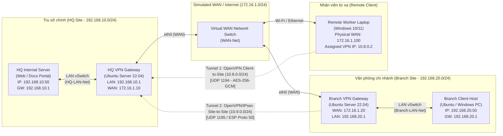

# TÀI LIỆU KỸ THUẬT: THIẾT KẾ KIẾN TRÚC MẠNG & TOPOLOGY LAB

> **Dự án:** Thiết lập mạng riêng ảo VPN Site-to-Site và Client-to-Site  
> **Tài liệu:** `docs/technical-guides/02-network-topology.md`  
> **Giai đoạn:** Giai đoạn 1 - Chuẩn bị máy ảo & Cấu hình mạng tĩnh  

---

## 1. Sơ đồ Tổng thể Kiến trúc Mạng (Master Topology)

Hệ thống Lab bao gồm 3 phân vùng mạng vật lý/ảo biệt lập, giao tiếp với nhau qua 2 thiết bị VPN Gateway:



---

## 2. Bảng Quy Hoạch IP, Subnet và Gateway Chi Tiết

| Node / Máy ảo | Tên Interface | Địa chỉ IP & Subnet | Default Gateway | Chức năng chi tiết |
| :--- | :--- | :--- | :--- | :--- |
| **Mạng WAN Giả lập** | Virtual Switch | `172.16.1.0/24` | Không có | Đại diện cho môi trường Internet công cộng kết nối giữa các chi nhánh |
| **VM-HQ-GW** (HQ Gateway) | `eth0` (WAN)<br>`eth1` (LAN)<br>`tun0` (C2S)<br>`tun1` (S2S) | `172.16.1.10/24`<br>`192.168.10.1/24`<br>`10.8.0.1/24`<br>`10.9.0.1/24` | None<br>None<br>None<br>None | VPN Gateway tại Trụ sở: phục vụ Remote Worker truy cập và kết nối Site-to-Site sang Chi nhánh |
| **VM-HQ-Server** (HQ Internal) | `eth0` (LAN) | `192.168.10.50/24` | `192.168.10.1` | Máy chủ Web Portal và tài liệu nội bộ cần được bảo vệ |
| **VM-Branch-GW** (Branch Gateway) | `eth0` (WAN)<br>`eth1` (LAN)<br>`tun0` (S2S) | `172.16.1.20/24`<br>`192.168.20.1/24`<br>`10.9.0.2/24` | None<br>None<br>None | VPN Gateway tại Chi nhánh: làm đầu cuối VPN kết nối đường hầm Site-to-Site về HQ |
| **VM-Branch-PC** (Branch Client) | `eth0` (LAN) | `192.168.20.50/24` | `192.168.20.1` | Máy trạm làm việc của nhân viên chi nhánh, truy cập tài nguyên HQ qua VPN Gateway |
| **VM-Remote-PC** (Remote Worker) | Card mạng vật lý / ảo<br>`tun0` (Virtual) | `172.16.1.100/24`<br>`10.8.0.2/24` (Cấp động) | Local Default Gateway<br>`10.8.0.1` (Pushed) | Máy tính xách tay của nhân viên từ xa kết nối Client-to-Site về HQ |

---

## 3. Cấu hình Card Mạng Ảo trên Hypervisor (VirtualBox / VMware)

Để đảm bảo các phân vùng mạng hoạt động cô lập và đúng thiết kế:

### 3.1. Thiết lập 3 mạng ảo (Internal Networks)
- **`WAN-Net`:** Mạng nội bộ kết nối các card WAN (`172.16.1.0/24`).
- **`HQ-LAN-Net`:** Mạng nội bộ riêng của Trụ sở chính (`192.168.10.0/24`).
- **`Branch-LAN-Net`:** Mạng nội bộ riêng của Văn phòng Chi nhánh (`192.168.20.0/24`).

### 3.2. Ánh xạ Card mạng trên từng máy ảo

1. **`VM-HQ-GW`:**
   - Adapter 1: `Internal Network` -> Tên: `WAN-Net` (nhận diện trong OS là `eth0`)
   - Adapter 2: `Internal Network` -> Tên: `HQ-LAN-Net` (nhận diện trong OS là `eth1`)
2. **`VM-Branch-GW`:**
   - Adapter 1: `Internal Network` -> Tên: `WAN-Net` (nhận diện trong OS là `eth0`)
   - Adapter 2: `Internal Network` -> Tên: `Branch-LAN-Net` (nhận diện trong OS là `eth1`)
3. **`VM-HQ-Server`:**
   - Adapter 1: `Internal Network` -> Tên: `HQ-LAN-Net` (nhận diện trong OS là `eth0`)
4. **`VM-Branch-PC`:**
   - Adapter 1: `Internal Network` -> Tên: `Branch-LAN-Net` (nhận diện trong OS là `eth0`)
5. **`VM-Remote-PC` (Windows):**
   - Adapter 1: `Internal Network` -> Tên: `WAN-Net` (nhận diện trong OS là Ethernet Adapter, đặt IP `172.16.1.100/24`)

---

## 4. Cài đặt IP Tĩnh Bằng Netplan trên Ubuntu Server

Các tệp cấu hình mẫu đã được lưu trong thư mục `configs/netplan/`:

### 4.1. Cấu hình trên VM-HQ-GW
Sao chép `configs/netplan/01-netcfg-hq-gw.yaml` vào `/etc/netplan/01-netcfg.yaml`:
```bash
sudo cp configs/netplan/01-netcfg-hq-gw.yaml /etc/netplan/01-netcfg.yaml
sudo chmod 600 /etc/netplan/01-netcfg.yaml
sudo netplan apply
```

### 4.2. Cấu hình trên VM-Branch-GW
Sao chép `configs/netplan/01-netcfg-branch-gw.yaml` vào `/etc/netplan/01-netcfg.yaml`:
```bash
sudo cp configs/netplan/01-netcfg-branch-gw.yaml /etc/netplan/01-netcfg.yaml
sudo chmod 600 /etc/netplan/01-netcfg.yaml
sudo netplan apply
```

### 4.3. Cấu hình trên VM-HQ-Server
Sao chép `configs/netplan/01-netcfg-hq-server.yaml` vào `/etc/netplan/01-netcfg.yaml`:
```bash
sudo cp configs/netplan/01-netcfg-hq-server.yaml /etc/netplan/01-netcfg.yaml
sudo chmod 600 /etc/netplan/01-netcfg.yaml
sudo netplan apply
```

### 4.4. Cấu hình trên VM-Branch-PC
Sao chép `configs/netplan/01-netcfg-branch-pc.yaml` vào `/etc/netplan/01-netcfg.yaml`:
```bash
sudo cp configs/netplan/01-netcfg-branch-pc.yaml /etc/netplan/01-netcfg.yaml
sudo chmod 600 /etc/netplan/01-netcfg.yaml
sudo netplan apply
```

---

## 5. Kích hoạt Chuyển tiếp Gói tin Kernel (IP Forwarding)

Trên cả 2 VPN Gateway (`VM-HQ-GW` và `VM-Branch-GW`), chuyển tiếp gói tin là điều kiện tiên quyết để định tuyến giữa các card mạng:

Chạy script tự động hóa:
```bash
sudo bash scripts/common/enable-ip-forward.sh
```

Hoặc thực hiện thủ công:
```bash
echo "net.ipv4.ip_forward = 1" | sudo tee /etc/sysctl.d/99-vpn-forward.conf
sudo sysctl -p /etc/sysctl.d/99-vpn-forward.conf
```

---

## 6. Thiết lập Tường lửa & Chống Phân mảnh Gói tin (MSS Clamping)

Chạy script thiết lập tường lửa trên từng Gateway:
```bash
# Trên VM-HQ-GW:
sudo bash scripts/common/setup-firewall-rules.sh hq-gw

# Trên VM-Branch-GW:
sudo bash scripts/common/setup-firewall-rules.sh branch-gw
```

---

## 7. Kiểm tra & Nghiệm thu Giai đoạn 1

Chạy script kiểm tra tự động trên bất kỳ node nào:
```bash
bash scripts/common/verify-phase1.sh
```

### Bảng tiêu chí đạt yêu cầu (Pass Criteria):
- [x] `VM-HQ-GW` ping thông `172.16.1.20` (Branch GW) và `172.16.1.100` (Remote PC).
- [x] `VM-HQ-GW` ping thông `192.168.10.50` (HQ Server).
- [x] `VM-Branch-GW` ping thông `192.168.20.50` (Branch PC).
- [x] `net.ipv4.ip_forward = 1` trên cả 2 Gateway.
- [x] Dịch vụ `chrony` đang hoạt động và đồng bộ thời gian trên toàn bộ máy ảo.

