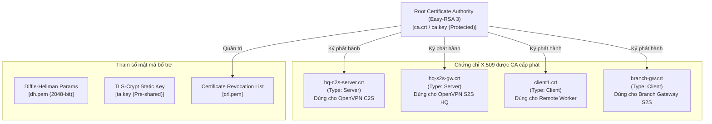

# TÀI LIỆU KỸ THUẬT: THIẾT LẬP HẠ TẦNG KHÓA CÔNG KHAI PKI VỚI EASY-RSA 3

> **Dự án:** Thiết lập mạng riêng ảo VPN Site-to-Site và Client-to-Site  
> **Tài liệu:** `docs/technical-guides/03-pki-ca-setup.md`  
> **Giai đoạn:** Giai đoạn 2 - Xây dựng PKI độc lập với Easy-RSA 3  

---

## 1. Tổng Quan Kiến Trúc PKI trong Hệ Thống VPN

Trong mô hình mạng riêng ảo cấp doanh nghiệp, xác thực dựa trên chứng chỉ số công khai **X.509** là giải pháp vượt trội so với mật khẩu truyền thống (Pre-Shared Key / Username-Password):
- **Tính bất khả giả mạo (Authenticity):** Mỗi node mạng (Server, Gateway, Client) sở hữu một cặp khóa bí mật/công khai riêng biệt được ký xác nhận bởi Root Certificate Authority (Root CA).
- **Tính toàn vẹn (Integrity):** Đảm bảo gói tin trao đổi trong quá trình bắt tay TLS không bị chỉnh sửa trên đường truyền mạng công cộng.
- **Tính bảo mật chuyển tiếp (Perfect Forward Secrecy - PFS):** Nhờ cơ chế trao đổi khóa Diffie-Hellman (`dh.pem`), dù khóa riêng của máy chủ bị lộ trong tương lai thì các phiên giao dịch mã hóa trong quá khứ vẫn an toàn.
- **Khả năng kiểm soát thu hồi (Revocation):** Khi một thiết bị bị mất cắp hoặc nhân viên nghỉ việc, CA có thể thu hồi chứng chỉ tức thì thông qua tệp danh sách thu hồi **CRL** (`crl.pem`) mà không cần đổi cấu hình toàn bộ hệ thống.



---

## 2. Quy Hoạch Thông Số Cấu Hình Easy-RSA (`vars`)

Tệp cấu hình biến môi trường mẫu được lưu tại `openvpn/pki/vars.example`:

| Tham số | Giá trị thiết lập | Mục đích bảo mật |
|---|---|---|
| `EASYRSA_REQ_COUNTRY` | `VN` | Quốc gia của tổ chức phát hành |
| `EASYRSA_REQ_ORG` | `CyberSec-VPN-Lab` | Tên cơ quan / tổ chức quản lý CA |
| `EASYRSA_ALGO` | `rsa` | Thuật toán khóa công khai bất đối xứng |
| `EASYRSA_KEY_SIZE` | `2048` | Kích thước khóa đạt chuẩn bảo mật NIST |
| `EASYRSA_CA_EXPIRE` | `3650` (10 năm) | Thời hạn hiệu lực của Root CA |
| `EASYRSA_CERT_EXPIRE` | `825` (~2.25 năm) | Thời hạn hiệu lực chứng chỉ thực thể theo chuẩn TLS hiện đại |
| `EASYRSA_CRL_DAYS` | `180` (6 tháng) | Chu kỳ làm mới danh sách thu hồi chứng chỉ |
| `EASYRSA_BATCH` | `1` | Chế độ thực thi tự động, không yêu cầu xác nhận tương tác thủ công |

---

## 3. Quy Trình Khởi Tạo & Ký Duyệt Chứng Chỉ Từng Bước

Toàn bộ quy trình dưới đây đã được đóng gói tự động trong script:
```bash
bash scripts/pki/init-ca.sh
```

### Bước 2.1: Khởi tạo CA và biến cấu hình
```bash
make-cadir ~/openvpn-ca && cd ~/openvpn-ca
cp <repository-path>/openvpn/pki/vars.example vars
./easyrsa init-pki
./easyrsa --batch build-ca nopass
```

### Bước 2.2: Sinh khóa Diffie-Hellman, TLS-Crypt và CRL
1. **Tham số Diffie-Hellman (`dh.pem`):**
   ```bash
   ./easyrsa gen-dh
   ```
2. **Khóa đối xứng bảo vệ kênh điều khiển TLS-Crypt (`ta.key`):**
   Cung cấp cơ chế mã hóa và xác thực toàn bộ gói tin bắt tay TLS, giúp che giấu dịch vụ OpenVPN trước các đợt quét cổng (port scan) và chống tấn công từ chối dịch vụ (DoS):
   ```bash
   openvpn --genkey secret ta.key
   ```
3. **Danh sách thu hồi chứng chỉ (`crl.pem`):**
   ```bash
   ./easyrsa gen-crl
   ```

### Bước 2.3: Sinh yêu cầu ký (CSR) và ký chứng chỉ X.509
Phân biệt rõ ràng giữa hai loại chứng chỉ để kích hoạt đúng cờ mở rộng `extendedKeyUsage`:

* **Chứng chỉ máy chủ (Server Certificates):** Cờ `TLS Web Server Authentication`:
  ```bash
  # Ký cho dịch vụ OpenVPN Client-to-Site Server
  ./easyrsa --batch gen-req hq-c2s-server nopass
  ./easyrsa --batch sign-req server hq-c2s-server

  # Ký cho dịch vụ OpenVPN Site-to-Site Server trên HQ Gateway
  ./easyrsa --batch gen-req hq-s2s-gw nopass
  ./easyrsa --batch sign-req server hq-s2s-gw
  ```

* **Chứng chỉ máy khách (Client Certificates):** Cờ `TLS Web Client Authentication`:
  ```bash
  # Ký cho Remote Worker Client Windows (client-windows / client1)
  ./easyrsa --batch gen-req client-windows nopass
  ./easyrsa --batch sign-req client client-windows
  ./easyrsa --batch gen-req client1 nopass
  ./easyrsa --batch sign-req client client1

  # Ký cho Client Linux (client-linux)
  ./easyrsa --batch gen-req client-linux nopass
  ./easyrsa --batch sign-req client client-linux

  # Ký cho Branch Gateway Endpoint (branch-gw)
  ./easyrsa --batch gen-req branch-gw nopass
  ./easyrsa --batch sign-req client branch-gw
  ```

---

## 4. Phân Phối Chứng Chỉ & Bảo Mật Khóa Bí Mật

### 4.1. Nguyên tắc phân quyền tệp tin (File Permissions)
Tuân thủ nghiêm ngặt nguyên tắc đặc quyền tối thiểu (Least Privilege):
```bash
# Thư mục chứa khóa bí mật
chmod 700 ~/openvpn-ca/pki/private

# Các tệp khóa riêng tư bắt buộc chỉ sở hữu bởi root/user hiện tại (600)
chmod 600 ~/openvpn-ca/pki/private/*.key ~/openvpn-ca/ta.key

# Các chứng chỉ công khai và danh sách thu hồi có thể đọc công khai (644)
chmod 644 ~/openvpn-ca/pki/ca.crt ~/openvpn-ca/pki/dh.pem ~/openvpn-ca/pki/crl.pem
chmod 644 ~/openvpn-ca/pki/issued/*.crt
```

### 4.2. Phân phối chứng chỉ sang các máy ảo
Sử dụng script tiện ích:
```bash
# Sao chép vào /etc/openvpn/server/ trên chính HQ Gateway
sudo bash scripts/pki/distribute-certs.sh local-server

# Chuyển an toàn qua SSH/SCP sang Branch Gateway (172.16.1.20)
sudo bash scripts/pki/distribute-certs.sh branch-gw 172.16.1.20
```

### 4.3. Đóng gói profile tự chứa (.ovpn inline) cho Windows Remote Client
Sử dụng script:
```bash
bash scripts/pki/build-client-ovpn.sh client1 ~/client1.ovpn
```
Tệp `client1.ovpn` thu được chứa toàn bộ nội dung của `ca.crt`, `client1.crt`, `client1.key` và `ta.key` bên trong các thẻ XML, cho phép người dùng chỉ cần import duy nhất một file vào OpenVPN GUI.

---

## 5. Quy Trình Thu Hồi Chứng Chỉ Số (Certificate Revocation - CRL)

Khi cần hủy quyền truy cập của một thiết bị (ví dụ: máy tính nhân viên `client1` bị thất lạc):

```bash
cd ~/openvpn-ca

# 1. Thực hiện thu hồi chứng chỉ
./easyrsa --batch revoke client1

# 2. Tạo mới danh sách CRL cập nhật
./easyrsa gen-crl

# 3. Cập nhật file crl.pem vào thư mục dịch vụ OpenVPN Server
sudo cp pki/crl.pem /etc/openvpn/server/crl.pem
sudo chmod 644 /etc/openvpn/server/crl.pem

# 4. Tải lại cấu hình OpenVPN Server
sudo systemctl restart openvpn-server@server-c2s
```

*Kết quả kiểm nghiệm:* Khi máy `client1` cố gắng bắt tay TLS lại với Gateway, kết nối sẽ bị từ chối ngay lập tức với thông điệp:
`TLS_ERROR: CRL check failed: certificate revoked`.

---

## 6. Lệnh Kiểm Tra & Nghiệm Thu Chứng Chỉ Với OpenSSL

Kiểm tra thông tin chi tiết của chứng chỉ số đã phát hành:
```bash
# Xem thông tin Subject, Issuer và hạn sử dụng
openssl x509 -in ~/openvpn-ca/pki/issued/hq-c2s-server.crt -noout -subject -issuer -dates

# Xác minh cấu trúc khóa công khai
openssl x509 -in ~/openvpn-ca/pki/issued/client1.crt -noout -text | grep -A 2 "Key Usage"

# Xác thực chuỗi tin cậy chứng chỉ đối với Root CA
openssl verify -CAfile ~/openvpn-ca/pki/ca.crt ~/openvpn-ca/pki/issued/client1.crt
# Kết quả kỳ vọng: client1.crt: OK
```

