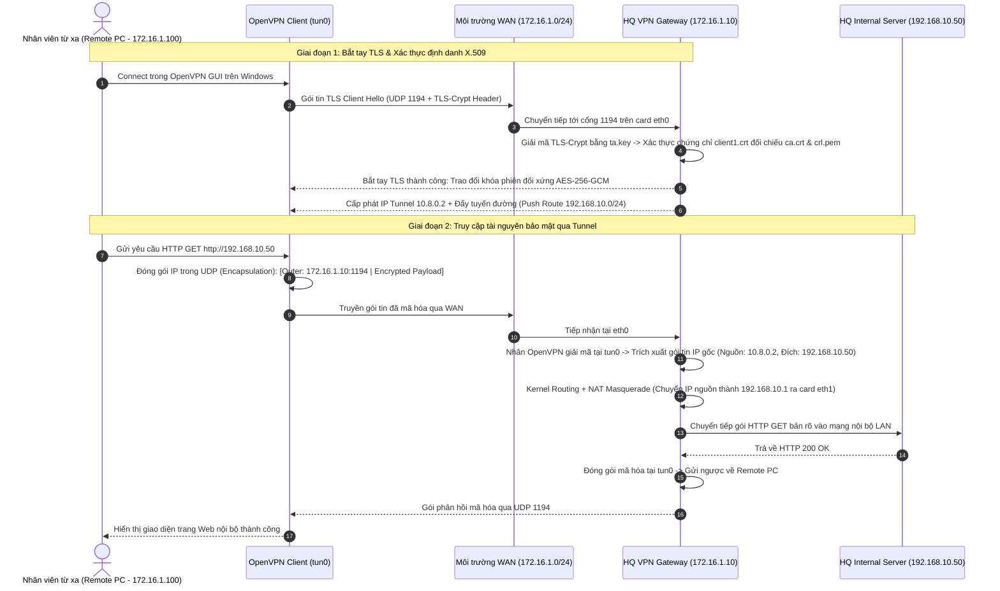

# OPENVPN CLIENT-TO-SITE: ARMBIAN SERVER VÀ WINDOWS CLIENT

> Demo hiện tại chỉ dùng OpenVPN C2S/S2S. Thực hiện [quy trình triển khai trong README](../../README.md) và [kịch bản 6–8 phút](../presentation/demo-script.md); nội dung chi tiết bên dưới là tài liệu tham khảo.

> **Dự án:** Thiết lập mạng riêng ảo VPN Site-to-Site và Client-to-Site  
> **Tài liệu:** `docs/technical-guides/04-client-to-site-guide.md`  
> **Giai đoạn:** Giai đoạn 3 - Triển khai Client-to-Site OpenVPN Server & Client  

---

## 1. Tổng Quan Kiến Trúc & Luồng Dữ Liệu (Sequence Diagram)

Mô hình **Client-to-Site (Remote Access)** cho phép nhân viên làm việc từ xa (Remote Worker) thiết lập một đường hầm bảo mật qua môi trường mạng không tin cậy (Internet/WAN) để truy cập an toàn vào hạ tầng mạng nội bộ của Trụ sở chính (HQ LAN `192.168.10.0/24`).



---

## 2. Phân Tích Chi Tiết Cấu Hình Máy Chủ (`server-c2s.conf`)

Tệp cấu hình máy chủ được lưu tại `openvpn/client-to-site/server/server.conf` và triển khai vào `/etc/openvpn/server/server-c2s.conf` trên `VM-HQ-GW`:

| Chỉ thị cấu hình | Giá trị | Ý nghĩa kỹ thuật & An ninh mạng |
|---|---|---|
| `port` | `1194` | Cổng dịch vụ tiêu chuẩn của OpenVPN do IANA cấp phát |
| `proto` | `udp` | Giao thức UDP tránh hiện tượng TCP-over-TCP Meltdown khi mạng có jitter |
| `dev` | `tun0` | Tạo giao diện mạng ảo Layer 3 (IP Tunneling - định tuyến) |
| `ca`, `cert`, `key` | `/etc/openvpn/server/...` | Chuỗi chứng chỉ số xác thực X.509 giữa Server và Client |
| `dh` | `dh.pem` | Tham số Diffie-Hellman 2048-bit bảo đảm Perfect Forward Secrecy |
| `tls-crypt` | `ta.key` | Khóa đối xứng bảo vệ kênh điều khiển, chống tấn công dò quét cổng và DoS |
| `crl-verify` | `crl.pem` | Kiểm tra danh sách thu hồi chứng chỉ số trong mỗi phiên bắt tay TLS |
| `server` | `10.8.0.0 255.255.255.0` | Cấu hình DHCP ảo: Server nhận `10.8.0.1`, các client nhận từ `10.8.0.2` trở đi |
| `topology` | `subnet` | Mô hình phân bổ mạng con hiện đại, mỗi client nhận 1 địa chỉ IP duy nhất |
| `push "route ..."` | `192.168.10.0 255.255.255.0` | Tự động thêm route vào bảng định tuyến của client trỏ vào mạng HQ LAN |
| `data-ciphers` | `AES-256-GCM` | Thuật toán mã hóa đối xứng xác thực (AEAD), tốc độ cao và được phép thương lượng trong lab |
| `auth` | `SHA256` | Với AES-GCM, tính toàn vẹn data channel do AEAD tag cung cấp |
| `user`, `group` | `nobody`, `nogroup` | Hạ quyền đặc quyền của tiến trình OpenVPN sau khi khởi tạo socket |
| `persist-key`, `persist-tun` | (Bật) | Giữ nguyên trạng thái tunnel và key khi khởi động lại dịch vụ hoặc rớt mạng ngắn |

---

## 3. Cơ Chế Định Tuyến & Thiết Lập Tường Lửa (Firewall & NAT)

C2S dùng NAT từ `10.8.0.0/24` vào HQ LAN, chỉ cho phép luồng client khởi tạo và lưu lượng phản hồi. Áp dụng cùng chính sách như các script deploy:

```bash
sudo bash scripts/common/enable-ip-forward.sh
sudo bash scripts/common/setup-firewall-rules.sh hq-gw openvpn
```

Chain `VPN_LAB_FORWARD` chặn chuyển tiếp ngoài các luồng được phép, kể cả khi FORWARD cũ đang ACCEPT. WAN → LAN/tunnel cũng bị chặn tại INPUT/OUTPUT trên gateway; SSH quản trị vẫn mở tới IP WAN từ subnet WAN lab.

---

## 4. Hướng Dẫn Cài Đặt & Kết Nối Phía Máy Khách (Client Setup)

### 4.1. Đóng gói tệp hồ sơ cấu hình (.ovpn)
Trên `VM-HQ-GW`, chạy script tự động để sinh file profile:
```bash
sudo bash scripts/pki/build-client-ovpn.sh client1 "$HOME/client1.ovpn"
```

### 4.2. Chuẩn bị Windows Remote-PC

Remote-PC dùng Windows 10/11 64-bit, chỉ nối WAN-Net. OpenVPN GUI hiện hỗ trợ Windows 10 trở lên; baseline lab là Windows 10 22H2 x64, khuyến nghị Windows 11 x64 còn được hỗ trợ. Xem [yêu cầu và nguồn chính thức](08-windows-client-requirements.md).

1. Cài OpenVPN Community x64 kèm OpenVPN GUI, service và driver mặc định. OpenVPN 2.7 dùng DCO mặc định, không còn Wintun; không tự cài driver Wintun theo hướng dẫn cũ.
2. Mở `ncpa.cpl` → adapter WAN-Net → IPv4: `172.16.1.100`, mask `255.255.255.0`, để trống gateway/DNS trên card lab.
3. Chuyển `client1.ovpn` từ home của tài khoản triển khai HQ qua Shared Folder/WinSCP/SCP. Không chuyển khóa CA. Import file trong OpenVPN GUI hoặc đặt ở `%USERPROFILE%\OpenVPN\config\`.
4. Tắt NAT phụ trước demo. Windows Remote-PC không chạy Netplan/Bash/deploy-all và không bật IP forwarding.

### 4.3. Kết nối và kiểm tra trên Windows

OpenVPN GUI ở system tray → chọn `client1` → **Connect**. Chờ Connected và `Initialization Sequence Completed` trong View Log, rồi mở PowerShell:

```powershell
ipconfig
route print -4
ping -n 3 10.8.0.1
ping -n 3 192.168.10.50
Test-NetConnection 192.168.10.50 -Port 80
Invoke-WebRequest -UseBasicParsing -Method Head -Uri http://192.168.10.50 -TimeoutSec 5
Start-Process http://192.168.10.50
```

IP client là `10.8.0.x`, không bắt buộc `.2`; tên adapter tùy driver. Route HQ phải qua adapter OpenVPN, không thay default route bằng VPN. Tài nguyên demo dùng IP trực tiếp nên không cần DNS nội bộ.

Ngắt bằng OpenVPN GUI → `client1` → **Disconnect**, kiểm tra `route print -4`. Profile không tự kết nối trước buổi demo. Không chạy đồng thời nhiều client với cùng profile.

---

## 5. Quy Trình Đo Kiểm Nghiệm Thu (Verification)

Chạy script kiểm tra nghiệm thu tự động trên Gateway:
```bash
sudo bash scripts/verify-c2s.sh server
```

Trên Windows Remote-PC dùng các lệnh PowerShell bên trên hoặc `quick-setup.bat`; không chạy script Bash. Đối chiếu [checklist demo](../../tests/openvpn-demo.md): IP tunnel, route HQ, ping/HTTP và status log `client1` trên HQ. C2S dùng NAT nên Portal có thể thấy IP gateway `192.168.10.1`; không dùng IP này để kết luận client là kết nối LAN trực tiếp.

---

## 6. Cẩm Nang Xử Lý Sự Cố Thường Gặp (Troubleshooting)

1. **Lỗi: `TLS Error: cannot locate HMAC checksum`**
   - *Nguyên nhân:* Server bật `tls-crypt ta.key` nhưng phía client thiếu khóa hoặc dùng `tls-auth`.
   - *Khắc phục:* Sử dụng script `build-client-ovpn.sh` để bảo đảm thẻ `<tls-crypt>` được nhúng chính xác.

2. **Lỗi: `Certificate not yet valid` hoặc `Certificate expired`**
   - *Nguyên nhân:* Đồng hồ thực tế giữa Windows Remote-PC và HQ-GW bị lệch, hoặc chứng chỉ đã hết hạn. Khác múi giờ hiển thị không tự gây lỗi nếu thời gian thực tế đúng.
   - *Khắc phục:* Đồng bộ Date & time trên Windows; dùng `sudo chronyc makestep` trên HQ Armbian khi có nguồn thời gian phù hợp.

3. **Lỗi: Kết nối thành công nhưng không ping được mạng LAN HQ**
   - *Nguyên nhân:* Quên chưa bật IP Forwarding hoặc thiếu quy tắc iptables NAT Masquerade.
   - *Khắc phục:* Chạy lại `sudo bash scripts/common/enable-ip-forward.sh` và `sudo bash scripts/common/setup-firewall-rules.sh hq-gw`.

4. **Lỗi: OpenVPN GUI đang chạy nhưng chưa có IP VPN**
   - *Kiểm tra:* View Log, chờ `Initialization Sequence Completed`; kiểm tra WAN `172.16.1.10`, UDP 1194, chứng chỉ và service/driver đi kèm bộ cài.

5. **Lỗi: HQ không ping được Windows nhưng Windows vẫn vào Portal được**
   - *Kiểm tra:* Rule ICMPv4 Echo Request theo đúng adapter/profile Windows Firewall. Không tắt toàn bộ firewall để thử ping.

Tham khảo: [OpenVPN Community — Windows 10 trở lên](https://openvpn.net/community/), [OpenVPN GUI](https://github.com/OpenVPN/openvpn-gui).

