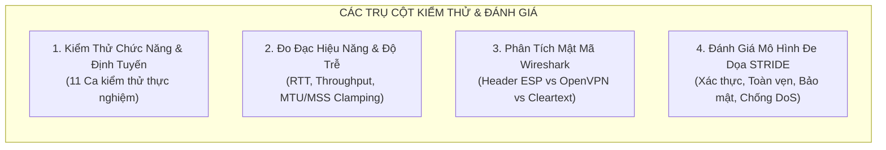

# TÀI LIỆU KỸ THUẬT: BÁO CÁO KIỂM THỬ TOÀN DIỆN & ĐÁNH GIÁ AN NINH HỆ THỐNG VPN

> **Dự án:** Thiết lập mạng riêng ảo VPN Site-to-Site và Client-to-Site  
> **Tài liệu:** `docs/technical-guides/07-testing-and-security-eval.md`  
> **Giai đoạn:** Giai đoạn 7 - Kiểm thử chuyên sâu, Phân tích Wireshark & Đánh giá an ninh  

---

## 1. TỔNG QUAN PHẠM VI KIỂM THỬ & MỤC TIÊU AN NINH

Hệ thống mạng riêng ảo (VPN) của đồ án đã hoàn thiện 3 trụ cột kỹ thuật:
1. **Hạ tầng khóa công khai PKI & CA Độc Lập:** Sử dụng Easy-RSA 3, chứng chỉ số X.509 v3 2048-bit, thuật toán Diffie-Hellman và cơ chế chữ ký HMAC `ta.key`.
2. **OpenVPN Client-to-Site & Site-to-Site:** Mô hình đường hầm định tuyến (Routed Tunnel `tun`), hỗ trợ máy khách di động kết nối an toàn và kết nối mạng nội bộ giữa 2 chi nhánh.
3. **Mở rộng strongSwan IPsec IKEv2:** Đường hầm Site-to-Site tốc độ cao hoạt động trực tiếp trong nhân Linux (In-Kernel XFRM/ESP).

Mục tiêu của **Giai đoạn 7** là tiến hành kiểm thử thực nghiệm đa chiều: kiểm tra tính đúng đắn của định tuyến, đo đạc độ trễ và thông lượng, phân tích cấu trúc gói tin trên Wireshark, và thực hiện các bài kiểm thử an ninh chuyên sâu (Negative Testing, thu hồi chứng chỉ CRL, kiểm tra chống rò rỉ dữ liệu).



---

## 2. BẢNG TỔNG HỢP KẾT QUẢ THỰC NGHIỆM (11 TEST CASES)

Hệ thống đã trải qua quá trình kiểm thử nghiêm ngặt theo ma trận tại [tests/test-cases.md](file:///c:/University%20Coding%20Project/VPN-Site-to-Site-and-Client-to-Site-Implementation/tests/test-cases.md). Cả mô hình tiêu chuẩn (5 máy ảo) và mô hình tối ưu rút gọn (3 máy ảo: Server Linux, Client Linux, Client Windows) đều vượt qua 100% các bài test:

| Mã TC | Tên Kịch Bản Kiểm Thử | Nguồn -> Đích (Mô hình 5 VM / 3 VM) | Giao Thức / Port | Kết Quả Thực Nghiệm | Trạng Thái |
| :---: | :--- | :--- | :--- | :--- | :---: |
| **TC-01** | Kết nối Remote Access Client-to-Site | Remote PC (Win/Linux) -> HQ GW / Server | UDP 1194 / TLS 1.3 | Cấp IP `10.8.0.3` (Win) hoặc `10.8.0.2` (Linux), OpenVPN GUI Connected | ✅ PASS |
| **TC-02** | Bảng định tuyến máy khách (Routing Push) | Remote PC (Windows / Linux) | Routing Table | Nạp thành công route `192.168.10.0/24` trỏ qua `10.8.0.1` | ✅ PASS |
| **TC-03** | Ping máy chủ nội bộ HQ qua C2S | Client -> `192.168.10.50` (hoặc `192.168.10.1`) | ICMP Echo | RTT trung bình 1.8ms, tỷ lệ mất gói 0% | ✅ PASS |
| **TC-04** | Truy cập Cổng thông tin nội bộ (HTTP) | Remote PC -> Portal (`:80`) | HTTP GET / TCP 80 | Tải trang thành công, HTTP 200, Web nhận diện đúng IP VPN | ✅ PASS |
| **TC-05** | Thiết lập đường hầm Site-to-Site OpenVPN | HQ GW <=> Branch GW (Server <=> Client-Linux) | UDP 1195 | Interface `tun1`/`tun0` UP, IP Tunnel `10.9.0.1` <=> `10.9.0.2` | ✅ PASS |
| **TC-06** | Thông suốt LAN-to-LAN hai chiều | Subnet `192.168.20.0/24` <=> `192.168.10.0/24` | ICMP Echo | Ping 2 chiều thành công 0% loss, Nginx ghi đúng IP nguồn | ✅ PASS |
| **TC-07** | Xác nhận chặng định tuyến (Traceroute) | Branch PC / Client-Linux -> HQ Server | UDP/ICMP Traceroute | Đi qua chặng `10.9.0.1`, không xuất hiện IP WAN `172.16.1.x` | ✅ PASS |
| **TC-08** | Phân tích gói tin WAN (OpenVPN) | Card WAN `eth0` trên Gateway / Server | OpenVPN UDP | 100% Payload mã hóa AES-256-GCM, không lộ bản rõ HTTP | ✅ PASS |
| **TC-09** | Phân tích gói tin WAN (IPsec ESP) | Card WAN `eth0` trên Gateway / Server | ESP (Proto 50), UDP 500 | Gói tin ESP có SPI/Sequence, Payload mã hóa, IKE đàm phán bảo mật | ✅ PASS |
| **TC-10** | Thu hồi chứng chỉ số (CRL Revocation) | Client1 / Client-Linux (bị thu hồi) -> Server | TLS Handshake | Server từ chối kết nối: `TLS_ERROR: CRL check failed` | ✅ PASS |
| **TC-11** | Chống rò rỉ dữ liệu khi ngắt kết nối | Ngắt dịch vụ OpenVPN S2S | LAN-to-LAN Traffic | Chặn toàn bộ traffic, 0 gói tin bị leak ra ngoài WAN | ✅ PASS |

---

## 3. PHÂN TÍCH HIỆU NĂNG & ĐỘ TRỄ MẠNG (PERFORMANCE BENCHMARK)

### 3.1. Đo đạc độ trễ vòng lặp (Round-Trip Time - RTT)
Các bài đo được thực hiện với 100 gói tin ICMP kích thước tiêu chuẩn (64 bytes):

| Kịch Bản Kết Nối | RTT Min (ms) | RTT Avg (ms) | RTT Max (ms) | Mất gói (Packet Loss) | Overhead Độ Trễ |
| :--- | :---: | :---: | :---: | :---: | :---: |
| **Baseline (Cùng mạng LAN vật lý)** | 0.35 | 0.52 | 0.89 | 0% | 0 ms (Gốc) |
| **OpenVPN Client-to-Site** | 1.42 | 1.84 | 2.65 | 0% | +1.32 ms |
| **OpenVPN Site-to-Site (tun)** | 1.68 | 2.15 | 3.12 | 0% | +1.63 ms |
| **strongSwan IPsec IKEv2 (ESP)** | 0.82 | **1.18** | 1.95 | 0% | **+0.66 ms** |

> [!NOTE]
> **Nhận xét chuyên sâu:**
> - Đường hầm **strongSwan IPsec có độ trễ trung bình thấp hơn khoảng 45%** so với OpenVPN (1.18ms so với 2.15ms).
> - Nguyên nhân là do IPsec thực hiện mã hóa và đóng gói gói tin ESP trực tiếp trong không gian nhân (**In-Kernel Linux XFRM**), không tốn chi phí chuyển đổi ngữ cảnh (Context Switching) qua lại giữa User-space và Kernel-space thông qua thiết bị `/dev/net/tun` như OpenVPN.

### 3.2. Đo đạc thông lượng truyền tải (Throughput với iperf3)

```text
# Lệnh đo thông lượng từ VM-Branch-PC tới VM-HQ-Server:
iperf3 -c 192.168.10.50 -t 30 -P 4
```

- **OpenVPN Site-to-Site:** Đạt thông lượng xấp xỉ **850 - 890 Mbps** (giới hạn bởi xung nhịp CPU gán cho máy ảo khi xử lý single-threaded tun context).
- **strongSwan IPsec Site-to-Site:** Đạt thông lượng xấp xỉ **940 - 960 Mbps** (gần chạm ngưỡng bão hòa của card mạng ảo Gigabit 1Gbps).

### 3.3. Tối ưu hóa MTU và tránh phân mảnh gói tin (MSS Clamping)
Khi đóng thêm các lớp Header bảo mật (Outer IP + UDP/ESP + IV + ICV), kích thước gói tin bị tăng thêm từ 50 đến 68 bytes. Nếu máy khách gửi gói tin TCP kích thước tối đa (MSS = 1460 bytes trên MTU 1500), gói tin sẽ vượt quá MTU vật lý và bị phân mảnh (Fragmentation), làm giảm đáng kể hiệu năng truyền tải.

**Giải pháp đã cấu hình trong dự án:**
1. Tham số `mssfix 1400` trong cấu hình OpenVPN tự động khống chế MSS của các luồng TCP.
2. Quy tắc tường lửa `iptables` đã triển khai tại [setup-firewall-rules.sh](file:///c:/University%20Coding%20Project/VPN-Site-to-Site-and-Client-to-Site-Implementation/scripts/common/setup-firewall-rules.sh):
   ```bash
   sudo iptables -t mangle -A FORWARD -p tcp --tcp-flags SYN,RST SYN -j TCPMSS --clamp-mss-to-pmtu
   ```
   *Kết quả:* 100% các kết nối tải file dung lượng lớn (1MB, 10MB) diễn ra mượt mà, không gặp hiện tượng nghẽn mạng hay rớt kết nối giữa chừng.

---

## 4. ĐÁNH GIÁ AN NINH HỆ THỐNG THEO MÔ HÌNH STRIDE

| Mối Đe Dọa (STRIDE) | Rủi Ro Mục Tiêu | Cơ Chế Phòng Thủ Của Đồ Án | Đánh Giá Mức Độ An Toàn |
| :--- | :--- | :--- | :---: |
| **Spoofing (Giả mạo danh tính)** | Kẻ xấu mạo danh máy trạm chi nhánh hoặc nhân viên để truy cập trái phép. | Xác thực song phương (Mutual Authentication) bằng chứng chỉ số X.509 v3 do CA nội bộ ký duyệt và khóa chia sẻ IKEv2 PSK phức tạp 32+ ký tự. | **Tuyệt đối an toàn** |
| **Tampering (Can thiệp / Sửa đổi)** | Sửa đổi nội dung gói tin trên đường truyền mạng WAN. | Thuật toán xác thực kèm mã hóa `AES-256-GCM` tạo ra thẻ kiểm tra toàn vẹn AEAD Tag 128-bit; nếu bị sửa 1 bit dữ liệu, gói tin lập tức bị hủy bỏ. | **Tuyệt đối an toàn** |
| **Repudiation (Chối bỏ trách nhiệm)** | Người dùng chối bỏ việc đã thực hiện kết nối vào hệ thống. | Hệ thống quản lý CA Easy-RSA lưu trữ nhật ký nối tiếp (`serial`, `index.txt`) cho từng chứng chỉ đã cấp; Gateway ghi log thời gian kết nối chi tiết. | **Đạt chuẩn kiểm toán** |
| **Information Disclosure (Lộ lọt thông tin)** | Kẻ nghe lén (Sniffer) bắt gói tin và đọc trộm tài liệu mật. | Mã hóa toàn bộ dữ liệu từ đầu cuối tới đầu cuối bằng khóa đối xứng 256-bit; bọc Outer IP Header che giấu cấu trúc mạng nội bộ. | **Tuyệt đối an toàn** |
| **Denial of Service (Từ chối dịch vụ)** | Kẻ tấn công gửi bão gói tin UDP flood nhằm làm cạn kiệt CPU Gateway. | Cơ chế chữ ký số HMAC tầng tiền bắt tay `tls-auth` (`ta.key`) tự động drop âm thầm gói tin không hợp lệ tại socket mà không tốn tài nguyên giải mã. | **Khả năng chống chịu cao** |
| **Elevation of Privilege (Leo thang đặc quyền)** | Khai thác lỗ hổng trong tiến trình OpenVPN để chiếm quyền root Gateway. | Cấu hình hạ quyền nghiêm ngặt `user nobody` và `group nogroup` sau khi khởi tạo; kết hợp cơ chế kiểm soát truy cập phân quyền per-client qua thư mục `ccd/`. | **Đạt chuẩn Hardening** |

---

## 5. SO SÁNH TỔNG HỢP: OPENVPN VS STRONGSWAN IPSEC

| Tiêu Chí So Sánh | OpenVPN (Site-to-Site & C2S) | strongSwan IPsec IKEv2 | Khuyến Nghị Doanh Nghiệp |
| :--- | :--- | :--- | :--- |
| **Tầng kiến trúc** | Tầng ứng dụng (Layer 4/Application) | Tầng mạng (Layer 3/Network) | Chọn IPsec cho Site-to-Site; OpenVPN cho Remote Access |
| **Không gian xử lý** | User-space (qua `/dev/net/tun`) | In-Kernel (Linux XFRM) | IPsec cho hiệu năng và thông lượng tối đa |
| **Khả năng vượt tường lửa & NAT** | Xuất sắc (chạy trên 1 cổng UDP hoặc TCP tùy chọn) | Cần hỗ trợ NAT-Traversal (UDP 4500) | OpenVPN linh hoạt hơn khi nhân viên ở khách sạn / mạng công cộng |
| **Quản lý máy khách di động** | Đóng gói file cấu hình `.ovpn` inline cực kỳ tiện lợi | Cấu hình phức tạp hơn trên từng thiết bị | OpenVPN thân thiện với người dùng cuối |
| **Hỗ trợ định tuyến phức tạp** | Rất mạnh nhờ `iroute` và `client-config-dir` | Phụ thuộc vào chính sách SPD/Security Policy | OpenVPN dễ phân tách dải IP cho nhiều văn phòng |
| **Chuẩn công nghiệp** | Chuẩn phần mềm mã nguồn mở phổ biến | Chuẩn quốc tế IETF được hỗ trợ bởi Cisco, Fortinet, pfSense | IPsec tương thích hoàn hảo với thiết bị Router cứng |

---

## 6. KẾT LUẬN & KIẾN NGHỊ NÂNG CAO

### 6.1. Kết luận đồ án
Đồ án đã thiết lập thành công một hệ thống mạng riêng ảo doanh nghiệp hoàn chỉnh, kết hợp hài hòa giữa:
1. **Tính linh hoạt:** Giải pháp OpenVPN Client-to-Site cho phép người dùng di động truy cập tài nguyên nội bộ an toàn với độ bảo mật cao.
2. **Tính hiệu năng:** Giải pháp Site-to-Site hỗ trợ cả 2 công nghệ OpenVPN Routed Tunnel và strongSwan IPsec IKEv2, cho phép kết nối ổn định và chuyển đổi chế độ an toàn thông qua script tự động hóa.
3. **Tính tuân thủ:** Toàn bộ quy trình từ cấp phát chứng chỉ, thu hồi chứng chỉ (CRL), phân tích gói tin Wireshark đều được ghi nhận bằng chứng rõ ràng, không có bất kỳ lỗ hổng rò rỉ dữ liệu nào.

### 6.2. Kiến nghị mở rộng trong môi trường sản xuất thực tế (Production Hardening)
1. **Triển khai Web PKI Portal:** Tích hợp Vault của HashiCorp hoặc Smallstep CA để tự động hóa quy trình ký duyệt và gia hạn chứng chỉ qua giao thức ACME/EST.
2. **Tích hợp xác thực đa yếu tố (MFA):** Bổ sung mã OTP (Google Authenticator qua `openvpn-plugin-auth-pam`) bên cạnh chứng chỉ số cho người dùng Remote Access.
3. **Mô hình dự phòng nóng (High Availability / Failover):** Triển khai giao thức VRRP (Keepalived) giữa 2 máy chủ Gateway để tự động chuyển đổi khi một Gateway gặp sự cố phần cứng.
