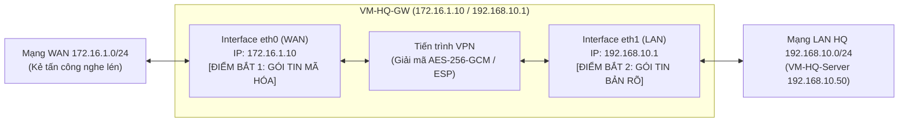

# HƯỚNG DẪN PHÂN TÍCH GÓI TIN WIRESHARK & MẬT MÃ MẠNG (WIRESHARK PACKET ANALYSIS GUIDE)

Tài liệu này cung cấp hướng dẫn chuyên sâu về **phương pháp bắt gói tin, phân tích cấu trúc Header và đối chứng mật mã** giữa dữ liệu bản rõ (Cleartext) và dữ liệu được mã hóa qua đường hầm OpenVPN và IPsec strongSwan trong đồ án An ninh mạng.

> Các Frame/SPI/IP dưới đây là ví dụ minh họa cấu trúc, không phải bằng chứng đã bắt trên VM. Thu PCAP thật theo [checklist](../openvpn-demo.md), đối chiếu log cipher và lưu traffic thử tương ứng.

---

## 1. PHƯƠNG PHÁP BẮT GÓI TIN ĐỐI CHỨNG (DUAL-INTERFACE CAPTURE METHODOLOGY)

Để chứng minh tính bảo mật và cơ chế đóng gói (Encapsulation) của VPN, hệ thống thiết lập 2 điểm giám sát gói tin đồng thời trên máy chủ cổng Trụ sở chính (`VM-HQ-GW`):



- **Điểm bắt 1 - Card WAN (`eth0`):** Đại diện cho môi trường Internet công cộng, nơi kẻ tấn công (Sniffer/Man-in-the-Middle) có thể bắt trộm toàn bộ lưu lượng. Lưu lượng nội bộ được bảo vệ phải nằm trong VPN; ARP, SSH quản trị hoặc ping WAN chủ đích có thể vẫn là bản rõ.
- **Điểm bắt 2 - Card LAN (`eth1`):** Đại diện cho mạng nội bộ an toàn sau khi gói tin đã được VPN Gateway bóc tách header và giải mã thành công, chuẩn bị chuyển tiếp tới máy chủ đích.

---

## 2. KỊCH BẢN 1: ĐỐI CHỨNG DỮ LIỆU BẢN RÕ (CLEARTEXT BASELINE)

Khi chưa có đường hầm VPN hoặc khi kiểm tra lưu lượng trên card LAN `eth1`, gói tin truyền tải hoàn toàn không được bảo vệ.

### 2.1. Phân tích gói tin HTTP GET bản rõ
Khi máy trạm yêu cầu tải file `financial-report-q4-internal.txt`:

```text
Frame 42: 382 bytes on wire (3056 bits), 382 bytes captured
Ethernet II, Src: 08:00:27:xx:xx:xx, Dst: 08:00:27:yy:yy:yy
Internet Protocol Version 4, Src: 192.168.20.50, Dst: 192.168.10.50
Transmission Control Protocol, Src Port: 54320, Dst Port: 80, Seq: 1, Ack: 1
Hypertext Transfer Protocol
    GET /files/financial-report-q4-internal.txt HTTP/1.1\r\n
    Host: 192.168.10.50\r\n
    User-Agent: curl/7.81.0\r\n
    Accept: */*\r\n
    \r\n
```

- **Lỗ hổng an ninh:** Kẻ nghe lén đọc được:
  1. Địa chỉ IP nguồn và đích thực tế (`192.168.20.50 -> 192.168.10.50`).
  2. Tên file nhạy cảm đang truy cập (`financial-report-q4-internal.txt`).
  3. Toàn bộ nội dung trả về trong HTTP Response (số liệu doanh thu, bí mật kinh doanh).

---

## 3. KỊCH BẢN 2: PHÂN TÍCH ĐƯỜNG HẦM OPENVPN (OPENVPN TUNNEL PACKET)

Khi gói tin trên đi qua đường hầm OpenVPN, toàn bộ IP packet gốc (bao gồm cả IP Header, TCP Header và HTTP Payload) được xem như một khối dữ liệu thô và được mã hóa bằng thuật toán `AES-256-GCM`.

### 3.1. Cấu trúc đóng gói OpenVPN Data Channel (P_DATA_V2)

```text
+--------------------------------------------------------------------------+
| Outer IP Header: Src=172.16.1.20, Dst=172.16.1.10 (20 bytes)             |
+--------------------------------------------------------------------------+
| Outer UDP Header: Src Port=ephemeral, Dst Port=1195 (8 bytes)                 |
+--------------------------------------------------------------------------+
| OpenVPN Header: Opcode (P_DATA_V2) + Peer-ID (3 bytes)                   |
+--------------------------------------------------------------------------+
| AEAD Tag: Tag xác thực toàn vẹn 128-bit (16 bytes)                       |
+--------------------------------------------------------------------------+
| Packet ID / IV: Bộ đếm gói chống tấn công Replay (8 bytes)               |
+--------------------------------------------------------------------------+
| Encrypted Payload (Ciphertext - AES-256-GCM):                            |
|    [Inner IP Header: 192.168.20.50 -> 192.168.10.50]                    |
|    [Inner TCP Header: Port 54320 -> Port 80]                             |
|    [HTTP Request: GET /files/financial-report-q4-internal.txt]           |
+--------------------------------------------------------------------------+
```

### 3.2. Bóc tách chi tiết trường dữ liệu trên Wireshark

```text
Frame 108: 438 bytes on wire, 438 bytes captured on interface eth0
Internet Protocol Version 4, Src: 172.16.1.20, Dst: 172.16.1.10
    Protocol: UDP (17)
User Datagram Protocol, Src Port: 1195, Dst Port: 1195
OpenVPN Protocol
    Message Type: P_DATA_V2 (0x09)
    Peer ID: 0x000000
    Authentication Tag: 4f 8a 2c b1 99 e2 71 c0 34 a5 88 1d 7e f0 42 19
    Packet ID: 0x0000003b (59)
    Encrypted Data (374 bytes): [Khối dữ liệu giả ngẫu nhiên có độ hỗn loạn cao]
        4a 8b 9c 1f d2 e3 01 a4 77 89 bc ef 12 34 56 78 ...
```

- **Đánh giá an ninh:**
  - Kẻ tấn công trên mạng WAN chỉ nhìn thấy giao tiếp giữa `172.16.1.20` và `172.16.1.10` trên cổng UDP 1195.
  - Không thể xác định được bên trong là lưu lượng web, chia sẻ file, hay VoIP.
  - Trường **Packet ID** chống tấn công phát lại (Replay Attack): nếu kẻ xấu bắt gói số 59 và phát lại, server sẽ lập tức hủy bỏ vì giá trị Packet ID đã được ghi nhận.

---

## 4. KỊCH BẢN 3: PHÂN TÍCH ĐƯỜNG HẦM IPSEC STRONGSWAN (ESP & IKEv2)

IPsec hoạt động ở Tầng Mạng (Network Layer 3) với 2 giai đoạn tách biệt: Đàm phán bảo mật (IKEv2) và Vận chuyển dữ liệu mã hóa (ESP).

### 4.1. Giai đoạn 1: Đàm phán IKEv2 (Internet Key Exchange v2)
- **Cổng giao tiếp:** UDP Port 500 (hoặc 4500 khi có NAT-Traversal).
- **Các bước trao đổi chính:**
  1. `IKE_SA_INIT (Exchange Type 34)`:
     - Khởi tạo bắt tay, đàm phán bộ Cipher Suite (AES-256-GCM, PRF-HMAC-SHA256, DH Group 14/MODP 2048-bit).
     - Trao đổi khóa Diffie-Hellman công khai (`KEi`, `KEr`) và số ngẫu nhiên lớn (`Nonce`).
  2. `IKE_AUTH (Exchange Type 35)`:
     - Gói tin được mã hóa ngay lập tức bằng khóa đối xứng vừa sinh ra từ Diffie-Hellman.
     - Xác thực danh tính 2 đầu Gateway bằng Pre-Shared Key (PSK).
     - Thiết lập Child SA (quy tắc mã hóa cho dải mạng con `192.168.10.0/24 <=> 192.168.20.0/24`).

### 4.2. Giai đoạn 2: Mã hóa dữ liệu ESP (Encapsulating Security Payload - Protocol 50)

```text
+--------------------------------------------------------------------------+
| New Outer IP Header: Src=172.16.1.20, Dst=172.16.1.10, Proto=50 (ESP)    |
+--------------------------------------------------------------------------+
| ESP SPI: Security Parameters Index (4 bytes, e.g., 0xc4a19b22)           |
+--------------------------------------------------------------------------+
| ESP Sequence Number: Bộ đếm gói tuần tự chống Replay (4 bytes)           |
+--------------------------------------------------------------------------+
| ESP Encrypted Payload (AES-256-GCM):                                     |
|    [Original IP Header: 192.168.20.50 -> 192.168.10.50]                 |
|    [Original TCP/HTTP Data]                                              |
|    [Padding Bytes (0-255 bytes) + Pad Length (1 byte) + Next Header (1B)]|
+--------------------------------------------------------------------------+
| ICV (Integrity Check Value): Thẻ xác thực GCM (16 bytes)         |
+--------------------------------------------------------------------------+
```

### 4.3. Bóc tách chi tiết trường ESP trên Wireshark

```text
Frame 215: 454 bytes on wire, 454 bytes captured on interface eth0
Internet Protocol Version 4, Src: 172.16.1.20, Dst: 172.16.1.10
    Protocol: Encapsulating Security Payload (50)
Encapsulating Security Payload
    ESP SPI: 0xc4a19b22 (3298925346)
    ESP Sequence: 84
    Encrypted Data (392 bytes): [Dữ liệu bị mã hóa hoàn toàn]
    Authentication Data: f2 a1 bc 88 43 19 de aa ...
```

- **Ý nghĩa các trường an ninh:**
  - **ESP SPI (Security Parameters Index):** Định danh 32-bit giúp Gateway tra cứu tức thì vào cơ sở dữ liệu SAD (Security Association Database) trong Kernel Linux để lấy khóa giải mã tương ứng.
  - **ESP Sequence:** Số thứ tự gói tin nghiêm ngặt tăng dần, kết hợp cơ chế Cửa sổ chống phát lại (Anti-Replay Window 64/128 packets).

---

## 5. SO SÁNH ĐẶC TÍNH MÃ HÓA & HIỆU NĂNG GÓI TIN (COMPARATIVE ANALYSIS)

| Tiêu Chí So Sánh | Dữ Liệu Bản Rõ (Cleartext) | OpenVPN Routed Tunnel | strongSwan IPsec Tunnel |
| :--- | :---: | :---: | :---: |
| **Giao thức vận chuyển** | TCP / UDP thuần | UDP (Port 1194 / 1195) | ESP (Protocol 50) |
| **Tầng mạng hoạt động** | Tầng ứng dụng / Tầng 4 | Tầng ứng dụng (Userspace daemon) | Tầng mạng (Linux Kernel XFRM) |
| **Thuật toán mã hóa** | Không có (Plaintext) | AES-256-GCM (AEAD) | AES-256-GCM (AEAD) |
| **Header Overhead** | 0 bytes | ~44 - 68 bytes | ~50 - 58 bytes |
| **Hiệu năng** | Cần đo baseline | Cần đo với DCO bật/tắt được ghi rõ | Cần đo trên cùng tài nguyên VM |
| **Khả năng xuyên NAT/Tường lửa**| Chuẩn | Rất tốt (chạy trên 1 port UDP tùy chọn) | Cần mở Protocol 50 hoặc NAT-T (UDP 4500) |
| **Bảo mật Header IP gốc** | Lộ 100% | Được mã hóa bên trong payload UDP | Được mã hóa bên trong ESP Tunnel |

---

## 6. BỘ LỌC WIRESHARK THỰC CHIẾN (WIRESHARK DISPLAY FILTER CHEAT SHEET)

Khi mở file `.pcap` hoặc bắt gói trực tiếp trong buổi thuyết minh đồ án, sử dụng các bộ lọc sau để minh chứng với Hội đồng đánh giá:

1. **Lọc toàn bộ lưu lượng OpenVPN:**
   ```wireshark
   openvpn || udp.port == 1194 || udp.port == 1195
   ```
2. **Lọc quá trình đàm phán và truyền tải IPsec:**
   ```wireshark
   esp || isakmp || udp.port == 500 || udp.port == 4500
   ```
3. **Bộ lọc quan sát bản rõ (Kiểm tra rò rỉ bản rõ trên WAN `eth0`):**
   ```wireshark
   (http || icmp) && ip.addr == 192.168.10.50
   ```
   *Kỳ vọng cho traffic thử:* không có bản rõ tương ứng trên WAN. 0 packet đơn lẻ chưa chứng minh an toàn: phải xác nhận capture/filter, phát traffic và đối chiếu log/counter. Với IPsec, có thể cần máy quan sát WAN riêng để tránh nhầm gói đã giải mã trong host.
4. **Bộ lọc giải mã đối chứng trên card LAN `eth1`:**
   ```wireshark
   http.request.method == "GET" || icmp.type == 8
   ```
   *Kết quả mong đợi:* Hiển thị đầy đủ các request HTTP `GET /` và ICMP Echo Request đã được Gateway giải mã chuyển tiếp vào máy chủ nội bộ.
