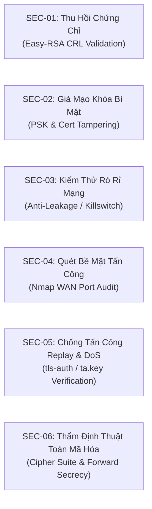

# QUY TRÌNH KIỂM THỬ AN NINH CHUYÊN SÂU & TẤN CÔNG GIẢ LẬP (SECURITY TESTS & ATTACK SIMULATION)

Tài liệu này mô tả các kịch bản **kiểm thử an ninh chuyên sâu (Negative & Boundary Testing)** và **tấn công giả lập** đối với hệ thống VPN Site-to-Site và Client-to-Site, phục vụ việc đánh giá khả năng phòng thủ của hệ thống theo quy chuẩn bảo mật doanh nghiệp.

---

## 1. TỔNG QUAN CÁC BÀI KIỂM THỬ AN NINH



---

## 2. CHI TIẾT CÁC KỊCH BẢN KIỂM THỬ AN NINH

### SEC-01: Thu Hồi Chứng Chỉ Số (Certificate Revocation List - CRL)
- **Mục tiêu an ninh:** Xác minh rằng khi một nhân viên nghỉ việc hoặc thiết bị máy trạm bị thất lạc, Quản trị viên CA có thể vô hiệu hóa quyền truy cập ngay lập tức bằng danh sách thu hồi chứng chỉ (CRL) mà không cần phải khởi tạo lại toàn bộ hệ thống PKI.
- **Mô hình đe dọa:** Kẻ tấn công đánh cắp file `.ovpn` và private key của nhân viên cũ để xâm nhập mạng nội bộ Trụ sở chính.
- **Quy trình thực nghiệm:**
  1. **Bước 1 - Khởi tạo danh sách CRL tại CA:**
     Trên máy chủ CA (`VM-HQ-GW`):
     ```bash
     cd /home/student/openvpn-ca
     # Thu hồi chứng chỉ của client1
     ./easyrsa revoke client1
     
     # Tạo / Cập nhật file crl.pem
     ./easyrsa gen-crl
     ```
  2. **Bước 2 - Cập nhật CRL vào OpenVPN Server:**
     ```bash
     sudo cp pki/crl.pem /etc/openvpn/server/crl.pem
     sudo chmod 644 /etc/openvpn/server/crl.pem
     ```
     *Lưu ý:* Cấu hình `crl-verify /etc/openvpn/server/crl.pem` trong [server.conf](file:///c:/University%20Coding%20Project/VPN-Site-to-Site-and-Client-to-Site-Implementation/openvpn/client-to-site/server/server.conf) sẽ tự động kiểm tra lại file `crl.pem` mỗi khi có kết nối mới mà không cần restart service OpenVPN.
  3. **Bước 3 - Kiểm thử kết nối từ máy khách (Attacker Client):**
     Khởi động OpenVPN GUI trên Windows với file `client1.ovpn` và bấm **Connect**.
- **Kết quả kỳ vọng:**
  - Kết nối bị ngắt ngay tại bước bắt tay TLS:
    ```text
    TLS_ERROR: BIO read tls_read_plaintext error
    VERIFY ERROR: depth=0, error=certificate revoked: CN=client1
    TLS Error: TLS object -> incoming plaintext read error
    TLS Error: TLS handshake failed
    ```
  - Log OpenVPN Server ghi nhận:
    ```text
    VERIFY ERROR: depth=0, error=certificate revoked: CN=client1
    172.16.1.100:xxxxx TLS_ERROR: BIO read tls_read_plaintext error
    172.16.1.100:xxxxx TLS Error: TLS handshake failed
    ```
- **Tiêu chuẩn nghiệm thu:** Kẻ tấn công bị từ chối truy cập 100%, không được cấp IP nội bộ `10.8.0.x`.

---

### SEC-02: Giả Mạo Khóa Bí Mật & Chứng Chỉ Bị Biến Đổi (Credential Tampering)
- **Mục tiêu an ninh:** Kiểm tra khả năng từ chối các kết nối sử dụng khóa tiền chia sẻ (PSK) bị sai hoặc chứng chỉ X.509 bị chỉnh sửa chữ ký số.
- **Kịch bản A: Sai Pre-Shared Key trên đường hầm strongSwan IPsec:**
  1. Trên `VM-Branch-GW`, mở file `/etc/ipsec.secrets` và cố tình sửa sai 1 ký tự trong khóa PSK:
     ```text
     172.16.1.20 172.16.1.10 : PSK "DuAnAnNinhMang2026WrongKeyInvalid!"
     ```
  2. Khởi động lại dịch vụ:
     ```bash
     sudo ipsec restart
     sudo ipsec up branch-to-hq
     ```
  3. Quan sát log hệ thống trên cả 2 Gateway:
     ```bash
     sudo ipsec statusall
     sudo journalctl -u strongswan -n 30 --no-pager
     ```
  - **Kết quả kỳ vọng:**
    - Quá trình đàm phán dừng lại ở bước `IKE_AUTH`.
    - Thông báo lỗi: `authentication of '172.16.1.10' with pre-shared key failed` hoặc `received AUTHENTICATION_FAILED notify error`.
    - Không có Child SA (ESP Tunnel) nào được khởi tạo.
- **Kịch bản B: Chỉnh sửa chữ ký chứng chỉ OpenVPN Client:**
  1. Mở file `.ovpn` trên máy client, sửa đổi ngẫu nhiên 1 byte ký tự trong thẻ `<cert>...</cert>`.
  2. Bấm Connect trên OpenVPN GUI.
  - **Kết quả kỳ vọng:** Lỗi `OpenSSL: error:0407008A:rsa routines:RSA_padding_check_PKCS1_type_1:invalid padding` hoặc `certificate signature failure`.

---

### SEC-03: Kiểm Thử Chống Rò Rỉ Dữ Liệu Khi Đứt Đường Truyền (Anti-Leakage / Killswitch)
- **Mục tiêu an ninh:** Khi đường hầm VPN bị đứt đột ngột do sự cố đường truyền, hệ thống Gateway không được phép định tuyến các gói tin nhạy cảm của mạng LAN nội bộ (`192.168.10.0/24`, `192.168.20.0/24`) ra ngoài giao diện công cộng `eth0` dưới dạng bản rõ.
- **Quy trình thực nghiệm:**
  1. Đặt bộ bắt gói tin trên cổng WAN `eth0` của Gateway Branch:
     ```bash
     sudo tcpdump -i eth0 -nn "net 192.168.10.0/24 or net 192.168.20.0/24" -w /tmp/leakage-test.pcap
     ```
  2. Tắt dịch vụ VPN trên HQ Gateway (`sudo systemctl stop openvpn-server@s2s-hq.service` hoặc `sudo ipsec stop`).
  3. Từ máy trạm chi nhánh `VM-Branch-PC` (`192.168.20.50`), liên tục gửi gói tin ICMP và HTTP tới máy chủ HQ:
     ```bash
     ping -c 20 -W 1 192.168.10.50
     curl --connect-timeout 2 http://192.168.10.50
     ```
  4. Dừng tcpdump và kiểm tra file `/tmp/leakage-test.pcap`:
     ```bash
     tcpdump -r /tmp/leakage-test.pcap
     ```
- **Kết quả kỳ vọng:**
  - File `leakage-test.pcap` có **0 gói tin** (Empty).
  - Tường lửa iptables trên Gateway và bảng định tuyến nhân Linux tuân thủ cơ chế Drop/Reject khi không có interface `tun1`/SA tương ứng, đảm bảo dữ liệu nội bộ không bao giờ bị rò rỉ ra Internet công cộng.

---

### SEC-04: Quét Bề Mặt Tấn Công Từ Mạng Ngoài (Nmap WAN Port Audit)
- **Mục tiêu an ninh:** Chứng minh rằng từ góc nhìn của mạng công cộng (WAN `172.16.1.0/24`), toàn bộ dịch vụ nội bộ quan trọng (SSH cổng 22, Web Nginx cổng 80, MySQL cổng 3306) đều bị ẩn giấu hoàn toàn đằng sau Gateway.
- **Quy trình thực nghiệm:**
  1. Đứng từ vị trí kẻ tấn công trên mạng ngoài (máy `VM-Remote-PC` trước khi bật VPN, hoặc một node trên mạng `172.16.1.x`), chạy lệnh quét Nmap toàn diện:
     ```bash
     # Quét TCP Connect & SYN scan
     nmap -sS -p 1-1024 -T4 172.16.1.10
     
     # Quét các cổng UDP VPN
     sudo nmap -sU -p 1194,1195,500,4500 172.16.1.10
     ```
- **Kết quả kỳ vọng:**
  - **TCP Scan:** Toàn bộ cổng TCP thông thường (80, 22, 443, 8080) đều trả về trạng thái `closed` hoặc `filtered`. Kẻ tấn công không thể kết nối trực tiếp vào Web Server HQ `192.168.10.50`.
  - **UDP Scan:** Chỉ các cổng VPN cần thiết được phát hiện mở:
    - Port `1194/udp` (OpenVPN Client-to-Site): `open|filtered`
    - Port `1195/udp` (OpenVPN Site-to-Site): `open|filtered`
    - Port `500/udp` & `4500/udp` (IPsec IKEv2): `open` (nếu đang ở mode IPsec).

---

### SEC-05: Chống Tấn Công Replay & Từ Chối Dịch Vụ (DoS) Bằng tls-auth / ta.key
- **Mục tiêu an ninh:** Kiểm tra hiệu quả của cơ chế chữ ký HMAC tầng tiền bắt tay (Pre-handshake Authentication) bằng tệp khóa đối xứng `ta.key`.
- **Cơ chế phòng thủ:**
  - Mọi gói tin gửi tới cổng OpenVPN UDP 1194/1195 phải mang chữ ký HMAC hợp lệ được tính toán bằng khóa `ta.key`.
  - Các gói tin từ kẻ quét cổng nmap, gói tin rác (UDP flood) hoặc gói tin gửi lại (Replay attack) do không có chữ ký HMAC hợp lệ sẽ bị nhân OpenVPN **âm thầm hủy bỏ (Drop silently)** ngay tại tầng socket, không tốn tài nguyên giải mã TLS hay phân bổ bộ nhớ.
- **Quy trình thực nghiệm:**
  1. Tạo một gói tin UDP giả mạo gửi tới cổng 1194 bằng công cụ `hping3` hoặc `nc`:
     ```bash
     sudo hping3 --udp -p 1194 --data 120 172.16.1.10 -c 10
     ```
  2. Quan sát log của OpenVPN Server:
     ```bash
     sudo tail -f /var/log/syslog | grep openvpn
     ```
- **Kết quả kỳ vọng:**
  - Server OpenVPN ghi nhận:
    ```text
    TLS Error: cannot locate HMAC in incoming packet from [AF_INET]172.16.1.x:xxxx
    ```
  - OpenVPN Server không phản hồi lại gói tin rác (tránh khuếch đại DoS) và không bắt đầu tiến trình đàm phán TLS tốn CPU.
  - Tấn công Replay bị chặn hoàn toàn nhờ trường **Packet ID (Sequence Number)** liên tục tăng được xác thực trong header của gói tin OpenVPN.

---

### SEC-06: Thẩm Định Thuật Toán Mật Mã & Tính Bí Mật Chuyển Tiếp Hoàn Hảo (Forward Secrecy)
- **Mục tiêu an ninh:** Thẩm định cấu hình mật mã của hệ thống đáp ứng các khuyến nghị an ninh mạng hiện đại (NIST SP 800-52r2, BSI TR-02102-4).
- **Tiêu chí đánh giá:**
  1. **Thuật toán mã hóa đối xứng (Data Encryption):**
     - Đạt chuẩn: `AES-256-GCM` hoặc `ChaCha20-Poly1305`.
     - Tuyệt đối loại bỏ: `DES`, `3DES`, `RC4`, `Blowfish (BF-CBC)` (đã bị lỗi SWEET32).
  2. **Thuật toán trao đổi khóa (Key Exchange) & Perfect Forward Secrecy (PFS):**
     - Sử dụng Diffie-Hellman tham số tối thiểu 2048-bit (Group 14) hoặc Đường cong elliptic ECDH (Curve25519 / secp256r1).
     - Đảm bảo tính chất **PFS**: Dù khóa riêng của Server (private key CA/Server) có bị lộ trong tương lai, kẻ tấn công cũng không thể giải mã các phiên làm việc đã được ghi lại trong quá khứ.
  3. **Thuật toán băm toàn vẹn (Hashing):**
     - Sử dụng `SHA256` hoặc `SHA512`. Loại bỏ hoàn toàn `MD5` và `SHA1`.
- **Lệnh kiểm tra thẩm định:**
  - Đối với OpenVPN:
    ```bash
    grep -E "cipher|auth|tls-version|dh" /etc/openvpn/server/server.conf
    ```
  - Đối với strongSwan IPsec:
    ```bash
    sudo ipsec statusall | grep -E "IKE|ESP"
    ```
    *Kỳ vọng:* Hiển thị rõ `IKE proposal: AES_GCM_16_256/PRF_HMAC_SHA2_256/MODP_2048` và `ESP proposal: AES_GCM_16_256/NO_EXT_AUTH/MODP_2048`.
